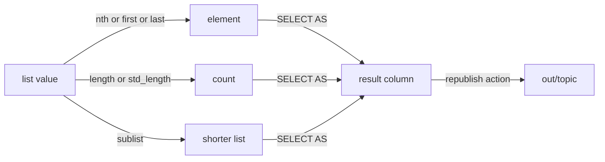

# Rule functions: arrays

<!-- GENERATED by `python3 docs/_tools/entries.py` from `docs/_inventory/`, `docs/_text/` and `docs/_verified/`. Do not edit by hand. -->

The complete MQTT platform in one small binary: broker, SQL rules, data connectors and multi-tenancy in a single process.

An array function reads or changes a JSON list. It returns an element, a shorter list, a count, or a boolean. Use this page when a rule must pick or measure a field that holds a list. You get one entry per function, each with a run against the broker.



A wrong argument count reads as null. A value that is not a list reads as null where the function needs a list. A null value never stops the rule. The `length` row also counts the characters of a text.

## Before you start

- Read [Rule SQL](./sql.md) for the query shape.
- Each entry below ran against the built broker through `POST /api/v1/rules/test`.

## Functions

| Function | What it does |
|---|---|
| `nth` | `nth(<n>, <list>)` returns the element at position `n`. |
| `length` | `length(<value>)` returns the size of a list or a text. |
| `sublist` | `sublist(<len>, <list>)` returns the first `len` elements. |
| `first` | `first(<list>)` returns the first element of a list. |
| `last` | `last(<list>)` returns the last element of a list. |
| `contains` | `contains(<element>, <list>)` reports whether a list holds an element. |
| `std_length` | `std_length(<value>)` returns the size of a list or a text. |

## Functions in detail

### `nth`

`nth(<n>, <list>)` returns the element at position `n`.

The call takes two arguments. The position counts from 1. The call
returns the element at that position. A position outside the list
returns an empty text. A value that is not a list returns null.

Signature: `nth(<n>, <list>)`.

Example (verified through `POST /api/v1/rules/test`):

```sql no-test
-- Comment: illustrative query. The verifier runs each case.
SELECT nth(2, nums) AS v FROM "sensors/+"
```

Input topic `sensors/kitchen` and payload `{"count": 3, "flag": null, "items": {"a": 1}, "name": "", "nums": [10, 20, 30], "tags": [1, 2], "temperature": 72.5}`. The broker answered `matched: true` with `projected: {"v": 20}`.
Another run with `SELECT nth(5, nums) AS v FROM "sensors/+"` on topic `sensors/kitchen` with payload `{"count": 3, "flag": null, "items": {"a": 1}, "name": "", "nums": [10, 20, 30], "tags": [1, 2], "temperature": 72.5}` answered `matched: true` with `projected: {"v": ""}`.
Another run with `SELECT nth(1, 'notalist') AS v FROM "sensors/+"` on topic `sensors/kitchen` with payload `{"count": 3, "flag": null, "items": {"a": 1}, "name": "", "nums": [10, 20, 30], "tags": [1, 2], "temperature": 72.5}` answered `matched: true` with `projected: {"v": null}`.
Another run with `SELECT nth(1) AS v FROM "sensors/+"` on topic `sensors/kitchen` with payload `{"count": 3, "flag": null, "items": {"a": 1}, "name": "", "nums": [10, 20, 30], "tags": [1, 2], "temperature": 72.5}` answered `matched: true` with `projected: {"v": null}`.

Verified: `POST /api/v1/rules/test` exits 0. See `../_verified/rules/fn-nth.json`.

Notes:

- The position counts from 1. A position below 1 and a position past the end return an empty text, not null.
- A value that is not a list returns null. A wrong argument count returns null.
- Repeat the check with the same call against a live broker.

### `length`

`length(<value>)` returns the size of a list or a text.

The call takes one argument. A list returns its element count. A text
returns its character count. Any other value returns null. The engine
rewrites the name `length` to the internal alias `std_length` before
it parses the SQL text.

Signature: `length(<value>)`.

Example (verified through `POST /api/v1/rules/test`):

```sql no-test
-- Comment: illustrative query. The verifier runs each case.
SELECT length(nums) AS v FROM "sensors/+"
```

Input topic `sensors/kitchen` and payload `{"count": 3, "flag": null, "items": {"a": 1}, "name": "", "nums": [10, 20, 30], "tags": [1, 2], "temperature": 72.5}`. The broker answered `matched: true` with `projected: {"v": 3}`.
Another run with `SELECT length([]) AS v FROM "sensors/+"` on topic `sensors/kitchen` with payload `{"count": 3, "flag": null, "items": {"a": 1}, "name": "", "nums": [10, 20, 30], "tags": [1, 2], "temperature": 72.5}` answered `matched: true` with `projected: {"v": 0}`.
Another run with `SELECT length('hello') AS v FROM "sensors/+"` on topic `sensors/kitchen` with payload `{"count": 3, "flag": null, "items": {"a": 1}, "name": "", "nums": [10, 20, 30], "tags": [1, 2], "temperature": 72.5}` answered `matched: true` with `projected: {"v": 5}`.
Another run with `SELECT length(5) AS v FROM "sensors/+"` on topic `sensors/kitchen` with payload `{"count": 3, "flag": null, "items": {"a": 1}, "name": "", "nums": [10, 20, 30], "tags": [1, 2], "temperature": 72.5}` answered `matched: true` with `projected: {"v": null}`.

Verified: `POST /api/v1/rules/test` exits 0. See `../_verified/rules/fn-length.json`.

Notes:

- A list returns its element count; a text returns its character count. Any other value returns null.
- The engine rewrites `length` to `std_length` before it parses the query, so the standard semantics apply.
- A wrong argument count returns null.
- Repeat the check with the same call against a live broker.

### `sublist`

`sublist(<len>, <list>)` returns the first `len` elements.
`sublist(<start>, <len>, <list>)` returns a slice from `start`.

The call takes two or three arguments. The two-argument form takes the
first `len` elements. The three-argument form counts from 1 and clamps
at the end of the list. A negative `len`, a negative two-argument
count, or a `start` below 1 returns null.

Signature: `sublist(<len>, <list>)` or `sublist(<start>, <len>, <list>)`.

Example (verified through `POST /api/v1/rules/test`):

```sql no-test
-- Comment: illustrative query. The verifier runs each case.
SELECT sublist(2, nums) AS v FROM "sensors/+"
```

Input topic `sensors/kitchen` and payload `{"count": 3, "flag": null, "items": {"a": 1}, "name": "", "nums": [10, 20, 30], "tags": [1, 2], "temperature": 72.5}`. The broker answered `matched: true` with `projected: {"v": [10, 20]}`.
Another run with `SELECT sublist(2, 2, nums) AS v FROM "sensors/+"` on topic `sensors/kitchen` with payload `{"count": 3, "flag": null, "items": {"a": 1}, "name": "", "nums": [10, 20, 30], "tags": [1, 2], "temperature": 72.5}` answered `matched: true` with `projected: {"v": [20, 30]}`.
Another run with `SELECT sublist(5, nums) AS v FROM "sensors/+"` on topic `sensors/kitchen` with payload `{"count": 3, "flag": null, "items": {"a": 1}, "name": "", "nums": [10, 20, 30], "tags": [1, 2], "temperature": 72.5}` answered `matched: true` with `projected: {"v": [10, 20, 30]}`.
Another run with `SELECT sublist(8, 5, nums) AS v FROM "sensors/+"` on topic `sensors/kitchen` with payload `{"count": 3, "flag": null, "items": {"a": 1}, "name": "", "nums": [10, 20, 30], "tags": [1, 2], "temperature": 72.5}` answered `matched: true` with `projected: {"v": []}`.
Another run with `SELECT sublist(-1, nums) AS v FROM "sensors/+"` on topic `sensors/kitchen` with payload `{"count": 3, "flag": null, "items": {"a": 1}, "name": "", "nums": [10, 20, 30], "tags": [1, 2], "temperature": 72.5}` answered `matched: true` with `projected: {"v": null}`.

Verified: `POST /api/v1/rules/test` exits 0. See `../_verified/rules/fn-sublist.json`.

Notes:

- The two-argument form takes the first `len` elements. The three-argument form counts from 1 and clamps at the end of the list.
- A negative count, or a `start` below 1, returns null. A wrong argument count returns null.
- Repeat the check with the same call against a live broker.

### `first`

`first(<list>)` returns the first element of a list.

The call takes one argument. An empty list returns null. A value that
is not a list returns null.

Signature: `first(<list>)`.

Example (verified through `POST /api/v1/rules/test`):

```sql no-test
-- Comment: illustrative query. The verifier runs each case.
SELECT first(nums) AS v FROM "sensors/+"
```

Input topic `sensors/kitchen` and payload `{"count": 3, "flag": null, "items": {"a": 1}, "name": "", "nums": [10, 20, 30], "tags": [1, 2], "temperature": 72.5}`. The broker answered `matched: true` with `projected: {"v": 10}`.
Another run with `SELECT first([]) AS v FROM "sensors/+"` on topic `sensors/kitchen` with payload `{"count": 3, "flag": null, "items": {"a": 1}, "name": "", "nums": [10, 20, 30], "tags": [1, 2], "temperature": 72.5}` answered `matched: true` with `projected: {"v": null}`.
Another run with `SELECT first('x') AS v FROM "sensors/+"` on topic `sensors/kitchen` with payload `{"count": 3, "flag": null, "items": {"a": 1}, "name": "", "nums": [10, 20, 30], "tags": [1, 2], "temperature": 72.5}` answered `matched: true` with `projected: {"v": null}`.

Verified: `POST /api/v1/rules/test` exits 0. See `../_verified/rules/fn-first.json`.

Notes:

- An empty list returns null. A value that is not a list returns null.
- A wrong argument count returns null.
- Repeat the check with the same call against a live broker.

### `last`

`last(<list>)` returns the last element of a list.

The call takes one argument. An empty list returns null. A value that
is not a list returns null.

Signature: `last(<list>)`.

Example (verified through `POST /api/v1/rules/test`):

```sql no-test
-- Comment: illustrative query. The verifier runs each case.
SELECT last(nums) AS v FROM "sensors/+"
```

Input topic `sensors/kitchen` and payload `{"count": 3, "flag": null, "items": {"a": 1}, "name": "", "nums": [10, 20, 30], "tags": [1, 2], "temperature": 72.5}`. The broker answered `matched: true` with `projected: {"v": 30}`.
Another run with `SELECT last([]) AS v FROM "sensors/+"` on topic `sensors/kitchen` with payload `{"count": 3, "flag": null, "items": {"a": 1}, "name": "", "nums": [10, 20, 30], "tags": [1, 2], "temperature": 72.5}` answered `matched: true` with `projected: {"v": null}`.
Another run with `SELECT last('x') AS v FROM "sensors/+"` on topic `sensors/kitchen` with payload `{"count": 3, "flag": null, "items": {"a": 1}, "name": "", "nums": [10, 20, 30], "tags": [1, 2], "temperature": 72.5}` answered `matched: true` with `projected: {"v": null}`.

Verified: `POST /api/v1/rules/test` exits 0. See `../_verified/rules/fn-last.json`.

Notes:

- An empty list returns null. A value that is not a list returns null.
- A wrong argument count returns null.
- Repeat the check with the same call against a live broker.

### `contains`

`contains(<element>, <list>)` reports whether a list holds an element.

The call takes two arguments. It returns `true` when the list holds a
value equal to the first argument. It returns `false` when the list
does not hold that value. A value that is not a list returns null.
Equality is strict: the integer `1` and the float `1.0` are different
values.

TODO(parity): the open question is whether the reference compares an
integer and a float as equal. The broker compares them strictly and
reports `false`.

Signature: `contains(<element>, <list>)`.

Example (verified through `POST /api/v1/rules/test`):

```sql no-test
-- Comment: illustrative query. The verifier runs each case.
SELECT contains(20, nums) AS v FROM "sensors/+"
```

Input topic `sensors/kitchen` and payload `{"count": 3, "flag": null, "items": {"a": 1}, "name": "", "nums": [10, 20, 30], "tags": [1, 2], "temperature": 72.5}`. The broker answered `matched: true` with `projected: {"v": true}`.
Another run with `SELECT contains(99, nums) AS v FROM "sensors/+"` on topic `sensors/kitchen` with payload `{"count": 3, "flag": null, "items": {"a": 1}, "name": "", "nums": [10, 20, 30], "tags": [1, 2], "temperature": 72.5}` answered `matched: true` with `projected: {"v": false}`.
Another run with `SELECT contains(1, 'notalist') AS v FROM "sensors/+"` on topic `sensors/kitchen` with payload `{"count": 3, "flag": null, "items": {"a": 1}, "name": "", "nums": [10, 20, 30], "tags": [1, 2], "temperature": 72.5}` answered `matched: true` with `projected: {"v": null}`.

Verified: `POST /api/v1/rules/test` exits 0. See `../_verified/rules/fn-contains.json`.

Notes:

- The argument order is `(element, list)`.
- Equality is strict: the integer `1` and the float `1.0` are different values.
- A value that is not a list returns null. A wrong argument count returns null.
- Repeat the check with the same call against a live broker.

### `std_length`

`std_length(<value>)` returns the size of a list or a text.

The call is the internal name of `length`. The broker rewrites SQL
text that names `length` to `std_length` before it parses the query.
A list returns its element count. A text returns its character count.
Any other value returns null.

Signature: `std_length(<value>)`.

Example (verified through `POST /api/v1/rules/test`):

```sql no-test
-- Comment: illustrative query. The verifier runs each case.
SELECT std_length(nums) AS v FROM "sensors/+"
```

Input topic `sensors/kitchen` and payload `{"count": 3, "flag": null, "items": {"a": 1}, "name": "", "nums": [10, 20, 30], "tags": [1, 2], "temperature": 72.5}`. The broker answered `matched: true` with `projected: {"v": 3}`.
Another run with `SELECT std_length('hello') AS v FROM "sensors/+"` on topic `sensors/kitchen` with payload `{"count": 3, "flag": null, "items": {"a": 1}, "name": "", "nums": [10, 20, 30], "tags": [1, 2], "temperature": 72.5}` answered `matched: true` with `projected: {"v": 5}`.
Another run with `SELECT std_length(5) AS v FROM "sensors/+"` on topic `sensors/kitchen` with payload `{"count": 3, "flag": null, "items": {"a": 1}, "name": "", "nums": [10, 20, 30], "tags": [1, 2], "temperature": 72.5}` answered `matched: true` with `projected: {"v": null}`.

Verified: `POST /api/v1/rules/test` exits 0. See `../_verified/rules/fn-std_length.json`.

Notes:

- The call reads the same as `length`.
- A list returns its element count; a text returns its character count. Any other value returns null.
- A wrong argument count returns null.
- Repeat the check with the same call against a live broker.

## Next steps

- Write the query with [Rule SQL](./sql.md).
- See every function in [Functions](./functions.md).
- Send results with [Actions](./actions.md).
