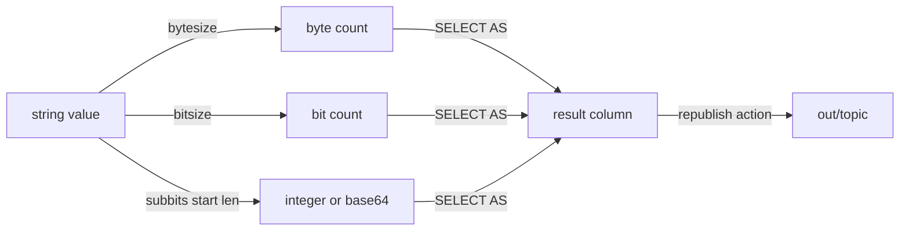

# Rule functions: bit and byte

<!-- GENERATED by `python3 docs/_tools/entries.py` from `docs/_inventory/`, `docs/_text/` and `docs/_verified/`. Do not edit by hand. -->

The complete MQTT platform in one small binary: broker, SQL rules, data connectors and multi-tenancy in a single process.

A bit and byte function measures a string or reads bits out of it. Use this page when a rule must size a payload field or decode a packed field. You get one entry per function, each with a run against the broker.



A wrong argument count reads as null. A non-string first argument reads as null. A value outside the accepted set of an argument reads as null. A null value never stops the rule.

## Before you start

- Read [Rule SQL](./sql.md) for the query shape.
- Each entry below ran against the built broker through `POST /api/v1/rules/test`.

## Functions

| Function | What it does |
|---|---|
| `bitsize` | `bitsize(<b>)` returns the bit length of the string `b`. |
| `bytesize` | `bytesize(<b>)` returns the byte length of the string `b`. |
| `subbits` | `subbits(<b>, <len>)` returns the first `len` bits of the string `b` as an integer. |

## Functions in detail

### `bitsize`

`bitsize(<b>)` returns the bit length of the string `b`.

The argument must be a string. The result is the UTF-8 byte length of
the string times 8. An empty string reads as 0. A non-string argument
reads as null. A wrong argument count reads as null.

Signature: `bitsize(<b>)`.

Example (verified through `POST /api/v1/rules/test`):

```sql no-test
-- Comment: illustrative query. The verifier runs each case.
SELECT bitsize('abc') AS v FROM "sensors/+"
```

Input topic `sensors/kitchen` and payload `{"temperature": 72.5}`. The broker answered `matched: true` with `projected: {"v": 24}`.
Another run with `SELECT bitsize('é') AS v FROM "sensors/+"` on topic `sensors/kitchen` with payload `{"temperature": 72.5}` answered `matched: true` with `projected: {"v": 16}`.
Another run with `SELECT bitsize('') AS v FROM "sensors/+"` on topic `sensors/kitchen` with payload `{"temperature": 72.5}` answered `matched: true` with `projected: {"v": 0}`.
Another run with `SELECT bitsize(255) AS v FROM "sensors/+"` on topic `sensors/kitchen` with payload `{"temperature": 72.5}` answered `matched: true` with `projected: {"v": null}`.

Verified: `POST /api/v1/rules/test` exits 0. See `../_verified/rules/fn-bitsize.json`.

Notes:

- The measure is the UTF-8 byte length of the string times 8.
- A wrong argument count returns null.
- Repeat the check with the same call against a live broker.

### `bytesize`

`bytesize(<b>)` returns the byte length of the string `b`.

The argument must be a string. The result is the UTF-8 byte length of
the string. An empty string reads as 0. A number, an array, or any
other non-string argument reads as null. A wrong argument count reads
as null. A multi-byte character counts as more than one byte.

Signature: `bytesize(<b>)`.

Example (verified through `POST /api/v1/rules/test`):

```sql no-test
-- Comment: illustrative query. The verifier runs each case.
SELECT bytesize('abc') AS v FROM "sensors/+"
```

Input topic `sensors/kitchen` and payload `{"temperature": 72.5}`. The broker answered `matched: true` with `projected: {"v": 3}`.
Another run with `SELECT bytesize('é') AS v FROM "sensors/+"` on topic `sensors/kitchen` with payload `{"temperature": 72.5}` answered `matched: true` with `projected: {"v": 2}`.
Another run with `SELECT bytesize('') AS v FROM "sensors/+"` on topic `sensors/kitchen` with payload `{"temperature": 72.5}` answered `matched: true` with `projected: {"v": 0}`.
Another run with `SELECT bytesize(1) AS v FROM "sensors/+"` on topic `sensors/kitchen` with payload `{"temperature": 72.5}` answered `matched: true` with `projected: {"v": null}`.

Verified: `POST /api/v1/rules/test` exits 0. See `../_verified/rules/fn-bytesize.json`.

Notes:

- The measure is the UTF-8 byte length of the string. A multi-byte character counts as more than one byte.
- A wrong argument count returns null.
- Repeat the check with the same call against a live broker.

### `subbits`

`subbits(<b>, <len>)` returns the first `len` bits of the string `b` as an integer.
`subbits(<b>, <start>, <len>)` starts at the 1-based bit position `start`.
The full form is `subbits(<b>, <start>, <len>, <type>, <signedness>, <endianness>)`.

The first argument must be a string. Bits run most significant first
inside each byte. The call accepts two to six arguments.

The default type is `integer`, the default signedness is `unsigned`,
and the default endianness is `big`. The type accepts `integer`,
`float`, and `bits`; `binary` is an alias of `bits`. The signedness
accepts `signed` and `unsigned`. The endianness accepts `big` and
`little`. A value outside these sets reads as null.

The length clamps to the bits that remain. A start position one past
the last bit reads as 0 when the type is `integer`; a start position
further out reads as null. An integer or float slice wider than 64
bits reads as null. A `float` slice that is not 32 or 64 bits wide
reads as null. A `bits` slice returns a base64 string of the covered
bytes. A wrong argument count reads as null.

Signature: `subbits(<b>, <len>)`, `subbits(<b>, <start>, <len>)`, or `subbits(<b>, <start>, <len>, <type>, <signedness>, <endianness>)`.

Example (verified through `POST /api/v1/rules/test`):

```sql no-test
-- Comment: illustrative query. The verifier runs each case.
SELECT subbits('A', 8) AS v FROM "sensors/+"
```

Input topic `sensors/kitchen` and payload `{"temperature": 72.5}`. The broker answered `matched: true` with `projected: {"v": 65}`.
Another run with `SELECT subbits('A', 1, 8) AS v FROM "sensors/+"` on topic `sensors/kitchen` with payload `{"temperature": 72.5}` answered `matched: true` with `projected: {"v": 65}`.
Another run with `SELECT subbits('A', 2, 7) AS v FROM "sensors/+"` on topic `sensors/kitchen` with payload `{"temperature": 72.5}` answered `matched: true` with `projected: {"v": 65}`.
Another run with `SELECT subbits('A', 9, 8) AS v FROM "sensors/+"` on topic `sensors/kitchen` with payload `{"temperature": 72.5}` answered `matched: true` with `projected: {"v": 0}`.
Another run with `SELECT subbits('A', 99, 8) AS v FROM "sensors/+"` on topic `sensors/kitchen` with payload `{"temperature": 72.5}` answered `matched: true` with `projected: {"v": null}`.
Another run with `SELECT subbits('AB', 1, 8, 'bits') AS v FROM "sensors/+"` on topic `sensors/kitchen` with payload `{"temperature": 72.5}` answered `matched: true` with `projected: {"v": "QQ=="}`.

Verified: `POST /api/v1/rules/test` exits 0. See `../_verified/rules/fn-subbits.json`.

Notes:

- Bits run most significant first inside each byte. Start is 1-based.
- The type accepts `integer`, `float`, and `bits`. The signedness accepts `signed` and `unsigned`. The endianness accepts `big` and `little`.
- An integer or float slice wider than 64 bits returns null. A `float` slice that is not 32 or 64 bits wide returns null.
- A `bits` slice returns a base64 string of the covered bytes. A wrong argument count returns null.
- Repeat the check with the same call against a live broker.

## Next steps

- Write the query with [Rule SQL](./sql.md).
- See every function in [Functions](./functions.md).
- Send results with [Actions](./actions.md).
