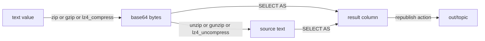

# Rule functions: compression

<!-- GENERATED by `python3 docs/_tools/entries.py` from `docs/_inventory/`, `docs/_text/` and `docs/_verified/`. Do not edit by hand. -->

The complete MQTT platform in one small binary: broker, SQL rules, data connectors and multi-tenancy in a single process.

A compression function shrinks a value for transport and restores it on read. Use this page when a rule must pack a field before it forwards it. You get one entry per function, each with a run against the broker.



A wrong argument count reads as null. A value the call cannot use reads as null. A null value never stops the rule. Each compress call returns base64 text. Each expand call returns text.

## Before you start

- Read [Rule SQL](./sql.md) for the query shape.
- Each entry below ran against the built broker through `POST /api/v1/rules/test`.

## Functions

| Function | What it does |
|---|---|
| `zip` | `zip(<v>)` returns the zlib form of `v` as base64 text. |
| `unzip` | `unzip(<s>)` returns the zlib source of `s` as text. |
| `gzip` | `gzip(<v>)` returns the gzip form of `v` as base64 text. |
| `gunzip` | `gunzip(<s>)` returns the gzip source of `s` as text. |
| `zip_compress` | `zip_compress(<v>)` returns the zlib form of `v` as base64 text. |
| `zip_uncompress` | `zip_uncompress(<s>)` returns the zlib source of `s` as text. |
| `lz4_compress` | `lz4_compress(<v>)` returns the LZ4 frame of `v` as base64 text. |
| `lz4_uncompress` | `lz4_uncompress(<s>)` returns the LZ4 source of `s` as text. |

## Functions in detail

### `zip`

`zip(<v>)` returns the zlib form of `v` as base64 text.

The call takes one argument. It reads the value as bytes. It
compresses the bytes with zlib. It encodes the result with base64.
A null value reads as null. An input above one mebibyte reads as
null. A wrong argument count reads as null.

Signature: `zip(<v>)`.

Example (verified through `POST /api/v1/rules/test`):

```sql no-test
-- Comment: illustrative query. The verifier runs each case.
SELECT unzip(zip('hello zip')) AS v FROM "sensors/+"
```

Input topic `sensors/kitchen` and payload `{"temperature": 72.5}`. The broker answered `matched: true` with `projected: {"v": "hello zip"}`.
Another run with `SELECT zip(NULL) AS v FROM "sensors/+"` on topic `sensors/kitchen` with payload `{"temperature": 72.5}` answered `matched: true` with `projected: {"v": null}`.
Another run with `SELECT zip() AS v FROM "sensors/+"` on topic `sensors/kitchen` with payload `{"temperature": 72.5}` answered `matched: true` with `projected: {"v": null}`.

Verified: `POST /api/v1/rules/test` exits 0. See `../_verified/rules/fn-zip.json`.

Notes:

- The result is base64 text of the zlib bytes. Decode it with `unzip(<s>)`.
- An input above one mebibyte reads as null. A wrong argument count returns null.
- Repeat the check with the same call against a live broker.

### `unzip`

`unzip(<s>)` returns the zlib source of `s` as text.

The call takes one argument. It decodes base64 first. It uses raw
bytes when base64 fails. It decompresses the bytes with zlib. It
returns text. A null value reads as null. Bad bytes read as null.
Non-text bytes read as null. An output above one mebibyte reads as
null. A wrong argument count reads as null.

Signature: `unzip(<s>)`.

Example (verified through `POST /api/v1/rules/test`):

```sql no-test
-- Comment: illustrative query. The verifier runs each case.
SELECT unzip(zip('hello unzip')) AS v FROM "sensors/+"
```

Input topic `sensors/kitchen` and payload `{"temperature": 72.5}`. The broker answered `matched: true` with `projected: {"v": "hello unzip"}`.
Another run with `SELECT unzip('!!!not-base64!!!') AS v FROM "sensors/+"` on topic `sensors/kitchen` with payload `{"temperature": 72.5}` answered `matched: true` with `projected: {"v": null}`.
Another run with `SELECT unzip() AS v FROM "sensors/+"` on topic `sensors/kitchen` with payload `{"temperature": 72.5}` answered `matched: true` with `projected: {"v": null}`.

Verified: `POST /api/v1/rules/test` exits 0. See `../_verified/rules/fn-unzip.json`.

Notes:

- The call accepts base64 text first and raw bytes next. A base64 string of zlib bytes returns the source text.
- Bad bytes, non-text bytes, and an output above one mebibyte return null. A wrong argument count returns null.
- Repeat the check with the same call against a live broker.

### `gzip`

`gzip(<v>)` returns the gzip form of `v` as base64 text.

The call takes one argument. It reads the value as bytes. It
compresses the bytes with gzip. It encodes the result with base64.
A null value reads as null. An input above one mebibyte reads as
null. A wrong argument count reads as null.

Signature: `gzip(<v>)`.

Example (verified through `POST /api/v1/rules/test`):

```sql no-test
-- Comment: illustrative query. The verifier runs each case.
SELECT gunzip(gzip('hello gzip')) AS v FROM "sensors/+"
```

Input topic `sensors/kitchen` and payload `{"temperature": 72.5}`. The broker answered `matched: true` with `projected: {"v": "hello gzip"}`.
Another run with `SELECT gzip(NULL) AS v FROM "sensors/+"` on topic `sensors/kitchen` with payload `{"temperature": 72.5}` answered `matched: true` with `projected: {"v": null}`.
Another run with `SELECT gzip() AS v FROM "sensors/+"` on topic `sensors/kitchen` with payload `{"temperature": 72.5}` answered `matched: true` with `projected: {"v": null}`.

Verified: `POST /api/v1/rules/test` exits 0. See `../_verified/rules/fn-gzip.json`.

Notes:

- The result is base64 text of the gzip bytes. Decode it with `gunzip(<s>)`.
- An input above one mebibyte reads as null. A wrong argument count returns null.
- Repeat the check with the same call against a live broker.

### `gunzip`

`gunzip(<s>)` returns the gzip source of `s` as text.

The call takes one argument. It decodes base64 first. It uses raw
bytes when base64 fails. It decompresses the bytes with gzip. It
returns text. A null value reads as null. Bad bytes read as null.
Non-text bytes read as null. An output above one mebibyte reads as
null. A wrong argument count reads as null.

Signature: `gunzip(<s>)`.

Example (verified through `POST /api/v1/rules/test`):

```sql no-test
-- Comment: illustrative query. The verifier runs each case.
SELECT gunzip(gzip('hello gunzip')) AS v FROM "sensors/+"
```

Input topic `sensors/kitchen` and payload `{"temperature": 72.5}`. The broker answered `matched: true` with `projected: {"v": "hello gunzip"}`.
Another run with `SELECT gunzip('!!!not-base64!!!') AS v FROM "sensors/+"` on topic `sensors/kitchen` with payload `{"temperature": 72.5}` answered `matched: true` with `projected: {"v": null}`.
Another run with `SELECT gunzip() AS v FROM "sensors/+"` on topic `sensors/kitchen` with payload `{"temperature": 72.5}` answered `matched: true` with `projected: {"v": null}`.

Verified: `POST /api/v1/rules/test` exits 0. See `../_verified/rules/fn-gunzip.json`.

Notes:

- The call accepts base64 text first and raw bytes next. A base64 string of gzip bytes returns the source text.
- Bad bytes, non-text bytes, and an output above one mebibyte return null. A wrong argument count returns null.
- Repeat the check with the same call against a live broker.

### `zip_compress`

`zip_compress(<v>)` returns the zlib form of `v` as base64 text.

The call takes one argument. It is an alias of `zip(<v>)`. It reads
the value as bytes. It compresses the bytes with zlib. A null value
reads as null. An input above one mebibyte reads as null. A wrong
argument count reads as null.

Signature: `zip_compress(<v>)`.

Example (verified through `POST /api/v1/rules/test`):

```sql no-test
-- Comment: illustrative query. The verifier runs each case.
SELECT zip_uncompress(zip_compress('hello zc')) AS v FROM "sensors/+"
```

Input topic `sensors/kitchen` and payload `{"temperature": 72.5}`. The broker answered `matched: true` with `projected: {"v": "hello zc"}`.
Another run with `SELECT zip_compress(NULL) AS v FROM "sensors/+"` on topic `sensors/kitchen` with payload `{"temperature": 72.5}` answered `matched: true` with `projected: {"v": null}`.
Another run with `SELECT zip_compress() AS v FROM "sensors/+"` on topic `sensors/kitchen` with payload `{"temperature": 72.5}` answered `matched: true` with `projected: {"v": null}`.

Verified: `POST /api/v1/rules/test` exits 0. See `../_verified/rules/fn-zip_compress.json`.

Notes:

- The call is an alias of `zip(<v>)`. The wire form is the same base64 zlib text.
- An input above one mebibyte reads as null. A wrong argument count returns null.
- Repeat the check with the same call against a live broker.

### `zip_uncompress`

`zip_uncompress(<s>)` returns the zlib source of `s` as text.

The call takes one argument. It is an alias of `unzip(<s>)`. It
decodes base64 first. It uses raw bytes when base64 fails. A null
value reads as null. Bad bytes read as null. Non-text bytes read as
null. An output above one mebibyte reads as null. A wrong argument
count reads as null.

Signature: `zip_uncompress(<s>)`.

Example (verified through `POST /api/v1/rules/test`):

```sql no-test
-- Comment: illustrative query. The verifier runs each case.
SELECT zip_uncompress(zip_compress('hello zu')) AS v FROM "sensors/+"
```

Input topic `sensors/kitchen` and payload `{"temperature": 72.5}`. The broker answered `matched: true` with `projected: {"v": "hello zu"}`.
Another run with `SELECT zip_uncompress('!!!not-base64!!!') AS v FROM "sensors/+"` on topic `sensors/kitchen` with payload `{"temperature": 72.5}` answered `matched: true` with `projected: {"v": null}`.
Another run with `SELECT zip_uncompress() AS v FROM "sensors/+"` on topic `sensors/kitchen` with payload `{"temperature": 72.5}` answered `matched: true` with `projected: {"v": null}`.

Verified: `POST /api/v1/rules/test` exits 0. See `../_verified/rules/fn-zip_uncompress.json`.

Notes:

- The call is an alias of `unzip(<s>)`. It accepts base64 text first and raw bytes next.
- Bad bytes, non-text bytes, and an output above one mebibyte return null. A wrong argument count returns null.
- Repeat the check with the same call against a live broker.

### `lz4_compress`

`lz4_compress(<v>)` returns the LZ4 frame of `v` as base64 text.

The call takes one argument. It reads the value as bytes. It
compresses the bytes with LZ4 framing. It encodes the result with
base64. A null value reads as null. An input above one mebibyte
reads as null. A wrong argument count reads as null.

Signature: `lz4_compress(<v>)`.

Example (verified through `POST /api/v1/rules/test`):

```sql no-test
-- Comment: illustrative query. The verifier runs each case.
SELECT lz4_uncompress(lz4_compress('hello lz4')) AS v FROM "sensors/+"
```

Input topic `sensors/kitchen` and payload `{"temperature": 72.5}`. The broker answered `matched: true` with `projected: {"v": "hello lz4"}`.
Another run with `SELECT lz4_compress(NULL) AS v FROM "sensors/+"` on topic `sensors/kitchen` with payload `{"temperature": 72.5}` answered `matched: true` with `projected: {"v": null}`.
Another run with `SELECT lz4_compress() AS v FROM "sensors/+"` on topic `sensors/kitchen` with payload `{"temperature": 72.5}` answered `matched: true` with `projected: {"v": null}`.

Verified: `POST /api/v1/rules/test` exits 0. See `../_verified/rules/fn-lz4_compress.json`.

Notes:

- The result is base64 text of the LZ4 frame bytes. Decode it with `lz4_uncompress(<s>)`.
- An input above one mebibyte reads as null. A wrong argument count returns null.
- Repeat the check with the same call against a live broker.

### `lz4_uncompress`

`lz4_uncompress(<s>)` returns the LZ4 source of `s` as text.

The call takes one argument. It decodes base64 first. It uses raw
bytes when base64 fails. It decompresses the frame with LZ4. It
returns text. An empty input reads as null. A null value reads as
null. Bad bytes read as null. Non-text bytes read as null. An output
above one mebibyte reads as null. A wrong argument count reads as
null.

Signature: `lz4_uncompress(<s>)`.

Example (verified through `POST /api/v1/rules/test`):

```sql no-test
-- Comment: illustrative query. The verifier runs each case.
SELECT lz4_uncompress(lz4_compress('hello lz4u')) AS v FROM "sensors/+"
```

Input topic `sensors/kitchen` and payload `{"temperature": 72.5}`. The broker answered `matched: true` with `projected: {"v": "hello lz4u"}`.
Another run with `SELECT lz4_uncompress('!!!not-base64!!!') AS v FROM "sensors/+"` on topic `sensors/kitchen` with payload `{"temperature": 72.5}` answered `matched: true` with `projected: {"v": null}`.
Another run with `SELECT lz4_uncompress() AS v FROM "sensors/+"` on topic `sensors/kitchen` with payload `{"temperature": 72.5}` answered `matched: true` with `projected: {"v": null}`.

Verified: `POST /api/v1/rules/test` exits 0. See `../_verified/rules/fn-lz4_uncompress.json`.

Notes:

- The call accepts base64 text first and raw bytes next. An empty input reads as null.
- Bad bytes, non-text bytes, and an output above one mebibyte return null. A wrong argument count returns null.
- Repeat the check with the same call against a live broker.

## Next steps

- Write the query with [Rule SQL](./sql.md).
- See every function in [Functions](./functions.md).
- Send results with [Actions](./actions.md).
