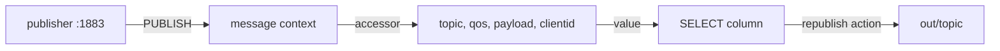

# Rule functions: message context

<!-- GENERATED by `python3 docs/_tools/entries.py` from `docs/_inventory/`, `docs/_text/` and `docs/_verified/`. Do not edit by hand. -->

The complete MQTT platform in one small binary: broker, SQL rules, data connectors and multi-tenancy in a single process.

A message context function reads the message under evaluation. It returns the topic, the payload, the QoS, the flags, or the client identity. Use this page when a rule must react to the message around the payload. You get one entry per function, each with a run against the broker.



The accessors take no payload column. They read the message that the rule evaluates. A value the message does not carry reads as null. The SQL studio has no live message, so a sample payload field of the same name supplies the value.

## Before you start

- Read [Rule SQL](./sql.md) for the query shape.
- Each entry below ran against the built broker through `POST /api/v1/rules/test`.

## Functions

| Function | What it does |
|---|---|
| `msgid` | `msgid()` reads the id of the message under evaluation. |
| `qos` | `qos()` reads the QoS level of the message under evaluation. |
| `flags` | `flags()` reads the flag map of the message under evaluation. |
| `flag` | `flag('<name>')` reads one flag of the message under evaluation. |
| `topic` | `topic()` reads the topic of the message under evaluation. |
| `clientid` | `clientid()` reads the client id that published the message. |
| `clientip` | `clientip()` reads the IP address of the client that published the message. |
| `peerhost` | `peerhost()` reads the host of the client that published the message. |
| `username` | `username()` reads the username that published the message. |
| `payload` | `payload()` reads the payload of the message under evaluation. |
| `contains_topic` | `contains_topic(<filters>, <topic>)` tests a subscription list for a topic. |
| `contains_topic_match` | `contains_topic_match(<filters>, <topic>)` tests a filter list against a topic. |
| `topic_match` | `topic_match('<topic>', '<filter>')` tests one topic against one filter. |
| `null` | `null()` returns the null value. |
| `coalesce_ne` | `coalesce_ne(<value>, ...)` returns the first argument that is neither null nor an empty string. |
| `div` | `div(<x>, <y>)` divides two integers and returns the integer quotient. |
| `fmod` | `fmod(<x>, <y>)` returns the floating remainder of x divided by y. |

## Functions in detail

### `msgid`

`msgid()` reads the id of the message under evaluation.

The broker supplies the id from the message. A message with no id reads
as null.

The SQL studio has no live message. The sample payload field `id` or
`msgid` then supplies the value, and the value keeps the type of that
field.

TODO(parity): does a live message supply the id when the payload carries
no `id` field?

Signature: `msgid()`.

Example (verified through `POST /api/v1/rules/test`):

```sql no-test
-- Comment: illustrative query. The verifier runs each case.
SELECT msgid() AS m FROM "sensors/+"
```

Input topic `sensors/kitchen` and payload `{"id": "5f2a"}`. The broker answered `matched: true` with `projected: {"m": "5f2a"}`.
Another run on topic `sensors/kitchen` with payload `{}` answered `matched: true` with `projected: {"m": null}`.
Another run on topic `sensors/kitchen` with payload `{"id": 5}` answered `matched: true` with `projected: {"m": 5}`.

Verified: `POST /api/v1/rules/test` exits 0. See `../_verified/rules/fn-msgid.json`.

Notes:

- The id comes from the message. The SQL studio has no live message, so the sample payload field `id` supplies it.
- A wrong argument count returns null.
- Repeat the check with the same call against a live broker.

### `qos`

`qos()` reads the QoS level of the message under evaluation.

The value is the number 0, 1 or 2. A message with no QoS reads as null.

The SQL studio has no live message. The sample payload field `qos` then
supplies the value.

TODO(parity): does a live message supply the QoS when the payload carries
no `qos` field?

Signature: `qos()`.

Example (verified through `POST /api/v1/rules/test`):

```sql no-test
-- Comment: illustrative query. The verifier runs each case.
SELECT qos() AS q FROM "sensors/+"
```

Input topic `sensors/kitchen` and payload `{"qos": 1}`. The broker answered `matched: true` with `projected: {"q": 1}`.
Another run on topic `sensors/kitchen` with payload `{}` answered `matched: true` with `projected: {"q": null}`.

Verified: `POST /api/v1/rules/test` exits 0. See `../_verified/rules/fn-qos.json`.

Notes:

- The value comes from the message. The SQL studio has no live message, so the sample payload field `qos` supplies it.
- A wrong argument count returns null.
- Repeat the check with the same call against a live broker.

### `flags`

`flags()` reads the flag map of the message under evaluation.

The value is an object. A message with no flags reads as an empty
object `{}`.

TODO(parity): does a live message supply its flag map when the payload
carries no `flags` field?

Signature: `flags()`.

Example (verified through `POST /api/v1/rules/test`):

```sql no-test
-- Comment: illustrative query. The verifier runs each case.
SELECT flags() AS f FROM "sensors/+"
```

Input topic `sensors/kitchen` and payload `{"flags": {"retain": true}}`. The broker answered `matched: true` with `projected: {"f": {"retain": true}}`.
Another run on topic `sensors/kitchen` with payload `{}` answered `matched: true` with `projected: {"f": {}}`.

Verified: `POST /api/v1/rules/test` exits 0. See `../_verified/rules/fn-flags.json`.

Notes:

- A message with no flags reads as an empty object `{}`.
- A wrong argument count returns null.
- Repeat the check with the same call against a live broker.

### `flag`

`flag('<name>')` reads one flag of the message under evaluation.

The first argument is the flag name. An absent flag name reads as null.

TODO(parity): does a live message supply its flags when the payload
carries no `flags` field?

Signature: `flag('<name>')`.

Example (verified through `POST /api/v1/rules/test`):

```sql no-test
-- Comment: illustrative query. The verifier runs each case.
SELECT flag('retain') AS f FROM "sensors/+"
```

Input topic `sensors/kitchen` and payload `{"flags": {"retain": true}}`. The broker answered `matched: true` with `projected: {"f": true}`.
Another run with `SELECT flag('dup') AS f FROM "sensors/+"` on topic `sensors/kitchen` with payload `{"flags": {"retain": true}}` answered `matched: true` with `projected: {"f": null}`.

Verified: `POST /api/v1/rules/test` exits 0. See `../_verified/rules/fn-flag.json`.

Notes:

- An absent flag name reads as null.
- A wrong argument count returns null.
- Repeat the check with the same call against a live broker.

### `topic`

`topic()` reads the topic of the message under evaluation.

`topic(<level>)` reads one topic level. Levels count from 1. A level
outside the topic reads as null. A level below 1 reads as null.

TODO(parity): does a live rule read the message topic, and not a payload
`topic` field?

Signature: `topic()` or `topic(<level>)`.

Example (verified through `POST /api/v1/rules/test`):

```sql no-test
-- Comment: illustrative query. The verifier runs each case.
SELECT topic() AS t FROM "sensors/+"
```

Input topic `sensors/kitchen` and payload `{}`. The broker answered `matched: true` with `projected: {"t": "sensors/kitchen"}`.
Another run with `SELECT topic(9) AS t FROM "sensors/+"` on topic `sensors/kitchen` with payload `{}` answered `matched: true` with `projected: {"t": null}`.

Verified: `POST /api/v1/rules/test` exits 0. See `../_verified/rules/fn-topic.json`.

Notes:

- `topic(<level>)` counts levels from 1. A level outside the topic reads as null.
- A wrong argument count returns null.
- Repeat the check with the same call against a live broker.

### `clientid`

`clientid()` reads the client id that published the message.

A message with no client id reads as null. The SQL studio has no live
client. The sample payload field `clientid` then supplies the value.

TODO(parity): does a live message supply the client id when the payload
carries no `clientid` field?

Signature: `clientid()`.

Example (verified through `POST /api/v1/rules/test`):

```sql no-test
-- Comment: illustrative query. The verifier runs each case.
SELECT clientid() AS c FROM "sensors/+"
```

Input topic `sensors/kitchen` and payload `{"clientid": "dev-01"}`. The broker answered `matched: true` with `projected: {"c": "dev-01"}`.
Another run on topic `sensors/kitchen` with payload `{}` answered `matched: true` with `projected: {"c": null}`.

Verified: `POST /api/v1/rules/test` exits 0. See `../_verified/rules/fn-clientid.json`.

Notes:

- The SQL studio has no live client, so the sample payload field `clientid` supplies the value.
- A wrong argument count returns null.
- Repeat the check with the same call against a live broker.

### `clientip`

`clientip()` reads the IP address of the client that published the message.

`clientip()` is an alias of `peerhost()`. The SQL studio has no live
client. The sample payload field `peerhost` then supplies the value.

TODO(parity): does a live message supply the peer address, as `peerhost()`
does?

Signature: `clientip()`.

Example (verified through `POST /api/v1/rules/test`):

```sql no-test
-- Comment: illustrative query. The verifier runs each case.
SELECT clientip() AS c FROM "sensors/+"
```

Input topic `sensors/kitchen` and payload `{"peerhost": "10.0.0.9"}`. The broker answered `matched: true` with `projected: {"c": "10.0.0.9"}`.
Another run on topic `sensors/kitchen` with payload `{}` answered `matched: true` with `projected: {"c": null}`.

Verified: `POST /api/v1/rules/test` exits 0. See `../_verified/rules/fn-clientip.json`.

Notes:

- `clientip()` is an alias of `peerhost()`.
- The SQL studio has no live client, so the sample payload field `peerhost` supplies the value.
- Repeat the check with the same call against a live broker.

### `peerhost`

`peerhost()` reads the host of the client that published the message.

The broker supplies the host from the message. A message with no host
reads as null.

The SQL studio has no live client. The sample payload field `peerhost`
then supplies the value, and the value keeps the type of that field.

TODO(parity): does a live message supply the peer host when the payload
carries no `peerhost` field?

Signature: `peerhost()`.

Example (verified through `POST /api/v1/rules/test`):

```sql no-test
-- Comment: illustrative query. The verifier runs each case.
SELECT peerhost() AS c FROM "sensors/+"
```

Input topic `sensors/kitchen` and payload `{"peerhost": "10.0.0.9"}`. The broker answered `matched: true` with `projected: {"c": "10.0.0.9"}`.
Another run on topic `sensors/kitchen` with payload `{}` answered `matched: true` with `projected: {"c": null}`.
Another run on topic `sensors/kitchen` with payload `{"peerhost": 42}` answered `matched: true` with `projected: {"c": 42}`.

Verified: `POST /api/v1/rules/test` exits 0. See `../_verified/rules/fn-peerhost.json`.

Notes:

- The SQL studio has no live client, so the sample payload field `peerhost` supplies the value.
- A wrong argument count returns null.
- Repeat the check with the same call against a live broker.

### `username`

`username()` reads the username that published the message.

The broker supplies the username from the message. A message with no
username reads as null.

The SQL studio has no live client. The sample payload field `username`
then supplies the value, and the value keeps the type of that field.

TODO(parity): does a live message supply the username when the payload
carries no `username` field?

Signature: `username()`.

Example (verified through `POST /api/v1/rules/test`):

```sql no-test
-- Comment: illustrative query. The verifier runs each case.
SELECT username() AS u FROM "sensors/+"
```

Input topic `sensors/kitchen` and payload `{"username": "alice"}`. The broker answered `matched: true` with `projected: {"u": "alice"}`.
Another run on topic `sensors/kitchen` with payload `{}` answered `matched: true` with `projected: {"u": null}`.
Another run on topic `sensors/kitchen` with payload `{"username": 42}` answered `matched: true` with `projected: {"u": 42}`.

Verified: `POST /api/v1/rules/test` exits 0. See `../_verified/rules/fn-username.json`.

Notes:

- The SQL studio has no live client, so the sample payload field `username` supplies the value.
- A wrong argument count returns null.
- Repeat the check with the same call against a live broker.

### `payload`

`payload()` reads the payload of the message under evaluation.

`payload('<json path>')` reads one value at a dotted path. An absent
path reads as null. A path on a payload that is not an object reads as
null.

Signature: `payload()` or `payload('<json path>')`.

Example (verified through `POST /api/v1/rules/test`):

```sql no-test
-- Comment: illustrative query. The verifier runs each case.
SELECT payload() AS p FROM "sensors/+"
```

Input topic `sensors/kitchen` and payload `{"a": 1}`. The broker answered `matched: true` with `projected: {"p": {"a": 1}}`.
Another run with `SELECT payload('x') AS p FROM "sensors/+"` on topic `sensors/kitchen` with payload `{"a": 1}` answered `matched: true` with `projected: {"p": null}`.

Verified: `POST /api/v1/rules/test` exits 0. See `../_verified/rules/fn-payload.json`.

Notes:

- `payload('<json path>')` reads a dotted path. An absent path reads as null.
- A wrong argument count returns null.
- Repeat the check with the same call against a live broker.

### `contains_topic`

`contains_topic(<filters>, <topic>)` tests a subscription list for a topic.

The list holds exact topic strings, or objects with `topic` and `qos`.
The match is exact: a wildcard in the list does not match. With a third
argument the stored `qos` must equal the wanted `qos`.

Signature: `contains_topic(<filters>, <topic> [, <qos>])`.

Example (verified through `POST /api/v1/rules/test`):

```sql no-test
-- Comment: illustrative query. The verifier runs each case.
SELECT contains_topic(topics, 'sensors/kitchen') AS c FROM "sensors/+"
```

Input topic `sensors/kitchen` and payload `{"topics": ["sensors/kitchen"]}`. The broker answered `matched: true` with `projected: {"c": true}`.
Another run on topic `sensors/kitchen` with payload `{"topics": ["sensors/+"]}` answered `matched: true` with `projected: {"c": false}`.

Verified: `POST /api/v1/rules/test` exits 0. See `../_verified/rules/fn-contains_topic.json`.

Notes:

- The list holds exact topic strings, or objects with `topic` and `qos`. A wildcard in the list does not match.
- With the three-argument form the stored `qos` must equal the wanted `qos`.
- Repeat the check with the same call against a live broker.

### `contains_topic_match`

`contains_topic_match(<filters>, <topic>)` tests a filter list against a topic.

The list holds topic filters. A wildcard in the list matches. With a
third argument the stored `qos` must equal the wanted `qos`.

Signature: `contains_topic_match(<filters>, <topic> [, <qos>])`.

Example (verified through `POST /api/v1/rules/test`):

```sql no-test
-- Comment: illustrative query. The verifier runs each case.
SELECT contains_topic_match(filters, 'sensors/kitchen') AS c FROM "sensors/+"
```

Input topic `sensors/kitchen` and payload `{"filters": ["sensors/+"]}`. The broker answered `matched: true` with `projected: {"c": true}`.
Another run on topic `sensors/kitchen` with payload `{"filters": ["other/+"]}` answered `matched: true` with `projected: {"c": false}`.

Verified: `POST /api/v1/rules/test` exits 0. See `../_verified/rules/fn-contains_topic_match.json`.

Notes:

- The list holds topic filters. A wildcard in the list matches.
- With the three-argument form the stored `qos` must equal the wanted `qos`.
- Repeat the check with the same call against a live broker.

### `topic_match`

`topic_match('<topic>', '<filter>')` tests one topic against one filter.

The first argument is the topic. The second argument is the filter.
Wildcards in the filter match. An invalid topic or filter reads as null.

Signature: `topic_match('<topic>', '<filter>')`.

Example (verified through `POST /api/v1/rules/test`):

```sql no-test
-- Comment: illustrative query. The verifier runs each case.
SELECT topic_match('sensors/kitchen', 'sensors/+') AS c FROM "sensors/+"
```

Input topic `sensors/kitchen` and payload `{}`. The broker answered `matched: true` with `projected: {"c": true}`.
Another run with `SELECT topic_match('sensors/kitchen', 'other/+') AS c FROM "sensors/+"` on topic `sensors/kitchen` with payload `{}` answered `matched: true` with `projected: {"c": false}`.

Verified: `POST /api/v1/rules/test` exits 0. See `../_verified/rules/fn-topic_match.json`.

Notes:

- The first argument is the topic. The second argument is the filter.
- An invalid topic or filter returns null.
- Repeat the check with the same call against a live broker.

### `null`

`null()` returns the null value.

The name `null` is a SQL keyword. The front end reads it as the null
literal, so the call does not parse. The broker registers the name, but
a rule cannot reach it through SQL.

BUG(parity): `null()` is registered, but the SQL front end reads `null`
as a keyword, so a rule cannot call it.

Signature: `null()`.

> **Not verified: see `../_verification/failures.md`.**

Notes:

- The name `null` is a SQL keyword. The call fails to parse through the SQL studio entry.
- Repeat the check with the same call against a live broker.

### `coalesce_ne`

`coalesce_ne(<value>, ...)` returns the first argument that is neither null nor an empty string.

A null argument and an empty string argument are both skipped. When
every argument is skipped, the result is null.

Signature: `coalesce_ne(<value>, ...)`.

Example (verified through `POST /api/v1/rules/test`):

```sql no-test
-- Comment: illustrative query. The verifier runs each case.
SELECT coalesce_ne(a, 'dflt') AS v FROM "sensors/+"
```

Input topic `sensors/kitchen` and payload `{"a": null}`. The broker answered `matched: true` with `projected: {"v": "dflt"}`.
Another run with `SELECT coalesce_ne(a, b) AS v FROM "sensors/+"` on topic `sensors/kitchen` with payload `{"a": null, "b": ""}` answered `matched: true` with `projected: {"v": null}`.

Verified: `POST /api/v1/rules/test` exits 0. See `../_verified/rules/fn-coalesce_ne.json`.

Notes:

- A null argument and an empty string argument are both skipped.
- A call with no argument returns null.
- Repeat the check with the same call against a live broker.

### `div`

`div(<x>, <y>)` divides two integers and returns the integer quotient.

The result truncates toward zero. The broker converts each argument to an
integer first: a decimal loses its fraction, `true` is 1, and `false` is
0. Text must hold an integer. A zero divisor, a value of another type,
and text that is not an integer read as null.

Signature: `div(<x>, <y>)`.

Example (verified through `POST /api/v1/rules/test`):

```sql no-test
-- Comment: illustrative query. The verifier runs each case.
SELECT div(7, 2) AS v FROM "sensors/+"
```

Input topic `sensors/kitchen` and payload `{}`. The broker answered `matched: true` with `projected: {"v": 3}`.
Another run with `SELECT div(1, 0) AS v FROM "sensors/+"` on topic `sensors/kitchen` with payload `{}` answered `matched: true` with `projected: {"v": null}`.
Another run with `SELECT div(7.5, 2) AS v FROM "sensors/+"` on topic `sensors/kitchen` with payload `{}` answered `matched: true` with `projected: {"v": 3}`.

Verified: `POST /api/v1/rules/test` exits 0. See `../_verified/rules/fn-div.json`.

Notes:

- The result truncates toward zero: `div(-7, 2)` is -3.
- The broker converts an argument to an integer: a decimal loses its fraction, `true` is 1, and `false` is 0. Text must hold an integer or the call returns null.
- Repeat the check with the same call against a live broker.

### `fmod`

`fmod(<x>, <y>)` returns the floating remainder of x divided by y.

The result takes the sign of the dividend. The broker converts each
argument to a number first: `true` is 1, `false` is 0, and text must hold
a number. A zero divisor, a value of another type, and text that is not a
number read as null.

Signature: `fmod(<x>, <y>)`.

Example (verified through `POST /api/v1/rules/test`):

```sql no-test
-- Comment: illustrative query. The verifier runs each case.
SELECT fmod(7.5, 2) AS v FROM "sensors/+"
```

Input topic `sensors/kitchen` and payload `{}`. The broker answered `matched: true` with `projected: {"v": 1.5}`.
Another run with `SELECT fmod(1.0, 0) AS v FROM "sensors/+"` on topic `sensors/kitchen` with payload `{}` answered `matched: true` with `projected: {"v": null}`.
Another run with `SELECT fmod(true, 2) AS v FROM "sensors/+"` on topic `sensors/kitchen` with payload `{}` answered `matched: true` with `projected: {"v": 1.0}`.

Verified: `POST /api/v1/rules/test` exits 0. See `../_verified/rules/fn-fmod.json`.

Notes:

- The result takes the sign of the dividend: `fmod(-7.5, 2)` is -1.5.
- The broker converts an argument to a number: `true` is 1, `false` is 0, and text must hold a number. Other text returns null.
- Repeat the check with the same call against a live broker.

## Next steps

- Write the query with [Rule SQL](./sql.md).
- See every function in [Functions](./functions.md).
- Send results with [Actions](./actions.md).
