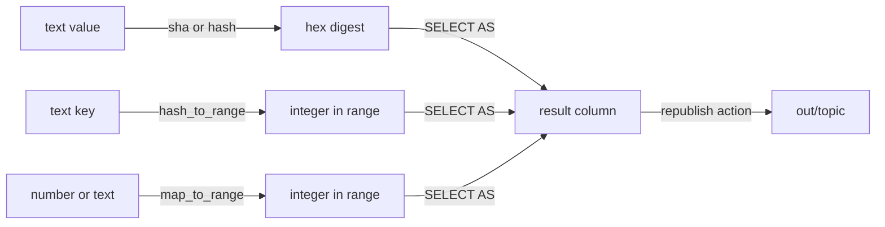

# Rule functions: hashing

<!-- GENERATED by `python3 docs/_tools/entries.py` from `docs/_inventory/`, `docs/_text/` and `docs/_verified/`. Do not edit by hand. -->

The complete MQTT platform in one small binary: broker, SQL rules, data connectors and multi-tenancy in a single process.

A hashing function digests a value or maps a key into a range. Use this page when a rule must hash a field or pick a shard. You get one entry per function, each with a run against the broker.



A wrong argument count reads as null. A value the call cannot use reads as null. A null value never stops the rule.

## Before you start

- Read [Rule SQL](./sql.md) for the query shape.
- Each entry below ran against the built broker through `POST /api/v1/rules/test`.

## Functions

| Function | What it does |
|---|---|
| `sha` | `sha(<s>)` returns the SHA-1 hex digest of `s`. |
| `hash` | `hash(<algo>, <data>)` returns the hex digest of `data`. |
| `hash_to_range` | `hash_to_range(<key>, <min>, <max>)` maps a text key into [`min`, `max`]. |
| `map_to_range` | `map_to_range(<value>, <min>, <max>)` maps a value into [`min`, `max`]. |

## Functions in detail

### `sha`

`sha(<s>)` returns the SHA-1 hex digest of `s`.

The call takes one argument. It hashes the text with SHA-1. It
returns lower-case hex text. An empty text returns the empty digest.
A null value reads as null. A wrong argument count reads as null.

Signature: `sha(<s>)`.

Example (verified through `POST /api/v1/rules/test`):

```sql no-test
-- Comment: illustrative query. The verifier runs each case.
SELECT sha('ab') AS v FROM "sensors/+"
```

Input topic `sensors/kitchen` and payload `{"temperature": 72.5}`. The broker answered `matched: true` with `projected: {"v": "da23614e02469a0d7c7bd1bdab5c9c474b1904dc"}`.
Another run with `SELECT sha('') AS v FROM "sensors/+"` on topic `sensors/kitchen` with payload `{"temperature": 72.5}` answered `matched: true` with `projected: {"v": "da39a3ee5e6b4b0d3255bfef95601890afd80709"}`.
Another run with `SELECT sha(NULL) AS v FROM "sensors/+"` on topic `sensors/kitchen` with payload `{"temperature": 72.5}` answered `matched: true` with `projected: {"v": null}`.
Another run with `SELECT sha() AS v FROM "sensors/+"` on topic `sensors/kitchen` with payload `{"temperature": 72.5}` answered `matched: true` with `projected: {"v": null}`.

Verified: `POST /api/v1/rules/test` exits 0. See `../_verified/rules/fn-sha.json`.

Notes:

- The digest is SHA-1 in lower-case hex. An empty text returns the empty digest.
- A null value returns null. A wrong argument count returns null.
- Repeat the check with the same call against a live broker.

### `hash`

`hash(<algo>, <data>)` returns the hex digest of `data`.

The call takes two arguments. The first names the algorithm. The
second holds the text. The name ignores case and edge space.
Supported names are `md5`, `sha`, `sha1`, `sha224`, `sha256`,
`sha384` and `sha512`.

Any other name fails closed. A null value
reads as null. A wrong argument count reads as null.

Signature: `hash(<algo>, <data>)`.

Example (verified through `POST /api/v1/rules/test`):

```sql no-test
-- Comment: illustrative query. The verifier runs each case.
SELECT hash('sha256', 'ab') AS v FROM "sensors/+"
```

Input topic `sensors/kitchen` and payload `{"temperature": 72.5}`. The broker answered `matched: true` with `projected: {"v": "fb8e20fc2e4c3f248c60c39bd652f3c1347298bb977b8b4d5903b85055620603"}`.
Another run with `SELECT hash('md5', 'ab') AS v FROM "sensors/+"` on topic `sensors/kitchen` with payload `{"temperature": 72.5}` answered `matched: true` with `projected: {"v": "187ef4436122d1cc2f40dc2b92f0eba0"}`.
Another run with `SELECT hash(' Sha256 ', 'ab') AS v FROM "sensors/+"` on topic `sensors/kitchen` with payload `{"temperature": 72.5}` answered `matched: true` with `projected: {"v": "fb8e20fc2e4c3f248c60c39bd652f3c1347298bb977b8b4d5903b85055620603"}`.
Another run with `SELECT hash('nope', 'ab') AS v FROM "sensors/+"` on topic `sensors/kitchen` with payload `{"temperature": 72.5}` answered `matched: true` with `projected: {"v": null}`.
Another run with `SELECT hash('sha256') AS v FROM "sensors/+"` on topic `sensors/kitchen` with payload `{"temperature": 72.5}` answered `matched: true` with `projected: {"v": null}`.

Verified: `POST /api/v1/rules/test` exits 0. See `../_verified/rules/fn-hash.json`.

Notes:

- The name ignores case and edge space. Supported names are `md5`, `sha`, `sha1`, `sha224`, `sha256`, `sha384` and `sha512`.
- Any other name fails closed. A null value returns null. A wrong argument count returns null.
- Repeat the check with the same call against a live broker.

### `hash_to_range`

`hash_to_range(<key>, <min>, <max>)` maps a text key into [`min`, `max`].

The call takes three arguments. The key must be text. The bounds
must be integers. The broker hashes the key with SHA-256. It returns
`min` plus the remainder modulo the span.

The span is `max` minus
`min` plus one. An empty key reads as null. A non-text key reads as
null. A `min` above `max` reads as null. A wrong argument count
reads as null.

Signature: `hash_to_range(<key>, <min>, <max>)`.

Example (verified through `POST /api/v1/rules/test`):

```sql no-test
-- Comment: illustrative query. The verifier runs each case.
SELECT hash_to_range('ab', 0, 99) AS v FROM "sensors/+"
```

Input topic `sensors/kitchen` and payload `{"temperature": 72.5}`. The broker answered `matched: true` with `projected: {"v": 19}`.
Another run with `SELECT hash_to_range('hello', 0, 9) AS v FROM "sensors/+"` on topic `sensors/kitchen` with payload `{"temperature": 72.5}` answered `matched: true` with `projected: {"v": 0}`.
Another run with `SELECT hash_to_range('', 0, 99) AS v FROM "sensors/+"` on topic `sensors/kitchen` with payload `{"temperature": 72.5}` answered `matched: true` with `projected: {"v": null}`.
Another run with `SELECT hash_to_range('ab', 99, 0) AS v FROM "sensors/+"` on topic `sensors/kitchen` with payload `{"temperature": 72.5}` answered `matched: true` with `projected: {"v": null}`.
Another run with `SELECT hash_to_range(123, 0, 99) AS v FROM "sensors/+"` on topic `sensors/kitchen` with payload `{"temperature": 72.5}` answered `matched: true` with `projected: {"v": null}`.
Another run with `SELECT hash_to_range('ab', 0) AS v FROM "sensors/+"` on topic `sensors/kitchen` with payload `{"temperature": 72.5}` answered `matched: true` with `projected: {"v": null}`.

Verified: `POST /api/v1/rules/test` exits 0. See `../_verified/rules/fn-hash_to_range.json`.

Notes:

- The broker hashes the key with SHA-256 and returns `min` plus the remainder modulo the span (`max` minus `min` plus one).
- An empty key, a non-text key, or a `min` above `max` returns null. A wrong argument count returns null.
- Repeat the check with the same call against a live broker.

### `map_to_range`

`map_to_range(<value>, <min>, <max>)` maps a value into [`min`, `max`].

The call takes three arguments. The bounds must be integers. A
number maps by its value modulo the span. A text maps by its first
16 bytes as an unsigned big-endian number modulo the span.

The span
is `max` minus `min` plus one. An empty text reads as null. A `min`
above `max` reads as null. A value that is not a number or text
reads as null. A wrong argument count reads as null.

Signature: `map_to_range(<value>, <min>, <max>)`.

Example (verified through `POST /api/v1/rules/test`):

```sql no-test
-- Comment: illustrative query. The verifier runs each case.
SELECT map_to_range(5, 0, 99) AS v FROM "sensors/+"
```

Input topic `sensors/kitchen` and payload `{"temperature": 72.5}`. The broker answered `matched: true` with `projected: {"v": 5}`.
Another run with `SELECT map_to_range('AB', 0, 99) AS v FROM "sensors/+"` on topic `sensors/kitchen` with payload `{"temperature": 72.5}` answered `matched: true` with `projected: {"v": 6}`.
Another run with `SELECT map_to_range(300, 0, 99) AS v FROM "sensors/+"` on topic `sensors/kitchen` with payload `{"temperature": 72.5}` answered `matched: true` with `projected: {"v": 0}`.
Another run with `SELECT map_to_range('', 0, 99) AS v FROM "sensors/+"` on topic `sensors/kitchen` with payload `{"temperature": 72.5}` answered `matched: true` with `projected: {"v": null}`.
Another run with `SELECT map_to_range(5, 99, 0) AS v FROM "sensors/+"` on topic `sensors/kitchen` with payload `{"temperature": 72.5}` answered `matched: true` with `projected: {"v": null}`.
Another run with `SELECT map_to_range(5, 0) AS v FROM "sensors/+"` on topic `sensors/kitchen` with payload `{"temperature": 72.5}` answered `matched: true` with `projected: {"v": null}`.

Verified: `POST /api/v1/rules/test` exits 0. See `../_verified/rules/fn-map_to_range.json`.

Notes:

- A number maps by its value modulo the span (`max` minus `min` plus one). A text maps by its first 16 bytes as an unsigned big-endian number modulo the span.
- An empty text, a value that is not a number or text, or a `min` above `max` returns null. A wrong argument count returns null.
- Repeat the check with the same call against a live broker.

## Next steps

- Write the query with [Rule SQL](./sql.md).
- See every function in [Functions](./functions.md).
- Send results with [Actions](./actions.md).
