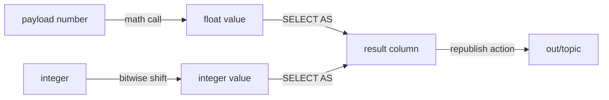

# Rule functions: math and bitwise

<!-- GENERATED by `python3 docs/_tools/entries.py` from `docs/_inventory/`, `docs/_text/` and `docs/_verified/`. Do not edit by hand. -->

The complete MQTT platform in one small binary: broker, SQL rules, data connectors and multi-tenancy in a single process.

A math function computes a numeric value from its arguments. A bitwise function shifts the bits of an integer. Use this page when a rule must compute a value on the message path. You get one entry per function, each with a run against the broker.



A wrong argument count reads as null. A value outside the domain of the function reads as null. A null value never stops the rule.

## Before you start

- Read [Rule SQL](./sql.md) for the query shape.
- Each entry below ran against the built broker through `POST /api/v1/rules/test`.

## Functions

| Function | What it does |
|---|---|
| `acosh` | `acosh(<x>)` returns the inverse hyperbolic cosine of `x`. |
| `asinh` | `asinh(<x>)` returns the inverse hyperbolic sine of `x`. |
| `atanh` | `atanh(<x>)` returns the inverse hyperbolic tangent of `x`. |
| `bitsl` | `bitsl(<x>, <n>)` shifts the bits of the integer `x` left by `n` places. |
| `bitsr` | `bitsr(<x>, <n>)` shifts the bits of the integer `x` right by `n` places. |

## Functions in detail

### `acosh`

`acosh(<x>)` returns the inverse hyperbolic cosine of `x`.

The argument is a number. The result is a float. The domain is
`x >= 1`. A value below 1 reads as null. A non-numeric argument or a
wrong argument count reads as null.

Signature: `acosh(<x>)`.

Example (verified through `POST /api/v1/rules/test`):

```sql no-test
-- Comment: illustrative query. The verifier runs each case.
SELECT acosh(2.0) AS v FROM "sensors/+"
```

Input topic `sensors/kitchen` and payload `{"temperature": 72.5}`. The broker answered `matched: true` with `projected: {"v": 1.3169578969248166}`.
Another run with `SELECT acosh(0.5) AS v FROM "sensors/+"` on topic `sensors/kitchen` with payload `{"temperature": 72.5}` answered `matched: true` with `projected: {"v": null}`.

Verified: `POST /api/v1/rules/test` exits 0. See `../_verified/rules/fn-acosh.json`.

Notes:

- The function is the inverse of `cosh`. The domain is `x >= 1`.
- A wrong argument count returns null.
- Repeat the check with the same call against a live broker.

### `asinh`

`asinh(<x>)` returns the inverse hyperbolic sine of `x`.

The argument is a number. The result is a float. The domain is every
real number. A non-numeric argument or a wrong argument count reads as
null.

Signature: `asinh(<x>)`.

Example (verified through `POST /api/v1/rules/test`):

```sql no-test
-- Comment: illustrative query. The verifier runs each case.
SELECT asinh(1.0) AS v FROM "sensors/+"
```

Input topic `sensors/kitchen` and payload `{"temperature": 72.5}`. The broker answered `matched: true` with `projected: {"v": 0.881373587019543}`.
Another run with `SELECT asinh(1.0, 2.0) AS v FROM "sensors/+"` on topic `sensors/kitchen` with payload `{"temperature": 72.5}` answered `matched: true` with `projected: {"v": null}`.

Verified: `POST /api/v1/rules/test` exits 0. See `../_verified/rules/fn-asinh.json`.

Notes:

- The domain is every real number.
- A wrong argument count returns null.
- Repeat the check with the same call against a live broker.

### `atanh`

`atanh(<x>)` returns the inverse hyperbolic tangent of `x`.

The argument is a number. The result is a float. The domain is
`-1 < x < 1`. A value of -1 or 1, or a value outside the domain, reads
as null. A non-numeric argument or a wrong argument count reads as null.

Signature: `atanh(<x>)`.

Example (verified through `POST /api/v1/rules/test`):

```sql no-test
-- Comment: illustrative query. The verifier runs each case.
SELECT atanh(0.5) AS v FROM "sensors/+"
```

Input topic `sensors/kitchen` and payload `{"temperature": 72.5}`. The broker answered `matched: true` with `projected: {"v": 0.5493061443340548}`.
Another run with `SELECT atanh(1.0) AS v FROM "sensors/+"` on topic `sensors/kitchen` with payload `{"temperature": 72.5}` answered `matched: true` with `projected: {"v": null}`.

Verified: `POST /api/v1/rules/test` exits 0. See `../_verified/rules/fn-atanh.json`.

Notes:

- The domain is `-1 < x < 1`. The two bounds read as null.
- A wrong argument count returns null.
- Repeat the check with the same call against a live broker.

### `bitsl`

`bitsl(<x>, <n>)` shifts the bits of the integer `x` left by `n` places.

Each argument must convert to an integer. A number with a fraction
truncates toward zero, so `bitsl(1.9, 2)` is 4. The shift count `n` runs
from 0 to 63, and a count outside that range reads as null. A wrong
argument count reads as null. The result is `x * 2^n` modulo 2^64, read
as a signed 64-bit integer. An overflowing shift wraps and never reads
as null: `bitsl(3, 63)` is -9223372036854775808.

Signature: `bitsl(<x>, <n>)`.

Example (verified through `POST /api/v1/rules/test`):

```sql no-test
-- Comment: illustrative query. The verifier runs each case.
SELECT bitsl(1, 3) AS v FROM "sensors/+"
```

Input topic `sensors/kitchen` and payload `{"temperature": 72.5}`. The broker answered `matched: true` with `projected: {"v": 8}`.
Another run with `SELECT bitsl(1, 64) AS v FROM "sensors/+"` on topic `sensors/kitchen` with payload `{"temperature": 72.5}` answered `matched: true` with `projected: {"v": null}`.
Another run with `SELECT bitsl(1.9, 2) AS v FROM "sensors/+"` on topic `sensors/kitchen` with payload `{"temperature": 72.5}` answered `matched: true` with `projected: {"v": 4}`.
Another run with `SELECT bitsl(3, 63) AS v FROM "sensors/+"` on topic `sensors/kitchen` with payload `{"temperature": 72.5}` answered `matched: true` with `projected: {"v": -9223372036854775808}`.

Verified: `POST /api/v1/rules/test` exits 0. See `../_verified/rules/fn-bitsl.json`.

Notes:

- The shift count runs from 0 to 63. An overflowing shift wraps; it does not read as null.
- A fractional argument truncates toward zero. A wrong argument count returns null.
- Repeat the check with the same call against a live broker.

### `bitsr`

`bitsr(<x>, <n>)` shifts the bits of the integer `x` right by `n` places.

Each argument must convert to an integer. A number with a fraction
truncates toward zero, so `bitsr(4.9, 1)` is 2. The shift count `n` runs
from 0 to 63, and a count outside that range reads as null. A wrong
argument count reads as null. The shift keeps the sign: a negative value
stays negative.

Signature: `bitsr(<x>, <n>)`.

Example (verified through `POST /api/v1/rules/test`):

```sql no-test
-- Comment: illustrative query. The verifier runs each case.
SELECT bitsr(8, 3) AS v FROM "sensors/+"
```

Input topic `sensors/kitchen` and payload `{"temperature": 72.5}`. The broker answered `matched: true` with `projected: {"v": 1}`.
Another run with `SELECT bitsr(-8, 1) AS v FROM "sensors/+"` on topic `sensors/kitchen` with payload `{"temperature": 72.5}` answered `matched: true` with `projected: {"v": -4}`.
Another run with `SELECT bitsr(8, -1) AS v FROM "sensors/+"` on topic `sensors/kitchen` with payload `{"temperature": 72.5}` answered `matched: true` with `projected: {"v": null}`.
Another run with `SELECT bitsr(4.9, 1) AS v FROM "sensors/+"` on topic `sensors/kitchen` with payload `{"temperature": 72.5}` answered `matched: true` with `projected: {"v": 2}`.

Verified: `POST /api/v1/rules/test` exits 0. See `../_verified/rules/fn-bitsr.json`.

Notes:

- The shift keeps the sign. `bitsr(-8, 1)` is -4.
- A shift count outside 0 to 63 reads as null. A wrong argument count returns null.
- Repeat the check with the same call against a live broker.

## Next steps

- Write the query with [Rule SQL](./sql.md).
- See every function in [Functions](./functions.md).
- Send results with [Actions](./actions.md).
