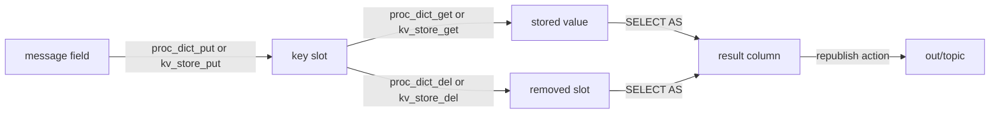

# Rule functions: rule state

<!-- GENERATED by `python3 docs/_tools/entries.py` from `docs/_inventory/`, `docs/_text/` and `docs/_verified/`. Do not edit by hand. -->

The complete MQTT platform in one small binary: broker, SQL rules, data connectors and multi-tenancy in a single process.

A rule state function reads or writes a key slot outside the message. Use this page when a rule must keep a value across messages. You get one entry per function, each with a run against the broker.



The `proc_dict` map is rule-local. The `kv_store` map is node-global. The test entry never writes: a put or a delete through it returns null and keeps the old state. A wrong argument count reads as null. A null value never stops the rule.

## Before you start

- Read [Rule SQL](./sql.md) for the query shape.
- Each entry below ran against the built broker through `POST /api/v1/rules/test`.

## Functions

| Function | What it does |
|---|---|
| `proc_dict_get` | `proc_dict_get(<key>)` returns the rule-local value for `key`. |
| `proc_dict_put` | `proc_dict_put(<key>, <value>)` writes the rule-local slot for `key`. |
| `proc_dict_del` | `proc_dict_del(<key>)` deletes the rule-local slot for `key`. |
| `kv_store_get` | `kv_store_get(<key>)` returns the node-global value for `key`. |
| `kv_store_put` | `kv_store_put(<key>, <value>)` writes the node-global slot for `key`. |
| `kv_store_del` | `kv_store_del(<key>)` deletes the node-global slot for `key`. |

## Functions in detail

### `proc_dict_get`

`proc_dict_get(<key>)` returns the rule-local value for `key`.

The call takes one key. It reads the slot of the current rule. One rule cannot read the slot of another rule. A missing key reads as null. A wrong argument count reads as null.

Signature: `proc_dict_get(<key>)`.

Example (verified through `POST /api/v1/rules/test`):

```sql no-test
-- Comment: illustrative query. The verifier runs each case.
SELECT proc_dict_get('dx2-state-missing-1') AS v FROM "sensors/+"
```

Input topic `sensors/kitchen` and payload `{"temperature": 72.5}`. The broker answered `matched: true` with `projected: {"v": null}`.
Another run with `SELECT proc_dict_get() AS v FROM "sensors/+"` on topic `sensors/kitchen` with payload `{"temperature": 72.5}` answered `matched: true` with `projected: {"v": null}`.

Verified: `POST /api/v1/rules/test` exits 0. See `../_verified/rules/fn-proc_dict_get.json`.

Notes:

- The map is rule-local. One rule cannot read the slot of another rule.
- A missing key reads as null. A wrong argument count returns null.
- Repeat the check with the same call against a live broker.

### `proc_dict_put`

`proc_dict_put(<key>, <value>)` writes the rule-local slot for `key`.

The call takes one key and one value. It writes the slot of the current rule. It returns the stored value. A key longer than 4096 characters reads as null. A wrong argument count reads as null. The test entry never writes: it returns null and keeps the old state. The map holds 10000 entries at most; a put past the cap returns null.

Signature: `proc_dict_put(<key>, <value>)`.

Example (verified through `POST /api/v1/rules/test`):

```sql no-test
-- Comment: illustrative query. The verifier runs each case.
SELECT proc_dict_put('dx2-state-k1', 1) AS v FROM "sensors/+"
```

Input topic `sensors/kitchen` and payload `{"temperature": 72.5}`. The broker answered `matched: true` with `projected: {"v": null}`.
Another run with `SELECT proc_dict_put('dx2-state-k1') AS v FROM "sensors/+"` on topic `sensors/kitchen` with payload `{"temperature": 72.5}` answered `matched: true` with `projected: {"v": null}`.

Verified: `POST /api/v1/rules/test` exits 0. See `../_verified/rules/fn-proc_dict_put.json`.

Notes:

- The test entry never writes. It returns null and keeps the old state.
- A key longer than 4096 characters reads as null. The map holds 10000 entries at most.
- A put past the cap returns null. A wrong argument count returns null.
- Repeat the check with the same call against a live broker.

### `proc_dict_del`

`proc_dict_del(<key>)` deletes the rule-local slot for `key`.

The call takes one key. It deletes the slot of the current rule. It returns the removed value. A missing key reads as null. A wrong argument count reads as null. The test entry never deletes: it returns null and keeps the old state.

Signature: `proc_dict_del(<key>)`.

Example (verified through `POST /api/v1/rules/test`):

```sql no-test
-- Comment: illustrative query. The verifier runs each case.
SELECT proc_dict_del('dx2-state-missing-1') AS v FROM "sensors/+"
```

Input topic `sensors/kitchen` and payload `{"temperature": 72.5}`. The broker answered `matched: true` with `projected: {"v": null}`.
Another run with `SELECT proc_dict_del() AS v FROM "sensors/+"` on topic `sensors/kitchen` with payload `{"temperature": 72.5}` answered `matched: true` with `projected: {"v": null}`.

Verified: `POST /api/v1/rules/test` exits 0. See `../_verified/rules/fn-proc_dict_del.json`.

Notes:

- The test entry never deletes. It returns null and keeps the old state.
- A missing key reads as null. A wrong argument count returns null.
- Repeat the check with the same call against a live broker.

### `kv_store_get`

`kv_store_get(<key>)` returns the node-global value for `key`.

The call takes one key, with one default option. It reads the shared node map. All rules share the same map. A missing key without a default reads as null. A missing key with a default returns the default. A wrong argument count reads as null.

Signature: `kv_store_get(<key> [, <default>])`.

Example (verified through `POST /api/v1/rules/test`):

```sql no-test
-- Comment: illustrative query. The verifier runs each case.
SELECT kv_store_get('dx2-state-missing-1') AS v FROM "sensors/+"
```

Input topic `sensors/kitchen` and payload `{"temperature": 72.5}`. The broker answered `matched: true` with `projected: {"v": null}`.
Another run with `SELECT kv_store_get('dx2-state-missing-1', 'fallback') AS v FROM "sensors/+"` on topic `sensors/kitchen` with payload `{"temperature": 72.5}` answered `matched: true` with `projected: {"v": "fallback"}`.
Another run with `SELECT kv_store_get('a', 'b', 'c') AS v FROM "sensors/+"` on topic `sensors/kitchen` with payload `{"temperature": 72.5}` answered `matched: true` with `projected: {"v": null}`.

Verified: `POST /api/v1/rules/test` exits 0. See `../_verified/rules/fn-kv_store_get.json`.

Notes:

- The map is node-global. All rules share the same map.
- A missing key without a default reads as null. A missing key with a default returns the default.
- A wrong argument count returns null.
- Repeat the check with the same call against a live broker.

### `kv_store_put`

`kv_store_put(<key>, <value>)` writes the node-global slot for `key`.

The call takes one key and one value. It writes the shared node map. All rules share the same map. It returns the stored value. A key longer than 4096 characters reads as null. A wrong argument count reads as null. The test entry never writes: it returns null and keeps the old state. The map holds 10000 entries at most; a put past the cap returns null.

Signature: `kv_store_put(<key>, <value>)`.

Example (verified through `POST /api/v1/rules/test`):

```sql no-test
-- Comment: illustrative query. The verifier runs each case.
SELECT kv_store_put('dx2-state-k1', 1) AS v FROM "sensors/+"
```

Input topic `sensors/kitchen` and payload `{"temperature": 72.5}`. The broker answered `matched: true` with `projected: {"v": null}`.
Another run with `SELECT kv_store_put('dx2-state-k1') AS v FROM "sensors/+"` on topic `sensors/kitchen` with payload `{"temperature": 72.5}` answered `matched: true` with `projected: {"v": null}`.

Verified: `POST /api/v1/rules/test` exits 0. See `../_verified/rules/fn-kv_store_put.json`.

Notes:

- The test entry never writes. It returns null and keeps the old state.
- A key longer than 4096 characters reads as null. The map holds 10000 entries at most.
- A put past the cap returns null. A wrong argument count returns null.
- Repeat the check with the same call against a live broker.

### `kv_store_del`

`kv_store_del(<key>)` deletes the node-global slot for `key`.

The call takes one key. It deletes the entry of the shared node map. It returns the removed value. A missing key reads as null. A wrong argument count reads as null. The test entry never deletes: it returns null and keeps the old state.

Signature: `kv_store_del(<key>)`.

Example (verified through `POST /api/v1/rules/test`):

```sql no-test
-- Comment: illustrative query. The verifier runs each case.
SELECT kv_store_del('dx2-state-missing-1') AS v FROM "sensors/+"
```

Input topic `sensors/kitchen` and payload `{"temperature": 72.5}`. The broker answered `matched: true` with `projected: {"v": null}`.
Another run with `SELECT kv_store_del() AS v FROM "sensors/+"` on topic `sensors/kitchen` with payload `{"temperature": 72.5}` answered `matched: true` with `projected: {"v": null}`.

Verified: `POST /api/v1/rules/test` exits 0. See `../_verified/rules/fn-kv_store_del.json`.

Notes:

- The test entry never deletes. It returns null and keeps the old state.
- A missing key reads as null. A wrong argument count returns null.
- Repeat the check with the same call against a live broker.

## Next steps

- Write the query with [Rule SQL](./sql.md).
- See every function in [Functions](./functions.md).
- Send results with [Actions](./actions.md).
