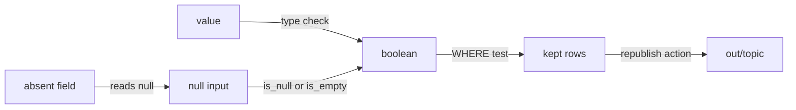

# Rule functions: type checks

<!-- GENERATED by `python3 docs/_tools/entries.py` from `docs/_inventory/`, `docs/_text/` and `docs/_verified/`. Do not edit by hand. -->

The complete MQTT platform in one small binary: broker, SQL rules, data connectors and multi-tenancy in a single process.

A type check function tests one value and returns a boolean. Use this page when a rule must branch on the type of a field. You get one entry per function, each with a run against the broker.



A type check never stops the rule. It returns a boolean for one value. A wrong argument count reads as null. A value that does not match the tested type returns `false`, never null.

## Before you start

- Read [Rule SQL](./sql.md) for the query shape.
- Each entry below ran against the built broker through `POST /api/v1/rules/test`.

## Functions

| Function | What it does |
|---|---|
| `is_null` | `is_null(<v>)` reports whether the value `v` is null. |
| `is_null_var` | `is_null_var(<v>)` reports whether the value `v` is null. |
| `is_not_null` | `is_not_null(<v>)` reports whether the value `v` is not null. |
| `is_not_null_var` | `is_not_null_var(<v>)` reports whether the value `v` is not null. |
| `is_str` | `is_str(<v>)` reports whether the value `v` is text. |
| `is_bool` | `is_bool(<v>)` reports whether the value `v` is a boolean. |
| `is_int` | `is_int(<v>)` reports whether the value `v` is an integer. |
| `is_float` | `is_float(<v>)` reports whether the value `v` is a float. |
| `is_num` | `is_num(<v>)` reports whether the value `v` is a number. |
| `is_map` | `is_map(<v>)` reports whether the value `v` is an object. |
| `is_array` | `is_array(<v>)` reports whether the value `v` is an array. |
| `is_empty` | `is_empty(<v>)` reports whether the value `v` is empty. |

## Functions in detail

### `is_null`

`is_null(<v>)` reports whether the value `v` is null.

The call takes one argument. It returns `true` only for the null value.
An absent payload field reads as null, so the call returns `true` for
it. A present value returns `false`. A wrong argument count reads as
null.

TODO(parity): the open question is whether `is_null` and
`is_null_var` must return different results. The broker reads both the
same way.

Signature: `is_null(<v>)`.

Example (verified through `POST /api/v1/rules/test`):

```sql no-test
-- Comment: illustrative query. The verifier runs each case.
SELECT is_null(NULL) AS v FROM "sensors/+"
```

Input topic `sensors/kitchen` and payload `{"count": 3, "flag": null, "items": {"a": 1}, "name": "", "tags": [1, 2], "temperature": 72.5}`. The broker answered `matched: true` with `projected: {"v": true}`.
Another run with `SELECT is_null(temperature) AS v FROM "sensors/+"` on topic `sensors/kitchen` with payload `{"count": 3, "flag": null, "items": {"a": 1}, "name": "", "tags": [1, 2], "temperature": 72.5}` answered `matched: true` with `projected: {"v": false}`.
Another run with `SELECT is_null(missing) AS v FROM "sensors/+"` on topic `sensors/kitchen` with payload `{"count": 3, "flag": null, "items": {"a": 1}, "name": "", "tags": [1, 2], "temperature": 72.5}` answered `matched: true` with `projected: {"v": true}`.
Another run with `SELECT is_null() AS v FROM "sensors/+"` on topic `sensors/kitchen` with payload `{"count": 3, "flag": null, "items": {"a": 1}, "name": "", "tags": [1, 2], "temperature": 72.5}` answered `matched: true` with `projected: {"v": null}`.

Verified: `POST /api/v1/rules/test` exits 0. See `../_verified/rules/fn-is_null.json`.

Notes:

- An absent payload field reads as null, so the call returns `true` for it.
- A wrong argument count returns null.
- Repeat the check with the same call against a live broker.

### `is_null_var`

`is_null_var(<v>)` reports whether the value `v` is null.

The call takes one argument. A null payload field reads as null, so
the call returns `true` for it. A present value returns `false`. The
result matches `is_null(<v>)`. A wrong argument count reads as null.

TODO(parity): the open question is whether `is_null_var` must differ
from `is_null`. The broker returns the same result for both.

Signature: `is_null_var(<v>)`.

Example (verified through `POST /api/v1/rules/test`):

```sql no-test
-- Comment: illustrative query. The verifier runs each case.
SELECT is_null_var(flag) AS v FROM "sensors/+"
```

Input topic `sensors/kitchen` and payload `{"count": 3, "flag": null, "items": {"a": 1}, "name": "", "tags": [1, 2], "temperature": 72.5}`. The broker answered `matched: true` with `projected: {"v": true}`.
Another run with `SELECT is_null_var(temperature) AS v FROM "sensors/+"` on topic `sensors/kitchen` with payload `{"count": 3, "flag": null, "items": {"a": 1}, "name": "", "tags": [1, 2], "temperature": 72.5}` answered `matched: true` with `projected: {"v": false}`.
Another run with `SELECT is_null_var('a', 'b') AS v FROM "sensors/+"` on topic `sensors/kitchen` with payload `{"count": 3, "flag": null, "items": {"a": 1}, "name": "", "tags": [1, 2], "temperature": 72.5}` answered `matched: true` with `projected: {"v": null}`.

Verified: `POST /api/v1/rules/test` exits 0. See `../_verified/rules/fn-is_null_var.json`.

Notes:

- The call reads the same as `is_null(<v>)`.
- A wrong argument count returns null.
- Repeat the check with the same call against a live broker.

### `is_not_null`

`is_not_null(<v>)` reports whether the value `v` is not null.

The call takes one argument. It returns `true` for every value that is
present, also for an empty text. The null value returns `false`. A
wrong argument count reads as null.

Signature: `is_not_null(<v>)`.

Example (verified through `POST /api/v1/rules/test`):

```sql no-test
-- Comment: illustrative query. The verifier runs each case.
SELECT is_not_null(temperature) AS v FROM "sensors/+"
```

Input topic `sensors/kitchen` and payload `{"count": 3, "flag": null, "items": {"a": 1}, "name": "", "tags": [1, 2], "temperature": 72.5}`. The broker answered `matched: true` with `projected: {"v": true}`.
Another run with `SELECT is_not_null(NULL) AS v FROM "sensors/+"` on topic `sensors/kitchen` with payload `{"count": 3, "flag": null, "items": {"a": 1}, "name": "", "tags": [1, 2], "temperature": 72.5}` answered `matched: true` with `projected: {"v": false}`.
Another run with `SELECT is_not_null('') AS v FROM "sensors/+"` on topic `sensors/kitchen` with payload `{"count": 3, "flag": null, "items": {"a": 1}, "name": "", "tags": [1, 2], "temperature": 72.5}` answered `matched: true` with `projected: {"v": true}`.
Another run with `SELECT is_not_null() AS v FROM "sensors/+"` on topic `sensors/kitchen` with payload `{"count": 3, "flag": null, "items": {"a": 1}, "name": "", "tags": [1, 2], "temperature": 72.5}` answered `matched: true` with `projected: {"v": null}`.

Verified: `POST /api/v1/rules/test` exits 0. See `../_verified/rules/fn-is_not_null.json`.

Notes:

- An empty text is not null, so the call returns `true` for it.
- A wrong argument count returns null.
- Repeat the check with the same call against a live broker.

### `is_not_null_var`

`is_not_null_var(<v>)` reports whether the value `v` is not null.

The call takes one argument. A null payload field returns `false`. An
absent payload field reads as null and returns `false`. A present value
returns `true`. The result matches `is_not_null(<v>)`. A wrong argument
count reads as null.

Signature: `is_not_null_var(<v>)`.

Example (verified through `POST /api/v1/rules/test`):

```sql no-test
-- Comment: illustrative query. The verifier runs each case.
SELECT is_not_null_var(count) AS v FROM "sensors/+"
```

Input topic `sensors/kitchen` and payload `{"count": 3, "flag": null, "items": {"a": 1}, "name": "", "tags": [1, 2], "temperature": 72.5}`. The broker answered `matched: true` with `projected: {"v": true}`.
Another run with `SELECT is_not_null_var(flag) AS v FROM "sensors/+"` on topic `sensors/kitchen` with payload `{"count": 3, "flag": null, "items": {"a": 1}, "name": "", "tags": [1, 2], "temperature": 72.5}` answered `matched: true` with `projected: {"v": false}`.
Another run with `SELECT is_not_null_var(missing) AS v FROM "sensors/+"` on topic `sensors/kitchen` with payload `{"count": 3, "flag": null, "items": {"a": 1}, "name": "", "tags": [1, 2], "temperature": 72.5}` answered `matched: true` with `projected: {"v": false}`.
Another run with `SELECT is_not_null_var('a', 'b') AS v FROM "sensors/+"` on topic `sensors/kitchen` with payload `{"count": 3, "flag": null, "items": {"a": 1}, "name": "", "tags": [1, 2], "temperature": 72.5}` answered `matched: true` with `projected: {"v": null}`.

Verified: `POST /api/v1/rules/test` exits 0. See `../_verified/rules/fn-is_not_null_var.json`.

Notes:

- The call reads the same as `is_not_null(<v>)`.
- A wrong argument count returns null.
- Repeat the check with the same call against a live broker.

### `is_str`

`is_str(<v>)` reports whether the value `v` is text.

The call takes one argument. A JSON string returns `true`. A number, a
boolean, null, an array and an object each return `false`. A wrong
argument count reads as null.

Signature: `is_str(<v>)`.

Example (verified through `POST /api/v1/rules/test`):

```sql no-test
-- Comment: illustrative query. The verifier runs each case.
SELECT is_str('a') AS v FROM "sensors/+"
```

Input topic `sensors/kitchen` and payload `{"count": 3, "flag": null, "items": {"a": 1}, "name": "", "tags": [1, 2], "temperature": 72.5}`. The broker answered `matched: true` with `projected: {"v": true}`.
Another run with `SELECT is_str(1) AS v FROM "sensors/+"` on topic `sensors/kitchen` with payload `{"count": 3, "flag": null, "items": {"a": 1}, "name": "", "tags": [1, 2], "temperature": 72.5}` answered `matched: true` with `projected: {"v": false}`.
Another run with `SELECT is_str(true) AS v FROM "sensors/+"` on topic `sensors/kitchen` with payload `{"count": 3, "flag": null, "items": {"a": 1}, "name": "", "tags": [1, 2], "temperature": 72.5}` answered `matched: true` with `projected: {"v": false}`.
Another run with `SELECT is_str() AS v FROM "sensors/+"` on topic `sensors/kitchen` with payload `{"count": 3, "flag": null, "items": {"a": 1}, "name": "", "tags": [1, 2], "temperature": 72.5}` answered `matched: true` with `projected: {"v": null}`.

Verified: `POST /api/v1/rules/test` exits 0. See `../_verified/rules/fn-is_str.json`.

Notes:

- A null value, a number and a boolean each return `false`.
- A wrong argument count returns null.
- Repeat the check with the same call against a live broker.

### `is_bool`

`is_bool(<v>)` reports whether the value `v` is a boolean.

The call takes one argument. Only the values `true` and `false` return
`true`. The numbers 1 and 0 and the texts `true` and `false` return
`false`. Every other value returns `false`. A wrong argument count
reads as null.

Signature: `is_bool(<v>)`.

Example (verified through `POST /api/v1/rules/test`):

```sql no-test
-- Comment: illustrative query. The verifier runs each case.
SELECT is_bool(true) AS v FROM "sensors/+"
```

Input topic `sensors/kitchen` and payload `{"count": 3, "flag": null, "items": {"a": 1}, "name": "", "tags": [1, 2], "temperature": 72.5}`. The broker answered `matched: true` with `projected: {"v": true}`.
Another run with `SELECT is_bool('true') AS v FROM "sensors/+"` on topic `sensors/kitchen` with payload `{"count": 3, "flag": null, "items": {"a": 1}, "name": "", "tags": [1, 2], "temperature": 72.5}` answered `matched: true` with `projected: {"v": false}`.
Another run with `SELECT is_bool(1) AS v FROM "sensors/+"` on topic `sensors/kitchen` with payload `{"count": 3, "flag": null, "items": {"a": 1}, "name": "", "tags": [1, 2], "temperature": 72.5}` answered `matched: true` with `projected: {"v": false}`.
Another run with `SELECT is_bool() AS v FROM "sensors/+"` on topic `sensors/kitchen` with payload `{"count": 3, "flag": null, "items": {"a": 1}, "name": "", "tags": [1, 2], "temperature": 72.5}` answered `matched: true` with `projected: {"v": null}`.

Verified: `POST /api/v1/rules/test` exits 0. See `../_verified/rules/fn-is_bool.json`.

Notes:

- Only the booleans `true` and `false` return `true`. The numbers 1 and 0 and the texts `true` and `false` return `false`.
- A wrong argument count returns null.
- Repeat the check with the same call against a live broker.

### `is_int`

`is_int(<v>)` reports whether the value `v` is an integer.

The call takes one argument. A JSON integer returns `true`. A float
such as `1.5` or `3.0` returns `false`. A numeric text returns
`false`. Every other value returns `false`. A wrong argument count
reads as null.

Signature: `is_int(<v>)`.

Example (verified through `POST /api/v1/rules/test`):

```sql no-test
-- Comment: illustrative query. The verifier runs each case.
SELECT is_int(1) AS v FROM "sensors/+"
```

Input topic `sensors/kitchen` and payload `{"count": 3, "flag": null, "items": {"a": 1}, "name": "", "tags": [1, 2], "temperature": 72.5}`. The broker answered `matched: true` with `projected: {"v": true}`.
Another run with `SELECT is_int(1.5) AS v FROM "sensors/+"` on topic `sensors/kitchen` with payload `{"count": 3, "flag": null, "items": {"a": 1}, "name": "", "tags": [1, 2], "temperature": 72.5}` answered `matched: true` with `projected: {"v": false}`.
Another run with `SELECT is_int('42') AS v FROM "sensors/+"` on topic `sensors/kitchen` with payload `{"count": 3, "flag": null, "items": {"a": 1}, "name": "", "tags": [1, 2], "temperature": 72.5}` answered `matched: true` with `projected: {"v": false}`.
Another run with `SELECT is_int() AS v FROM "sensors/+"` on topic `sensors/kitchen` with payload `{"count": 3, "flag": null, "items": {"a": 1}, "name": "", "tags": [1, 2], "temperature": 72.5}` answered `matched: true` with `projected: {"v": null}`.

Verified: `POST /api/v1/rules/test` exits 0. See `../_verified/rules/fn-is_int.json`.

Notes:

- An integer literal and an integer payload field return `true`. A float such as `3.0` and a numeric text return `false`.
- A wrong argument count returns null.
- Repeat the check with the same call against a live broker.

### `is_float`

`is_float(<v>)` reports whether the value `v` is a float.

The call takes one argument. A JSON float returns `true`. The literal
`3.0` is a float and returns `true`. An integer returns `false`. A
wrong argument count reads as null.

Signature: `is_float(<v>)`.

Example (verified through `POST /api/v1/rules/test`):

```sql no-test
-- Comment: illustrative query. The verifier runs each case.
SELECT is_float(1.5) AS v FROM "sensors/+"
```

Input topic `sensors/kitchen` and payload `{"count": 3, "flag": null, "items": {"a": 1}, "name": "", "tags": [1, 2], "temperature": 72.5}`. The broker answered `matched: true` with `projected: {"v": true}`.
Another run with `SELECT is_float(1) AS v FROM "sensors/+"` on topic `sensors/kitchen` with payload `{"count": 3, "flag": null, "items": {"a": 1}, "name": "", "tags": [1, 2], "temperature": 72.5}` answered `matched: true` with `projected: {"v": false}`.
Another run with `SELECT is_float(3.0) AS v FROM "sensors/+"` on topic `sensors/kitchen` with payload `{"count": 3, "flag": null, "items": {"a": 1}, "name": "", "tags": [1, 2], "temperature": 72.5}` answered `matched: true` with `projected: {"v": true}`.
Another run with `SELECT is_float() AS v FROM "sensors/+"` on topic `sensors/kitchen` with payload `{"count": 3, "flag": null, "items": {"a": 1}, "name": "", "tags": [1, 2], "temperature": 72.5}` answered `matched: true` with `projected: {"v": null}`.

Verified: `POST /api/v1/rules/test` exits 0. See `../_verified/rules/fn-is_float.json`.

Notes:

- A float literal and a float payload field return `true`. An integer literal returns `false`.
- A wrong argument count returns null.
- Repeat the check with the same call against a live broker.

### `is_num`

`is_num(<v>)` reports whether the value `v` is a number.

The call takes one argument. An integer and a float each return
`true`. A numeric text returns `false`. Every other value returns
`false`. A wrong argument count reads as null.

Signature: `is_num(<v>)`.

Example (verified through `POST /api/v1/rules/test`):

```sql no-test
-- Comment: illustrative query. The verifier runs each case.
SELECT is_num(1) AS v FROM "sensors/+"
```

Input topic `sensors/kitchen` and payload `{"count": 3, "flag": null, "items": {"a": 1}, "name": "", "tags": [1, 2], "temperature": 72.5}`. The broker answered `matched: true` with `projected: {"v": true}`.
Another run with `SELECT is_num(1.5) AS v FROM "sensors/+"` on topic `sensors/kitchen` with payload `{"count": 3, "flag": null, "items": {"a": 1}, "name": "", "tags": [1, 2], "temperature": 72.5}` answered `matched: true` with `projected: {"v": true}`.
Another run with `SELECT is_num('1') AS v FROM "sensors/+"` on topic `sensors/kitchen` with payload `{"count": 3, "flag": null, "items": {"a": 1}, "name": "", "tags": [1, 2], "temperature": 72.5}` answered `matched: true` with `projected: {"v": false}`.
Another run with `SELECT is_num() AS v FROM "sensors/+"` on topic `sensors/kitchen` with payload `{"count": 3, "flag": null, "items": {"a": 1}, "name": "", "tags": [1, 2], "temperature": 72.5}` answered `matched: true` with `projected: {"v": null}`.

Verified: `POST /api/v1/rules/test` exits 0. See `../_verified/rules/fn-is_num.json`.

Notes:

- An integer and a float return `true`. A numeric text returns `false`.
- A wrong argument count returns null.
- Repeat the check with the same call against a live broker.

### `is_map`

`is_map(<v>)` reports whether the value `v` is an object.

The call takes one argument. A JSON object returns `true`. JSON text
that holds an object returns `false`; convert it with `map(<v>)` first.
An array returns `false`. A wrong argument count reads as null.

Signature: `is_map(<v>)`.

Example (verified through `POST /api/v1/rules/test`):

```sql no-test
-- Comment: illustrative query. The verifier runs each case.
SELECT is_map(items) AS v FROM "sensors/+"
```

Input topic `sensors/kitchen` and payload `{"count": 3, "flag": null, "items": {"a": 1}, "name": "", "tags": [1, 2], "temperature": 72.5}`. The broker answered `matched: true` with `projected: {"v": true}`.
Another run with `SELECT is_map('{"a":1}') AS v FROM "sensors/+"` on topic `sensors/kitchen` with payload `{"count": 3, "flag": null, "items": {"a": 1}, "name": "", "tags": [1, 2], "temperature": 72.5}` answered `matched: true` with `projected: {"v": false}`.
Another run with `SELECT is_map([1]) AS v FROM "sensors/+"` on topic `sensors/kitchen` with payload `{"count": 3, "flag": null, "items": {"a": 1}, "name": "", "tags": [1, 2], "temperature": 72.5}` answered `matched: true` with `projected: {"v": false}`.
Another run with `SELECT is_map() AS v FROM "sensors/+"` on topic `sensors/kitchen` with payload `{"count": 3, "flag": null, "items": {"a": 1}, "name": "", "tags": [1, 2], "temperature": 72.5}` answered `matched: true` with `projected: {"v": null}`.

Verified: `POST /api/v1/rules/test` exits 0. See `../_verified/rules/fn-is_map.json`.

Notes:

- A JSON object in the payload returns `true`. JSON text returns `false`; convert it with `map(<v>)` first.
- A wrong argument count returns null.
- Repeat the check with the same call against a live broker.

### `is_array`

`is_array(<v>)` reports whether the value `v` is an array.

The call takes one argument. A JSON array returns `true`. An object
returns `false`. JSON text that holds an array returns `false`. A wrong
argument count reads as null.

Signature: `is_array(<v>)`.

Example (verified through `POST /api/v1/rules/test`):

```sql no-test
-- Comment: illustrative query. The verifier runs each case.
SELECT is_array([1, 2]) AS v FROM "sensors/+"
```

Input topic `sensors/kitchen` and payload `{"count": 3, "flag": null, "items": {"a": 1}, "name": "", "tags": [1, 2], "temperature": 72.5}`. The broker answered `matched: true` with `projected: {"v": true}`.
Another run with `SELECT is_array('{"a":1}') AS v FROM "sensors/+"` on topic `sensors/kitchen` with payload `{"count": 3, "flag": null, "items": {"a": 1}, "name": "", "tags": [1, 2], "temperature": 72.5}` answered `matched: true` with `projected: {"v": false}`.
Another run with `SELECT is_array(items) AS v FROM "sensors/+"` on topic `sensors/kitchen` with payload `{"count": 3, "flag": null, "items": {"a": 1}, "name": "", "tags": [1, 2], "temperature": 72.5}` answered `matched: true` with `projected: {"v": false}`.
Another run with `SELECT is_array() AS v FROM "sensors/+"` on topic `sensors/kitchen` with payload `{"count": 3, "flag": null, "items": {"a": 1}, "name": "", "tags": [1, 2], "temperature": 72.5}` answered `matched: true` with `projected: {"v": null}`.

Verified: `POST /api/v1/rules/test` exits 0. See `../_verified/rules/fn-is_array.json`.

Notes:

- A JSON array returns `true`. An object and JSON text return `false`.
- A wrong argument count returns null.
- Repeat the check with the same call against a live broker.

### `is_empty`

`is_empty(<v>)` reports whether the value `v` is empty.

The call takes one argument. An empty text, an empty array and an
empty object each return `true`. The null value and an absent payload
field return `true`. A number and a boolean never return `true`. A
wrong argument count reads as null.

TODO(parity): the open question is whether the number 0 and the
boolean false count as empty. The broker reads them as not empty.

Signature: `is_empty(<v>)`.

Example (verified through `POST /api/v1/rules/test`):

```sql no-test
-- Comment: illustrative query. The verifier runs each case.
SELECT is_empty('') AS v FROM "sensors/+"
```

Input topic `sensors/kitchen` and payload `{"count": 3, "flag": null, "items": {"a": 1}, "name": "", "tags": [1, 2], "temperature": 72.5}`. The broker answered `matched: true` with `projected: {"v": true}`.
Another run with `SELECT is_empty('a') AS v FROM "sensors/+"` on topic `sensors/kitchen` with payload `{"count": 3, "flag": null, "items": {"a": 1}, "name": "", "tags": [1, 2], "temperature": 72.5}` answered `matched: true` with `projected: {"v": false}`.
Another run with `SELECT is_empty([]) AS v FROM "sensors/+"` on topic `sensors/kitchen` with payload `{"count": 3, "flag": null, "items": {"a": 1}, "name": "", "tags": [1, 2], "temperature": 72.5}` answered `matched: true` with `projected: {"v": true}`.
Another run with `SELECT is_empty({}) AS v FROM "sensors/+"` on topic `sensors/kitchen` with payload `{"count": 3, "flag": null, "items": {"a": 1}, "name": "", "tags": [1, 2], "temperature": 72.5}` answered `matched: true` with `projected: {"v": true}`.
Another run with `SELECT is_empty(NULL) AS v FROM "sensors/+"` on topic `sensors/kitchen` with payload `{"count": 3, "flag": null, "items": {"a": 1}, "name": "", "tags": [1, 2], "temperature": 72.5}` answered `matched: true` with `projected: {"v": true}`.
Another run with `SELECT is_empty(0) AS v FROM "sensors/+"` on topic `sensors/kitchen` with payload `{"count": 3, "flag": null, "items": {"a": 1}, "name": "", "tags": [1, 2], "temperature": 72.5}` answered `matched: true` with `projected: {"v": false}`.
Another run with `SELECT is_empty() AS v FROM "sensors/+"` on topic `sensors/kitchen` with payload `{"count": 3, "flag": null, "items": {"a": 1}, "name": "", "tags": [1, 2], "temperature": 72.5}` answered `matched: true` with `projected: {"v": null}`.

Verified: `POST /api/v1/rules/test` exits 0. See `../_verified/rules/fn-is_empty.json`.

Notes:

- An empty text, an empty array, an empty object and null each return `true`.
- A number and a boolean never return `true`. A wrong argument count returns null.
- Repeat the check with the same call against a live broker.

## Next steps

- Write the query with [Rule SQL](./sql.md).
- See every function in [Functions](./functions.md).
- Send results with [Actions](./actions.md).
