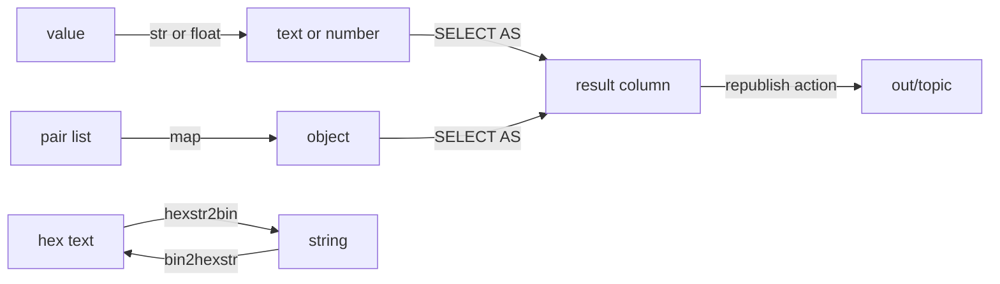

# Rule functions: type conversion

<!-- GENERATED by `python3 docs/_tools/entries.py` from `docs/_inventory/`, `docs/_text/` and `docs/_verified/`. Do not edit by hand. -->

The complete MQTT platform in one small binary: broker, SQL rules, data connectors and multi-tenancy in a single process.

A type conversion function reads one value and returns another type. Use this page when a rule must change the type of a payload field before it stores or forwards it. You get one entry per function, each with a run against the broker.



A wrong argument count reads as null. A value the call cannot convert reads as null. A null value never stops the rule.

## Before you start

- Read [Rule SQL](./sql.md) for the query shape.
- Each entry below ran against the built broker through `POST /api/v1/rules/test`.

## Functions

| Function | What it does |
|---|---|
| `str` | `str(<v>)` converts the value `v` to a string. |
| `str_utf8` | `str_utf8(<v>)` converts the value `v` to UTF-8 text. |
| `str_utf16_le` | `str_utf16_le(<v>)` converts the value `v` to base64 UTF-16LE text. |
| `bool` | `bool(<v>)` converts the value `v` to a boolean. |
| `int` | `int(<v>)` converts the value `v` to an integer. |
| `float` | `float(<v>)` converts the value `v` to a number. |
| `float2str` | `float2str(<f>, <precision>)` renders the number `f` as text. |
| `map` | `map(<v>)` converts the value `v` to an object. |
| `bin2hexstr` | `bin2hexstr(<b>)` converts the string `b` to upper-case hex text. |
| `hexstr2bin` | `hexstr2bin(<s>)` converts the hex text `s` to a string. |
| `sqlserver_bin2hexstr` | `sqlserver_bin2hexstr(<b>)` converts the string `b` to `0x` hex text. |

## Functions in detail

### `str`

`str(<v>)` converts the value `v` to a string.

The call takes one argument. A number or a boolean renders as plain
text. An array or an object renders as JSON text. A null value reads
as null. A wrong argument count reads as null.

TODO(parity): the rendering of a nested array or object is open. The
broker renders it as JSON text.

Signature: `str(<v>)`.

Example (verified through `POST /api/v1/rules/test`):

```sql no-test
-- Comment: illustrative query. The verifier runs each case.
SELECT str(42) AS v FROM "sensors/+"
```

Input topic `sensors/kitchen` and payload `{"temperature": 72.5}`. The broker answered `matched: true` with `projected: {"v": "42"}`.
Another run with `SELECT str(true) AS v FROM "sensors/+"` on topic `sensors/kitchen` with payload `{"temperature": 72.5}` answered `matched: true` with `projected: {"v": "true"}`.
Another run with `SELECT str([1, 2]) AS v FROM "sensors/+"` on topic `sensors/kitchen` with payload `{"temperature": 72.5}` answered `matched: true` with `projected: {"v": "[1,2]"}`.
Another run with `SELECT str(map('{"a":1}')) AS v FROM "sensors/+"` on topic `sensors/kitchen` with payload `{"temperature": 72.5}` answered `matched: true` with `projected: {"v": "{\"a\":1}"}`.
Another run with `SELECT str(NULL) AS v FROM "sensors/+"` on topic `sensors/kitchen` with payload `{"temperature": 72.5}` answered `matched: true` with `projected: {"v": null}`.
Another run with `SELECT str() AS v FROM "sensors/+"` on topic `sensors/kitchen` with payload `{"temperature": 72.5}` answered `matched: true` with `projected: {"v": null}`.

Verified: `POST /api/v1/rules/test` exits 0. See `../_verified/rules/fn-str.json`.

Notes:

- A number or a boolean renders as plain text. An array or an object renders as JSON text.
- A wrong argument count returns null.
- Repeat the check with the same call against a live broker.

### `str_utf8`

`str_utf8(<v>)` converts the value `v` to UTF-8 text.

The call is the same as `str(<v>)`. A JSON string is UTF-8 text by
construction. A number or a boolean renders as plain text. A null
value reads as null. A wrong argument count reads as null.

Signature: `str_utf8(<v>)`.

Example (verified through `POST /api/v1/rules/test`):

```sql no-test
-- Comment: illustrative query. The verifier runs each case.
SELECT str_utf8(7) AS v FROM "sensors/+"
```

Input topic `sensors/kitchen` and payload `{"temperature": 72.5}`. The broker answered `matched: true` with `projected: {"v": "7"}`.
Another run with `SELECT str_utf8('héllo') AS v FROM "sensors/+"` on topic `sensors/kitchen` with payload `{"temperature": 72.5}` answered `matched: true` with `projected: {"v": "h\u00e9llo"}`.
Another run with `SELECT str_utf8(NULL) AS v FROM "sensors/+"` on topic `sensors/kitchen` with payload `{"temperature": 72.5}` answered `matched: true` with `projected: {"v": null}`.
Another run with `SELECT str_utf8() AS v FROM "sensors/+"` on topic `sensors/kitchen` with payload `{"temperature": 72.5}` answered `matched: true` with `projected: {"v": null}`.

Verified: `POST /api/v1/rules/test` exits 0. See `../_verified/rules/fn-str_utf8.json`.

Notes:

- The call is the same as `str(<v>)`.
- A wrong argument count returns null.
- Repeat the check with the same call against a live broker.

### `str_utf16_le`

`str_utf16_le(<v>)` converts the value `v` to base64 UTF-16LE text.

The call takes one argument. The broker encodes the string as UTF-16LE
bytes and returns those bytes as base64 text. An empty string reads as
`""`. A null value reads as null. A wrong argument count reads as null.

TODO(parity): the wire form of a UTF-16LE value is open. The broker
returns base64 text.

Signature: `str_utf16_le(<v>)`.

Example (verified through `POST /api/v1/rules/test`):

```sql no-test
-- Comment: illustrative query. The verifier runs each case.
SELECT str_utf16_le('A') AS v FROM "sensors/+"
```

Input topic `sensors/kitchen` and payload `{"temperature": 72.5}`. The broker answered `matched: true` with `projected: {"v": "QQA="}`.
Another run with `SELECT str_utf16_le('é') AS v FROM "sensors/+"` on topic `sensors/kitchen` with payload `{"temperature": 72.5}` answered `matched: true` with `projected: {"v": "6QA="}`.
Another run with `SELECT str_utf16_le('') AS v FROM "sensors/+"` on topic `sensors/kitchen` with payload `{"temperature": 72.5}` answered `matched: true` with `projected: {"v": ""}`.
Another run with `SELECT str_utf16_le(NULL) AS v FROM "sensors/+"` on topic `sensors/kitchen` with payload `{"temperature": 72.5}` answered `matched: true` with `projected: {"v": null}`.
Another run with `SELECT str_utf16_le() AS v FROM "sensors/+"` on topic `sensors/kitchen` with payload `{"temperature": 72.5}` answered `matched: true` with `projected: {"v": null}`.

Verified: `POST /api/v1/rules/test` exits 0. See `../_verified/rules/fn-str_utf16_le.json`.

Notes:

- The result is base64 text of the UTF-16LE bytes. An empty string reads as `""`.
- A wrong argument count returns null.
- Repeat the check with the same call against a live broker.

### `bool`

`bool(<v>)` converts the value `v` to a boolean.

The call takes one argument. `true` and `false` stay. The numbers `1`
and `0` convert. The texts `true`, `false`, `1` and `0` convert. Letter
case and surrounding spaces do not change the result. Every other value
reads as null. A wrong argument count reads as null.

TODO(parity): the full truthiness table is open. The broker accepts
only the values above.

Signature: `bool(<v>)`.

Example (verified through `POST /api/v1/rules/test`):

```sql no-test
-- Comment: illustrative query. The verifier runs each case.
SELECT bool(1) AS v FROM "sensors/+"
```

Input topic `sensors/kitchen` and payload `{"temperature": 72.5}`. The broker answered `matched: true` with `projected: {"v": true}`.
Another run with `SELECT bool(false) AS v FROM "sensors/+"` on topic `sensors/kitchen` with payload `{"temperature": 72.5}` answered `matched: true` with `projected: {"v": false}`.
Another run with `SELECT bool('TRUE') AS v FROM "sensors/+"` on topic `sensors/kitchen` with payload `{"temperature": 72.5}` answered `matched: true` with `projected: {"v": true}`.
Another run with `SELECT bool(' 1 ') AS v FROM "sensors/+"` on topic `sensors/kitchen` with payload `{"temperature": 72.5}` answered `matched: true` with `projected: {"v": true}`.
Another run with `SELECT bool(2) AS v FROM "sensors/+"` on topic `sensors/kitchen` with payload `{"temperature": 72.5}` answered `matched: true` with `projected: {"v": null}`.
Another run with `SELECT bool('yes') AS v FROM "sensors/+"` on topic `sensors/kitchen` with payload `{"temperature": 72.5}` answered `matched: true` with `projected: {"v": null}`.
Another run with `SELECT bool() AS v FROM "sensors/+"` on topic `sensors/kitchen` with payload `{"temperature": 72.5}` answered `matched: true` with `projected: {"v": null}`.

Verified: `POST /api/v1/rules/test` exits 0. See `../_verified/rules/fn-bool.json`.

Notes:

- Only `true`/`false`, the numbers `1`/`0`, and the texts `true`, `false`, `1`, `0` convert. Every other value returns null.
- A wrong argument count returns null.
- Repeat the check with the same call against a live broker.

### `int`

`int(<v>)` converts the value `v` to an integer.

The call takes one argument. A float truncates toward zero. A numeric
text parses. A boolean reads as 1 or 0. Every other value reads as
null. A wrong argument count reads as null.

Signature: `int(<v>)`.

Example (verified through `POST /api/v1/rules/test`):

```sql no-test
-- Comment: illustrative query. The verifier runs each case.
SELECT int('42') AS v FROM "sensors/+"
```

Input topic `sensors/kitchen` and payload `{"temperature": 72.5}`. The broker answered `matched: true` with `projected: {"v": 42}`.
Another run with `SELECT int(3.9) AS v FROM "sensors/+"` on topic `sensors/kitchen` with payload `{"temperature": 72.5}` answered `matched: true` with `projected: {"v": 3}`.
Another run with `SELECT int(true) AS v FROM "sensors/+"` on topic `sensors/kitchen` with payload `{"temperature": 72.5}` answered `matched: true` with `projected: {"v": 1}`.
Another run with `SELECT int('x') AS v FROM "sensors/+"` on topic `sensors/kitchen` with payload `{"temperature": 72.5}` answered `matched: true` with `projected: {"v": null}`.
Another run with `SELECT int() AS v FROM "sensors/+"` on topic `sensors/kitchen` with payload `{"temperature": 72.5}` answered `matched: true` with `projected: {"v": null}`.

Verified: `POST /api/v1/rules/test` exits 0. See `../_verified/rules/fn-int.json`.

Notes:

- A float truncates toward zero. A numeric text parses. A boolean reads as 1 or 0.
- A wrong argument count returns null.
- Repeat the check with the same call against a live broker.

### `float`

`float(<v>)` converts the value `v` to a number.
`float(<v>, <decimals>)` rounds the result to `decimals` places.

The call takes one or two arguments. A numeric text parses. A boolean
reads as 1.0 or 0.0. `decimals` runs from 0 to 20; a value outside that
range reads as null. Every other value reads as null. A wrong argument
count reads as null.

Signature: `float(<v>)` or `float(<v>, <decimals>)`.

Example (verified through `POST /api/v1/rules/test`):

```sql no-test
-- Comment: illustrative query. The verifier runs each case.
SELECT float('2.5') AS v FROM "sensors/+"
```

Input topic `sensors/kitchen` and payload `{"temperature": 72.5}`. The broker answered `matched: true` with `projected: {"v": 2.5}`.
Another run with `SELECT float(1) AS v FROM "sensors/+"` on topic `sensors/kitchen` with payload `{"temperature": 72.5}` answered `matched: true` with `projected: {"v": 1.0}`.
Another run with `SELECT float(2.567, 2) AS v FROM "sensors/+"` on topic `sensors/kitchen` with payload `{"temperature": 72.5}` answered `matched: true` with `projected: {"v": 2.57}`.
Another run with `SELECT float('x') AS v FROM "sensors/+"` on topic `sensors/kitchen` with payload `{"temperature": 72.5}` answered `matched: true` with `projected: {"v": null}`.
Another run with `SELECT float(2.5, 99) AS v FROM "sensors/+"` on topic `sensors/kitchen` with payload `{"temperature": 72.5}` answered `matched: true` with `projected: {"v": null}`.
Another run with `SELECT float() AS v FROM "sensors/+"` on topic `sensors/kitchen` with payload `{"temperature": 72.5}` answered `matched: true` with `projected: {"v": null}`.

Verified: `POST /api/v1/rules/test` exits 0. See `../_verified/rules/fn-float.json`.

Notes:

- The second argument rounds the result to `decimals` places. `decimals` runs from 0 to 20.
- A wrong argument count returns null.
- Repeat the check with the same call against a live broker.

### `float2str`

`float2str(<f>, <precision>)` renders the number `f` as text.

The call takes two arguments. `precision` sets the count of decimals.
The result holds exactly `precision` decimals. `precision` runs from 0
to 20; a value outside that range reads as null. A text that is not a
number reads as null. A wrong argument count reads as null.

Signature: `float2str(<f>, <precision>)`.

Example (verified through `POST /api/v1/rules/test`):

```sql no-test
-- Comment: illustrative query. The verifier runs each case.
SELECT float2str(2.567, 2) AS v FROM "sensors/+"
```

Input topic `sensors/kitchen` and payload `{"temperature": 72.5}`. The broker answered `matched: true` with `projected: {"v": "2.57"}`.
Another run with `SELECT float2str(42, 3) AS v FROM "sensors/+"` on topic `sensors/kitchen` with payload `{"temperature": 72.5}` answered `matched: true` with `projected: {"v": "42.000"}`.
Another run with `SELECT float2str(2.5, 0) AS v FROM "sensors/+"` on topic `sensors/kitchen` with payload `{"temperature": 72.5}` answered `matched: true` with `projected: {"v": "2"}`.
Another run with `SELECT float2str(1.0, 99) AS v FROM "sensors/+"` on topic `sensors/kitchen` with payload `{"temperature": 72.5}` answered `matched: true` with `projected: {"v": null}`.
Another run with `SELECT float2str() AS v FROM "sensors/+"` on topic `sensors/kitchen` with payload `{"temperature": 72.5}` answered `matched: true` with `projected: {"v": null}`.

Verified: `POST /api/v1/rules/test` exits 0. See `../_verified/rules/fn-float2str.json`.

Notes:

- The result holds exactly `precision` decimals. `precision` runs from 0 to 20; a value outside that range returns null.
- A wrong argument count returns null.
- Repeat the check with the same call against a live broker.

### `map`

`map(<v>)` converts the value `v` to an object.

The call takes one argument. JSON text that holds an object reads as
that object. A list of `[key, value]` pairs reads as an object with
those keys. A key that is not a text reads as null. Every other value
reads as null. A wrong argument count reads as null.

Signature: `map(<v>)`.

Example (verified through `POST /api/v1/rules/test`):

```sql no-test
-- Comment: illustrative query. The verifier runs each case.
SELECT map('{"a":1}') AS v FROM "sensors/+"
```

Input topic `sensors/kitchen` and payload `{"temperature": 72.5}`. The broker answered `matched: true` with `projected: {"v": {"a": 1}}`.
Another run with `SELECT map([["a", 1]]) AS v FROM "sensors/+"` on topic `sensors/kitchen` with payload `{"temperature": 72.5}` answered `matched: true` with `projected: {"v": {"a": 1}}`.
Another run with `SELECT map('nope') AS v FROM "sensors/+"` on topic `sensors/kitchen` with payload `{"temperature": 72.5}` answered `matched: true` with `projected: {"v": null}`.
Another run with `SELECT map([[1, 2]]) AS v FROM "sensors/+"` on topic `sensors/kitchen` with payload `{"temperature": 72.5}` answered `matched: true` with `projected: {"v": null}`.
Another run with `SELECT map() AS v FROM "sensors/+"` on topic `sensors/kitchen` with payload `{"temperature": 72.5}` answered `matched: true` with `projected: {"v": null}`.

Verified: `POST /api/v1/rules/test` exits 0. See `../_verified/rules/fn-map.json`.

Notes:

- JSON text that holds an object, or a list of `[key, value]` pairs, reads as an object. A key that is not a text returns null.
- A wrong argument count returns null.
- Repeat the check with the same call against a live broker.

### `bin2hexstr`

`bin2hexstr(<b>)` converts the string `b` to upper-case hex text.
`bin2hexstr(<b>, <prefix>)` prepends `prefix` to the result.

The call takes one or two arguments. Each byte of the string becomes
two upper-case hex digits. An empty string reads as `""`. A null value
reads as null. A wrong argument count reads as null.

Signature: `bin2hexstr(<b>)` or `bin2hexstr(<b>, <prefix>)`.

Example (verified through `POST /api/v1/rules/test`):

```sql no-test
-- Comment: illustrative query. The verifier runs each case.
SELECT bin2hexstr('AB') AS v FROM "sensors/+"
```

Input topic `sensors/kitchen` and payload `{"temperature": 72.5}`. The broker answered `matched: true` with `projected: {"v": "4142"}`.
Another run with `SELECT bin2hexstr('a') AS v FROM "sensors/+"` on topic `sensors/kitchen` with payload `{"temperature": 72.5}` answered `matched: true` with `projected: {"v": "61"}`.
Another run with `SELECT bin2hexstr('AB', '0x') AS v FROM "sensors/+"` on topic `sensors/kitchen` with payload `{"temperature": 72.5}` answered `matched: true` with `projected: {"v": "0x4142"}`.
Another run with `SELECT bin2hexstr('') AS v FROM "sensors/+"` on topic `sensors/kitchen` with payload `{"temperature": 72.5}` answered `matched: true` with `projected: {"v": ""}`.
Another run with `SELECT bin2hexstr(NULL) AS v FROM "sensors/+"` on topic `sensors/kitchen` with payload `{"temperature": 72.5}` answered `matched: true` with `projected: {"v": null}`.
Another run with `SELECT bin2hexstr() AS v FROM "sensors/+"` on topic `sensors/kitchen` with payload `{"temperature": 72.5}` answered `matched: true` with `projected: {"v": null}`.

Verified: `POST /api/v1/rules/test` exits 0. See `../_verified/rules/fn-bin2hexstr.json`.

Notes:

- Each byte becomes two upper-case hex digits. The second argument prepends a prefix.
- A wrong argument count returns null.
- Repeat the check with the same call against a live broker.

### `hexstr2bin`

`hexstr2bin(<s>)` converts the hex text `s` to a string.
`hexstr2bin(<s>, <prefix>)` strips the required `prefix` first.

The call takes one or two arguments. The text must hold hex digit
pairs. A missing prefix, an odd length, or a non-hex digit reads as
null. The decoded bytes must form valid UTF-8 text; any other result
reads as null. A wrong argument count reads as null.

Signature: `hexstr2bin(<s>)` or `hexstr2bin(<s>, <prefix>)`.

Example (verified through `POST /api/v1/rules/test`):

```sql no-test
-- Comment: illustrative query. The verifier runs each case.
SELECT hexstr2bin('4142') AS v FROM "sensors/+"
```

Input topic `sensors/kitchen` and payload `{"temperature": 72.5}`. The broker answered `matched: true` with `projected: {"v": "AB"}`.
Another run with `SELECT hexstr2bin('0x4142', '0x') AS v FROM "sensors/+"` on topic `sensors/kitchen` with payload `{"temperature": 72.5}` answered `matched: true` with `projected: {"v": "AB"}`.
Another run with `SELECT hexstr2bin('zz') AS v FROM "sensors/+"` on topic `sensors/kitchen` with payload `{"temperature": 72.5}` answered `matched: true` with `projected: {"v": null}`.
Another run with `SELECT hexstr2bin('414') AS v FROM "sensors/+"` on topic `sensors/kitchen` with payload `{"temperature": 72.5}` answered `matched: true` with `projected: {"v": null}`.
Another run with `SELECT hexstr2bin('FF') AS v FROM "sensors/+"` on topic `sensors/kitchen` with payload `{"temperature": 72.5}` answered `matched: true` with `projected: {"v": null}`.
Another run with `SELECT hexstr2bin() AS v FROM "sensors/+"` on topic `sensors/kitchen` with payload `{"temperature": 72.5}` answered `matched: true` with `projected: {"v": null}`.

Verified: `POST /api/v1/rules/test` exits 0. See `../_verified/rules/fn-hexstr2bin.json`.

Notes:

- The text must hold hex digit pairs. The decoded bytes must form valid UTF-8 text.
- A missing prefix, an odd length, a non-hex digit, or non-UTF-8 bytes return null.
- A wrong argument count returns null.
- Repeat the check with the same call against a live broker.

### `sqlserver_bin2hexstr`

`sqlserver_bin2hexstr(<b>)` converts the string `b` to `0x` hex text.

The call takes one argument. It is `bin2hexstr(<b>, '0x')` under
another name. Each byte becomes two upper-case hex digits. An empty
string reads as `0x`. A null value reads as null. A wrong argument
count reads as null.

Signature: `sqlserver_bin2hexstr(<b>)`.

Example (verified through `POST /api/v1/rules/test`):

```sql no-test
-- Comment: illustrative query. The verifier runs each case.
SELECT sqlserver_bin2hexstr('AB') AS v FROM "sensors/+"
```

Input topic `sensors/kitchen` and payload `{"temperature": 72.5}`. The broker answered `matched: true` with `projected: {"v": "0x4142"}`.
Another run with `SELECT sqlserver_bin2hexstr('a') AS v FROM "sensors/+"` on topic `sensors/kitchen` with payload `{"temperature": 72.5}` answered `matched: true` with `projected: {"v": "0x61"}`.
Another run with `SELECT sqlserver_bin2hexstr('') AS v FROM "sensors/+"` on topic `sensors/kitchen` with payload `{"temperature": 72.5}` answered `matched: true` with `projected: {"v": "0x"}`.
Another run with `SELECT sqlserver_bin2hexstr(NULL) AS v FROM "sensors/+"` on topic `sensors/kitchen` with payload `{"temperature": 72.5}` answered `matched: true` with `projected: {"v": null}`.
Another run with `SELECT sqlserver_bin2hexstr() AS v FROM "sensors/+"` on topic `sensors/kitchen` with payload `{"temperature": 72.5}` answered `matched: true` with `projected: {"v": null}`.

Verified: `POST /api/v1/rules/test` exits 0. See `../_verified/rules/fn-sqlserver_bin2hexstr.json`.

Notes:

- It is `bin2hexstr(<b>, '0x')` under another name. An empty string reads as `0x`.
- A wrong argument count returns null.
- Repeat the check with the same call against a live broker.

## Next steps

- Write the query with [Rule SQL](./sql.md).
- See every function in [Functions](./functions.md).
- Send results with [Actions](./actions.md).
