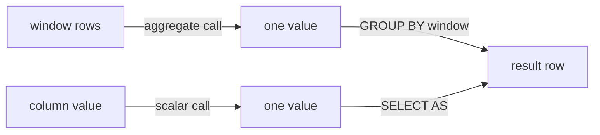

# Rule functions

Functions transform columns inside `SELECT` and `WHERE`. Scalar functions map one row to one value. Aggregate functions fold a window into one value.

Use this page to pick a function. You get the call shape and the arity of each name. The broker serves this same list at `GET /api/v1/rules/functions`.



## Before you start

- Read [Rule SQL](./sql.md) for `SELECT` and `WHERE`.
- Wrong argument counts yield null. They never stop the rule.
- Names are lowercase. Calls use parentheses.

> [!NOTE]
> The docs run checks each name against the live catalogue. It runs the sample calls below. It does not run each call shape. The failure record lists the rest.

## Math

| Function | Arity | What it does | Call shape |
|---|---|---|---|
| `abs` | 1 | Absolute value. | `abs(-3)` |
| `ceil` | 1 | Smallest integer above the value. | `ceil(1.2)` |
| `ceiling` | 1 | Alias of `ceil`. | `ceiling(1.2)` |
| `floor` | 1 | Largest integer below the value. | `floor(1.8)` |
| `round` | 1-2 | Round to decimals (default 0). | `round(1.235, 2)` |
| `sqrt` | 1 | Square root; null for negatives. | `sqrt(9)` |
| `power` | 2 | Raise x to the power y. | `power(2, 10)` |
| `pow` | 2 | Alias of `power`. | `pow(2, 10)` |
| `sin` | 1 | Sine of radians. | `sin(1)` |
| `cos` | 1 | Cosine of radians. | `cos(1)` |
| `tan` | 1 | Tangent of radians. | `tan(1)` |
| `asin` | 1 | Arc sine; null outside [-1, 1]. | `asin(1)` |
| `acos` | 1 | Arc cosine; null outside [-1, 1]. | `acos(1)` |
| `atan` | 1 | Arc tangent. | `atan(1)` |
| `atan2` | 2 | Arc tangent of y/x. | `atan2(1, 1)` |
| `exp` | 1 | e raised to the value. | `exp(1)` |
| `ln` | 1-2 | Natural or base-b logarithm. | `ln(10)` |
| `log` | 1-2 | Natural or base-b logarithm. | `log(8, 2)` |
| `log2` | 1 | Base-2 logarithm. | `log2(8)` |
| `log10` | 1 | Base-10 logarithm. | `log10(100)` |
| `sign` | 1 | Sign: -1, 0 or 1. | `sign(-5)` |
| `mod` | 2 | Remainder of x divided by y. | `mod(7, 3)` |
| `cosh` | 1 | Hyperbolic cosine. | `cosh(1)` |
| `sinh` | 1 | Hyperbolic sine. | `sinh(1)` |
| `tanh` | 1 | Hyperbolic tangent. | `tanh(1)` |
| `cot` | 1 | Cotangent of radians. | `cot(1)` |
| `radians` | 1 | Degrees to radians. | `radians(180)` |
| `degrees` | 1 | Radians to degrees. | `degrees(3.14159)` |
| `bitand` | 2 | Bitwise AND. | `bitand(6, 3)` |
| `bitor` | 2 | Bitwise OR. | `bitor(6, 3)` |
| `bitxor` | 2 | Bitwise XOR. | `bitxor(6, 3)` |
| `bitnot` | 1 | Bitwise NOT. | `bitnot(6)` |
| `pi` | 0 | The constant pi. | `pi()` |
| `rand` | 0 | Random float in [0, 1). | `rand()` |
| `conv` | 3 | Number string between radix bases. | `conv('ff', 16, 10)` |

## Strings

| Function | Arity | What it does | Call shape |
|---|---|---|---|
| `concat` | 1+ | Concatenate all arguments. | `concat('a', 'b')` |
| `lower` | 1 | Lowercase the string. | `lower('AB')` |
| `upper` | 1 | Uppercase the string. | `upper('ab')` |
| `length` | 1 | Character length. | `length('abc')` |
| `trim` | 1 | Strip edge whitespace. | `trim(' a ')` |
| `ltrim` | 1 | Strip leading whitespace. | `ltrim(' a ')` |
| `rtrim` | 1 | Strip trailing whitespace. | `rtrim(' a ')` |
| `lpad` | 2-3 | Left-pad to length. | `lpad('ab', 5, '0')` |
| `rpad` | 2-3 | Right-pad to length. | `rpad('ab', 5, '0')` |
| `replace` | 3 | Replace all occurrences. | `replace('aaa', 'a', 'b')` |
| `split` | 2 | Split on a separator. | `split('a,b', ',')` |
| `reverse` | 1 | Reverse characters. | `reverse('abc')` |
| `substr` | 2-3 | Substring, 1-based start. | `substr('abcdef', 2, 3)` |
| `substring` | 2-3 | Alias of `substr`. | `substring('abcdef', 2, 3)` |
| `startswith` | 2 | Prefix check. | `startswith('abc', 'a')` |
| `endswith` | 2 | Suffix check. | `endswith('abc', 'c')` |

## Arrays and objects

| Function | Arity | What it does | Call shape |
|---|---|---|---|
| `array_contains` | 2 | Whether the array holds the value. | `array_contains([1, 2], 2)` |
| `array_join` | 1-2 | Join elements with a separator. | `array_join([1, 2], ',')` |
| `keys` | 1 | Object keys as an array. | `keys(obj)` |
| `values` | 1 | Object values as an array. | `values(obj)` |
| `object_construct` | 0+ | Build an object from pairs. | `object_construct('a', 1)` |
| `object_concat` | 2+ | Merge objects left to right. | `object_concat(o1, o2)` |
| `erase` | 2+ | Remove keys from an object. | `erase(obj, 'a')` |
| `object_erase` | 2+ | Alias of `erase`. | `object_erase(obj, 'a')` |
| `object_pick` | 2+ | Keep only listed keys. | `object_pick(obj, 'a')` |
| `obj_to_kvpair_array` | 1 | Object to `{key, value}` array. | `obj_to_kvpair_array(obj)` |
| `object_to_kvpair_array` | 1 | Alias of `obj_to_kvpair_array`. | `object_to_kvpair_array(obj)` |
| `to_json` | 1 | Serialize a value to JSON text. | `to_json(obj)` |
| `tojson` | 1 | Alias of `to_json`. | `tojson(obj)` |
| `parse_json` | 1 | Parse JSON text to a value. | `parse_json('{"a":1}')` |
| `parsejson` | 1 | Alias of `parse_json`. | `parsejson('{"a":1}')` |
| `json_parse` | 1 | Alias of `parse_json`. | `json_parse('{"a":1}')` |
| `array_create` | 0+ | Array from arguments. | `array_create(1, 2)` |
| `array_position` | 2 | 1-based position, or null. | `array_position([1, 2], 2)` |
| `array_length` | 1 | Element count. | `array_length([1, 2])` |
| `array_slice` | 3 | Slice, 1-based inclusive bounds. | `array_slice([1, 2, 3], 1, 2)` |
| `array_concat` | 2 | Concatenate two arrays. | `array_concat([1], [2])` |
| `deduplicate` | 1 | Remove duplicate elements. | `deduplicate([1, 1, 2])` |
| `cardinality` | 1 | Element count. | `cardinality([1, 2])` |
| `array_cardinality` | 1 | Alias of `cardinality`. | `array_cardinality([1, 2])` |
| `element_at` | 2 | Element at 1-based index. | `element_at([1, 2], -1)` |
| `array_contains_any` | 2 | Whether any listed value is held. | `array_contains_any([1, 2], [2, 3])` |
| `array_remove` | 2 | Remove all occurrences. | `array_remove([1, 1], 1)` |
| `array_distinct` | 1 | Distinct elements. | `array_distinct([1, 1, 2])` |
| `array_intersect` | 2 | Elements present in both arrays. | `array_intersect([1, 2], [2, 3])` |
| `array_union` | 2 | Distinct union. | `array_union([1], [2])` |
| `array_except` | 2 | Elements missing from the second array. | `array_except([1, 2], [2])` |
| `array_max` | 1 | Maximum element. | `array_max([1, 2])` |
| `array_min` | 1 | Minimum element. | `array_min([1, 2])` |
| `array_avg` | 1 | Average of numeric elements. | `array_avg([1, 2])` |
| `array_flatten` | 1 | Flatten one nesting level. | `array_flatten([[1], [2]])` |
| `array_sort` | 1 | Sort ascending. | `array_sort([2, 1])` |
| `repeat` | 2 | Repeat a value n times. | `repeat('a', 3)` |
| `sequence` | 2-3 | Integer sequence with step. | `sequence(1, 5)` |
| `kvpair_array_to_obj` | 1 | `{key, value}` array to object. | `kvpair_array_to_obj(pairs)` |
| `object` | 2 | Build object from keys array and values array. | `object(['a', 'b'], [1, 2])` |
| `items` | 1 | Object to array of key-value pair arrays. | `items(obj)` |
| `array_positions` | 2 | All 0-based positions of a value. | `array_positions([1, 2, 2, 3, 2], 2)` |
| `array_last_position` | 2 | 1-based index of last match; 0 when absent. | `array_last_position([1, 2, 1], 1)` |
| `array_shuffle` | 1 | Randomly permute array elements. | `array_shuffle([1, 2, 3])` |
| `array_map` | 2 | Apply a scalar function to each element. | `array_map('abs', [-1, 2])` |

## Date and time

| Function | Arity | What it does | Call shape |
|---|---|---|---|
| `now` | 0 | Current epoch milliseconds. | `now()` |
| `current_timestamp` | 0 | Current timestamp. | `current_timestamp()` |
| `local_timestamp` | 0 | Current local timestamp. | `local_timestamp()` |
| `current_date` | 0 | Current date. | `current_date()` |
| `cur_date` | 0 | Alias of `current_date`. | `cur_date()` |
| `current_time` | 0 | Current time. | `current_time()` |
| `cur_time` | 0 | Alias of `current_time`. | `cur_time()` |
| `local_time` | 0 | Current local time. | `local_time()` |
| `format_date` | 2 | Format epoch millis with a pattern. | `format_date(now(), 'yyyy-MM-dd')` |
| `from_unix_time` | 1-2 | Epoch seconds to timestamp. | `from_unix_time(1700000000)` |
| `date_parse` | 2 | Parse text with a pattern. | `date_parse('2024-01-01', 'yyyy-MM-dd')` |
| `date_add` | 3 | Add n units to a timestamp. | `date_add(now(), 1, 'day')` |
| `date_diff` | 3 | Difference in units. | `date_diff(t1, t2, 'hour')` |
| `year` | 1 | Year of a timestamp. | `year(ts)` |
| `month` | 1 | Month, 1-12. | `month(ts)` |
| `day` | 1 | Day of month. | `day(ts)` |
| `day_of_week` | 1 | Weekday, 1=Sunday to 7=Saturday. | `day_of_week(ts)` |
| `day_of_month` | 1 | Day of month. | `day_of_month(ts)` |
| `day_of_year` | 1 | Day of year. | `day_of_year(ts)` |
| `day_name` | 1 | Weekday name. | `day_name(ts)` |
| `month_name` | 1 | Month name. | `month_name(ts)` |
| `microsecond` | 1 | Microsecond part. | `microsecond(ts)` |
| `last_day` | 1 | Last day of the month. | `last_day(ts)` |
| `to_seconds` | 1 | Days since year 0 as seconds. | `to_seconds(ts)` |
| `from_days` | 1 | Days since year 0 to a date. | `from_days(739000)` |
| `hour` | 1 | Hour of a timestamp. | `hour(ts)` |
| `minute` | 1 | Minute of a timestamp. | `minute(ts)` |
| `second` | 1 | Second of a timestamp. | `second(ts)` |

## JSON paths

| Function | Arity | What it does | Call shape |
|---|---|---|---|
| `json_path_query` | 2 | All values at a JSON path. | `json_path_query(payload, '$.a')` |
| `json_path_query_first` | 2 | First value at a JSON path. | `json_path_query_first(payload, '$.a')` |
| `json_path_exists` | 2 | Whether a JSON path matches. | `json_path_exists(payload, '$.a')` |
| `json_map` | 0+ | Build an object from pairs. | `json_map('a', 1)` |

## Hash and text codes

| Function | Arity | What it does | Call shape |
|---|---|---|---|
| `md5` | 1 | MD5 hex digest. | `md5('ab')` |
| `sha256` | 1 | SHA-256 hex digest. | `sha256('ab')` |
| `sha512` | 1 | SHA-512 hex digest. | `sha512('ab')` |
| `sha1` | 1 | SHA-1 hex digest. | `sha1('ab')` |
| `sha384` | 1 | SHA-384 hex digest. | `sha384('ab')` |
| `crc32` | 1 | IEEE CRC-32 checksum. | `crc32('ab')` |
| `regexp_matches` | 2 | Whether text matches the regex. | `regexp_matches('abc', '^a')` |
| `regexp_replace` | 3 | Replace regex matches. | `regexp_replace('aaa', 'a', 'b')` |
| `regexp_substring` | 2 | First regex match. | `regexp_substring('abc123', '[0-9]+')` |
| `regexp_substr` | 2 | First regex match, group 1 preferred. | `regexp_substr('abc123', '[0-9]+')` |
| `split_value` | 3 | 0-based split segment. | `split_value('a,b', ',', 1)` |
| `numbytes` | 1 | UTF-8 byte length. | `numbytes('ab')` |
| `chr` | 1 | Character for a code point. | `chr(65)` |
| `trunc` | 1-2 | Truncate toward zero. | `trunc(1.9)` |
| `hex2dec` | 1 | Hex text to decimal. | `hex2dec('ff')` |
| `dec2hex` | 1 | Decimal to `0x` hex. | `dec2hex(255)` |
| `encode` | 2 | Encode with the named method. | `encode('ab', 'base64')` |
| `base64_encode` | 1 | Base64-encode a value. | `base64_encode('ab')` |
| `decode` | 2 | Decode with the named method. | `decode('YWI=', 'base64')` |
| `base64_decode` | 1 | Base64-decode text. | `base64_decode('YWI=')` |

## Conversion

| Function | Arity | What it does | Call shape |
|---|---|---|---|
| `cast` | 1 | Convert to the target type. | `cast('42')` |
| `coalesce` | 1+ | First non-null argument. | `coalesce(a, b, 0)` |
| `isnan` | 1 | Whether the value is NaN. | `isnan(x)` |
| `isnumeric` | 1 | Whether the value is numeric. | `isnumeric('42')` |
| `nvl` | 2 | Value, or a default when null. | `nvl(a, 0)` |
| `isnull` | 1 | Whether the value is null. | `isnull(a)` |
| `tstamp` | 0 | Current epoch milliseconds. | `tstamp()` |
| `uuid` | 0 | New random UUID text. | `uuid()` |
| `newuuid` | 0 | Alias of `uuid`. | `newuuid()` |
| `delay` | 2 | Wait n ms, then return the value. | `delay(10, 'ok')` |
| `unnest` | 1 | Expand an array into rows. | `unnest(arr)` |
| `extract` | 1 | Expand a map onto the current row. | `extract(obj)` |

## Aggregates

Aggregates need `GROUP BY` with a window. See [Rule SQL](./sql.md).

| Function | Arity | What it does | Call shape |
|---|---|---|---|
| `avg` | 1 | Average of column values. | `avg(temperature)` |
| `collect` | 1 | Column values as an array. | `collect(temperature)` |
| `count` | 1 | Row or non-null count. | `count(*)` |
| `last_value` | 1-2 | Last non-null value. | `last_value(temperature)` |
| `latest` | 1 | Most recent value. | `latest(temperature)` |
| `lead` | 1-3 | Value n rows ahead. | `lead(temperature, 1)` |
| `max` | 1 | Maximum value. | `max(temperature)` |
| `median` | 1 | Median value. | `median(temperature)` |
| `merge_agg` | 1 | Merge object values left to right. | `merge_agg(obj)` |
| `min` | 1 | Minimum value. | `min(temperature)` |
| `percentile` | 2 | Continuous percentile. | `percentile(temperature, 0.95)` |
| `percentile_cont` | 2 | Continuous percentile by interpolation. | `percentile_cont(temperature, 0.9)` |
| `percentile_disc` | 2 | Discrete percentile value. | `percentile_disc(temperature, 0.95)` |
| `row_number` | 0 | 1-based row number. | `row_number()` |
| `stddev` | 1 | Population standard deviation. | `stddev(temperature)` |
| `stddevs` | 1 | Sample standard deviation. | `stddevs(temperature)` |
| `sum` | 1 | Sum of values. | `sum(temperature)` |
| `var` | 1 | Population variance. | `var(temperature)` |
| `vars` | 1 | Sample variance. | `vars(temperature)` |
| `last_agg_hit_count` | 0 | Trigger count of aggregate rule. | `last_agg_hit_count()` |
| `last_agg_hit_time` | 0 | Time of last aggregate rule hit. | `last_agg_hit_time()` |

## Analytics

| Function | Arity | What it does | Call shape |
|---|---|---|---|
| `acc_avg` | 1 | Running average. | `acc_avg(temperature)` |
| `acc_count` | 1 | Running non-null count. | `acc_count(temperature)` |
| `acc_map_agg` | 2 | Running map keyed by first argument. | `acc_map_agg(device, temperature)` |
| `acc_max` | 1 | Running maximum. | `acc_max(temperature)` |
| `acc_max_by` | 2 | Running value with the maximum key. | `acc_max_by(temperature, ts)` |
| `acc_min` | 1 | Running minimum. | `acc_min(temperature)` |
| `acc_min_by` | 2 | Running value with the minimum key. | `acc_min_by(temperature, ts)` |
| `acc_sum` | 1 | Running sum. | `acc_sum(temperature)` |
| `changed_col` | 1 | Value when it changed, else null. | `changed_col(temperature)` |
| `had_changed` | 1 | Whether the value changed. | `had_changed(temperature)` |
| `lag` | 1-3 | Value n rows behind. | `lag(temperature, 1)` |
| `changed_cols` | 2+ | Columns that changed since last emit. | `changed_cols('', true, col1)` |
| `acc_collect` | 1 | Collect non-null values into an array. | `acc_collect(val)` |
| `acc_distinct_collect` | 1 | Collect unique non-null values in order. | `acc_distinct_collect(val)` |
| `distinct_acc` | 1 | Alias of `acc_distinct_collect`. | `distinct_acc(val)` |

## System

| Function | Arity | What it does | Call shape |
|---|---|---|---|
| `event_time` | 0 | Event time of the record. | `event_time()` |
| `meta` | 1 | Message metadata by key. | `meta('id')` |
| `mqtt` | 1 | MQTT message field by key. | `mqtt('topic')` |
| `rule_id` | 0 | Id of the running rule. | `rule_id()` |
| `window_end` | 0 | End bound of the window. | `window_end()` |
| `window_start` | 0 | Start bound of the window. | `window_start()` |
| `rule_start` | 0 | Start time of the rule. | `rule_start()` |
| `last_hit_count` | 0 | Trigger count of continuous rule. | `last_hit_count()` |
| `last_hit_time` | 0 | Time of last continuous rule hit. | `last_hit_time()` |
| `get_keyed_state` | 3 | Keyed state value with type and default. | `get_keyed_state('k', 'string', '')` |

## Message context

These broker functions read the current message and client. They take no payload argument.

| Function | What it does | Call shape |
|---|---|---|
| `msgid` | Message id of the current message. | `msgid()` |
| `qos` | QoS of the current message. | `qos()` |
| `flags` | Flag map of the current message. | `flags()` |
| `flag` | One flag by name. | `flag('retain')` |
| `topic` | Topic of the current message. | `topic()` |
| `clientid` | Client id of the publisher. | `clientid()` |
| `clientip` | IP of the publisher. | `clientip()` |
| `peerhost` | Host of the publisher. | `peerhost()` |
| `username` | Username of the publisher. | `username()` |
| `payload` | Raw payload of the current message. | `payload()` |
| `topic_match` | Whether the topic matches a filter. | `topic_match('sensors/+')` |
| `contains_topic` | Whether a list holds the topic. | `contains_topic(topics)` |
| `contains_topic_match` | Whether a list matches the topic. | `contains_topic_match(filters)` |

## Checks and conversion extras

| Function | What it does | Call shape |
|---|---|---|
| `null` | The null value. | `null()` |
| `coalesce_ne` | First argument not equal to the second. | `coalesce_ne(a, b)` |
| `div` | Integer division. | `div(7, 2)` |
| `fmod` | Float remainder. | `fmod(7.5, 2)` |
| `str` | Value to string. | `str(42)` |
| `str_utf8` | Value to UTF-8 text. | `str_utf8(7)` |
| `str_utf16_le` | Value to base64 UTF-16LE text. | `str_utf16_le('A')` |
| `bool` | Value to boolean. | `bool(1)` |
| `int` | Value to integer. | `int('42')` |
| `float` | Value to float. | `float('2.5')` |
| `float2str` | Number to fixed-precision text. | `float2str(2.567, 2)` |
| `map` | JSON text or pair list to an object. | `map('{"a":1}')` |
| `is_null`, `is_null_var` | Whether the value is null. | `is_null(a)` |
| `is_not_null`, `is_not_null_var` | Whether the value is not null. | `is_not_null(a)` |
| `is_str` | Whether the value is text. | `is_str(a)` |
| `is_bool` | Whether the value is boolean. | `is_bool(a)` |
| `is_int` | Whether the value is an integer. | `is_int(a)` |
| `is_float` | Whether the value is a float. | `is_float(a)` |
| `is_num` | Whether the value is numeric. | `is_num(a)` |
| `is_map` | Whether the value is an object. | `is_map(a)` |
| `is_array` | Whether the value is an array. | `is_array(a)` |
| `is_empty` | Whether the value is empty. | `is_empty(a)` |

## String extras

| Function | What it does | Call shape |
|---|---|---|
| `strlen` | Character length. | `strlen('abc')` |
| `substr` | Substring, 0-based start. | `substr('abcdef', 1, 3)` |
| `split` | Split on a separator. | `split('a,b', ',')` |
| `concat` | Concatenate arguments. | `concat('a', 'b')` |
| `tokens` | Token list from text. | `tokens('a b')` |
| `sprintf_s` | Format with a pattern and an array. | `sprintf_s('%s-%s', ['a', 'b'])` |
| `pad` | Pad a string to width. | `pad('ab', 5)` |
| `replace` | Replace all occurrences. | `replace('aaa', 'a', 'b')` |
| `regex_match` | Whether the regex matches. | `regex_match('abc', '^a')` |
| `regex_replace` | Replace regex matches. | `regex_replace('aaa', 'a', 'b')` |
| `regex_extract` | First regex group. | `regex_extract('abc123', '[0-9]+')` |
| `ascii` | Code point of the first character. | `ascii('A')` |
| `find` | Position of a substring. | `find('abc', 'b')` |
| `join_to_string` | Join array elements to text. | `join_to_string([1, 2], ',')` |
| `join_to_sql_values_string` | Array to a SQL values list. | `join_to_sql_values_string(rows)` |
| `map_to_redis_hset_args` | Object to Redis HSET arguments. | `map_to_redis_hset_args(obj)` |
| `jq` | Query with a dot path. | `jq('.a', payload)` |
| `unescape` | Unescape text escapes. | `unescape('a\\nb')` |
| `rm_prefix` | Remove a leading prefix. | `rm_prefix('sensors/01', 'sensors/')` |
| `rtrim` | Strip trailing characters. | `rtrim('ab  ')` |
| `bin2hexstr` | String to upper-case hex text. | `bin2hexstr('AB')` |
| `hexstr2bin` | Hex text to string. | `hexstr2bin('4142')` |
| `sqlserver_bin2hexstr` | String to `0x` hex text. | `sqlserver_bin2hexstr('AB')` |
| `bitsize` | Bit length of a string. | `bitsize('abc')` |
| `bytesize` | Byte length of a string. | `bytesize('abc')` |
| `subbits` | Bit slice of a string. | `subbits('A', 1, 8)` |
| `bitsl` | Shift bits left. | `bitsl(1, 3)` |
| `bitsr` | Shift bits right. | `bitsr(8, 2)` |
| `acosh` | Inverse hyperbolic cosine. | `acosh(1)` |
| `asinh` | Inverse hyperbolic sine. | `asinh(1)` |
| `atanh` | Inverse hyperbolic tangent. | `atanh(0.5)` |
| `format_time` | Format datetime or epoch millis with a pattern. | `format_time(now(), 'yyyy-MM-dd HH:mm:ss')` |
| `indexof` | 0-based index of first match; -1 when absent. | `indexof('hello', 'll')` |
| `format` | Format number with decimals and grouping. | `format(1234.567, 2)` |

## Map and array extras

| Function | What it does | Call shape |
|---|---|---|
| `map_new` | New empty object. | `map_new()` |
| `map_get` | Value at a path. | `map_get(obj, 'a.b')` |
| `map_put` | Object with a path set. | `map_put(obj, 'a', 1)` |
| `map_keys` | Keys of an object. | `map_keys(obj)` |
| `map_values` | Values of an object. | `map_values(obj)` |
| `map_to_entries` | Object to entry array. | `map_to_entries(obj)` |
| `map_size` | Key count. | `map_size(obj)` |
| `mget` | Several paths at once. | `mget(obj, ['a', 'b'])` |
| `mput` | Several paths set at once. | `mput(obj, ['a'], [1])` |
| `nth` | Element at an index. | `nth([1, 2], 0)` |
| `length` | Length of text or array. | `length('abc')` |
| `sublist` | Array slice. | `sublist([1, 2, 3], 0, 2)` |
| `first` | First element. | `first([1, 2])` |
| `last` | Last element. | `last([1, 2])` |
| `contains` | Whether the array holds the value. | `contains([1, 2], 2)` |

## Hash, codes, and compression extras

| Function | What it does | Call shape |
|---|---|---|
| `sha` | Digest with the named algorithm. | `sha('ab', 'sha256')` |
| `hash` | Hash of a value. | `hash('ab')` |
| `hash_to_range` | Hash mapped into `[min, max]`. | `hash_to_range('ab', 0, 99)` |
| `map_to_range` | Value mapped into `[min, max]`. | `map_to_range(5, 0, 99)` |
| `zip` | Compress bytes (zip). | `zip(bytes)` |
| `unzip` | Decompress zip bytes. | `unzip(bytes)` |
| `gzip` | Compress bytes (gzip). | `gzip(bytes)` |
| `gunzip` | Decompress gzip bytes. | `gunzip(bytes)` |
| `zip_compress` | Compress text (zip). | `zip_compress('ab')` |
| `zip_uncompress` | Decompress zip text. | `zip_uncompress(bytes)` |
| `lz4_compress` | Compress bytes (lz4). | `lz4_compress(bytes)` |
| `lz4_uncompress` | Decompress lz4 bytes. | `lz4_uncompress(bytes)` |
| `base64_encode` | Base64-encode a value. | `base64_encode('ab')` |
| `base64_decode` | Base64-decode text. | `base64_decode('YWI=')` |
| `json_encode` | Serialize a value to JSON text. | `json_encode(obj)` |
| `json_decode` | Parse JSON text to a value. | `json_decode('{"a":1}')` |
| `term_encode` | Encode a value to binary term form. | `term_encode(obj)` |
| `term_decode` | Decode binary term form. | `term_decode(bytes)` |
| `compress` | Compress input with zlib, gzip, flate, or zstd. | `compress('abc', 'zlib')` |
| `decompress` | Decompress input with zlib, gzip, flate, or zstd. | `decompress('eJzT0yMAAGUAAM8=', 'zlib')` |

## Date extras

| Function | What it does | Call shape |
|---|---|---|
| `now_rfc3339` | Current time as RFC 3339 text. | `now_rfc3339()` |
| `unix_ts_to_rfc3339` | Epoch seconds to RFC 3339 text. | `unix_ts_to_rfc3339(1700000000)` |
| `rfc3339_to_unix_ts` | RFC 3339 text to epoch seconds. | `rfc3339_to_unix_ts('2024-01-01T00:00:00Z')` |
| `now_timestamp` | Current epoch milliseconds. | `now_timestamp()` |
| `format_date` | Format a timestamp with a pattern. | `format_date(ts, 'yyyy-MM-dd')` |
| `date_to_unix_ts` | Date text to epoch seconds. | `date_to_unix_ts('2024-01-01')` |
| `timezone_to_offset_seconds` | Zone name to offset seconds. | `timezone_to_offset_seconds('UTC')` |
| `mongo_date` | Date in MongoDB form. | `mongo_date()` |
| `date_calc` | Calculate date from date and duration text. | `date_calc('2019-01-01', '1h30m')` |
| `convert_tz` | Convert timestamp to target time zone. | `convert_tz(ts, 'Asia/Shanghai')` |

> [!NOTE]
> `timezone_to_second` is an alias of `timezone_to_offset_seconds`. Both names work.

## Random, environment, and state

| Function | What it does | Call shape |
|---|---|---|
| `getenv` | Environment value by name. Keys above 4 KiB yield null. | `getenv('REGION')` |
| `random` | Random integer. | `random()` |
| `uuid_v4` | New UUID text with hyphens. | `uuid_v4()` |
| `uuid_v4_no_hyphen` | New UUID text without hyphens. | `uuid_v4_no_hyphen()` |
| `proc_dict_get` | Read a process dictionary key. | `proc_dict_get('k')` |
| `proc_dict_put` | Write a process dictionary key. | `proc_dict_put('k', 1)` |
| `proc_dict_del` | Delete a process dictionary key. | `proc_dict_del('k')` |
| `kv_store_get` | Read a rule key-value key. | `kv_store_get('k')` |
| `kv_store_put` | Write a rule key-value key. | `kv_store_put('k', 1)` |
| `kv_store_del` | Delete a rule key-value key. | `kv_store_del('k')` |

> [!WARNING]
> State functions share mutable state across messages. Two rules that write one key race. Prefer stateless transforms for routing.

## Vectors

| Function | What it does | Call shape |
|---|---|---|
| `cosine_similarity` | Cosine similarity of two vectors. | `cosine_similarity([1.0, 0.0], [0.0, 1.0])` |
| `vector_l2` | Euclidean distance of two vectors. | `vector_l2([1.0, 2.0], [4.0, 6.0])` |
| `vector_dot` | Dot product of two vectors. | `vector_dot([1.0, 2.0], [3.0, 4.0])` |
| `vector_match` | Top matches by cosine similarity. | `vector_match([1.0, 0.0], [[1.0, 0.0], [0.0, 1.0]], 1)` |

## Plug-ins

| Function | What it does | Call shape |
|---|---|---|
| `wasm_run` | Run a function from a loaded WASM module. | `wasm_run('math', 'add', 10, 20)` |

## Internal aliases

The engine rewrites these colliding names to the documented semantics. Use the plain names in rules.

| Alias | Behaves as |
|---|---|
| `std_substr` | `substr` |
| `std_split` | `split` |
| `std_concat` | `concat` |
| `std_length` | `length` |
| `std_base64_encode` | `base64_encode` |
| `std_base64_decode` | `base64_decode` |
| `std_rtrim` | `rtrim` |

## Check that it works

Ask the broker for its function list. The list holds the names of this page.

```toml test
[node]
id = "docs-rules-functions"

[listeners.tcp]
bind = "0.0.0.0:1883"

[listeners.api]
bind = "0.0.0.0:18083"

[logging]
level = "warn"

[auth]
allow_anonymous = true
```

```sh test
python3 - <<'PY'
import json, os, urllib.request
port = os.environ.get("API_PORT", "18083")
key = os.environ["API_KEY"]
req = urllib.request.Request(
    f"http://127.0.0.1:{port}/api/v1/rules/functions",
    headers={"Authorization": f"Bearer {key}"})
with urllib.request.urlopen(req, timeout=5) as res:
    body = json.load(res)
names = {entry["name"] for entry in body}
for want in ("upper", "lower", "abs", "concat", "avg", "count",
             "json_path_query", "sha256", "coalesce", "lag",
             "date_add", "uuid", "rule_id", "percentile"):
    assert want in names, want
print("ok")
PY
```

```output
ok
```

The broker runs these sample calls through the dry-run API. They cover math and string groups only. They prove the path from SQL text to result.

```sh test
python3 - <<'PY'
import json, os, urllib.request
port = os.environ.get("API_PORT", "18083")
key = os.environ["API_KEY"]

def dry_run(sql):
    body = json.dumps({"sql_query": sql, "topic_filter": "sensors/+",
                       "topic": "sensors/kitchen",
                       "payload": {"temperature": 72.5}}).encode()
    req = urllib.request.Request(
        f"http://127.0.0.1:{port}/api/v1/rules/test", data=body, method="POST",
        headers={"Authorization": f"Bearer {key}", "Content-Type": "application/json"})
    with urllib.request.urlopen(req, timeout=5) as res:
        return json.load(res)

hit = dry_run('SELECT abs(-3) AS a, ceil(1.2) AS c FROM "sensors/+"')
assert hit["matched"] is True, hit
assert hit["projected"] == {"a": 3, "c": 2}, hit
hit = dry_run("SELECT lower('AB') AS l, upper('ab') AS u FROM \"sensors/+\"")
assert hit["matched"] is True, hit
assert hit["projected"] == {"l": "ab", "u": "AB"}, hit
hit = dry_run("SELECT concat('a', 'b') AS s, length('abc') AS n FROM \"sensors/+\"")
assert hit["matched"] is True, hit
assert hit["projected"] == {"s": "ab", "n": 3}, hit
print("ok")
PY
```

```output
ok
```

## Next steps

- Write the query with [Rule SQL](./sql.md).
- Send results with [Actions](./actions.md).
