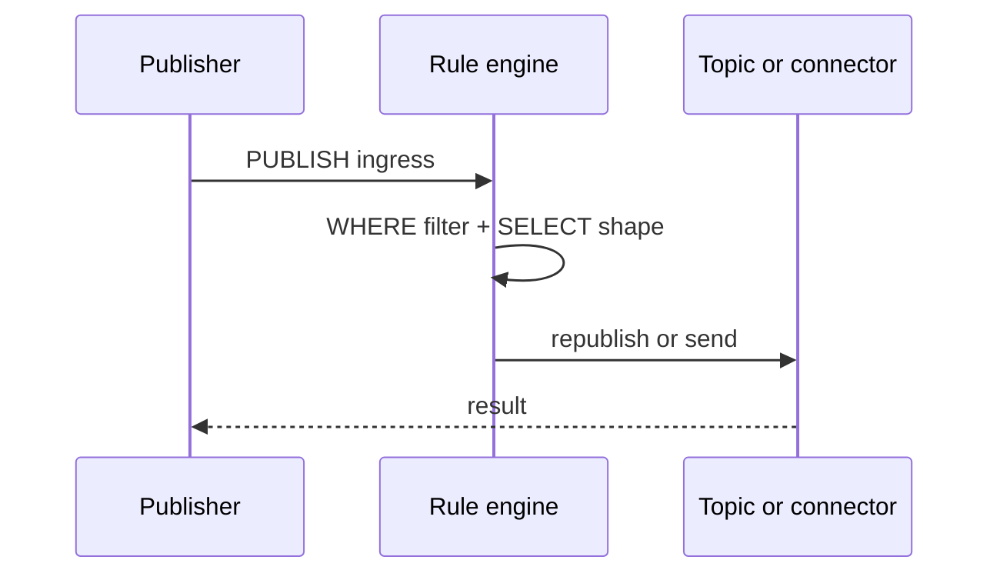

# Rules

A rule runs inside the broker process. It reads a message once at ingress on the node that receives it. It filters with `WHERE`, shapes with `SELECT` and sends the result to a topic or to a connector with `INTO connector("<id>")`.



## Example

Send hot readings to the alerts topic:

```sql
SELECT device, temp AS temp_c FROM "factory/+/heat"
WHERE temp > 80.0
```

Republish the result to a new topic:

```sql
SELECT device, temp * 1.8 + 32 AS temp_f FROM "factory/+/heat"
WHERE temp > 40.0
```

Send the result to a connector:

```sql
SELECT device, temp FROM "factory/+/heat"
WHERE temp > 40.0
INTO connector("kafka-edge")
```

## Built-in actions

The `republish` action publishes to a fixed topic with a payload template. Manage rules through the management API under `/api/v5/rules`. A rule with an unknown function is refused with 400.

## Windows

Stateful rules group events in time or count windows: `TUMBLINGWINDOW`, `HOPPINGWINDOW`, `SLIDINGWINDOW` and `COUNTWINDOW`. They aggregate with `avg`, `sum`, `count`, `min`, `max`, `stddev` and `percentile`.

## Bounds

The rule engine has a bounded ingress buffer. Set its depth with `rules_engine.window_channel_depth` (default 65536). Set the overflow policy with `rules_engine.backpressure_policy` (default `DropOldest`). Spill overflow to disk with `rules_engine.spill_dir`.

## Check that it works

Start the broker with this file. It sets the window channel depth. The health endpoint returns `OK`.

```toml test
[node]
id = "docs-rules"

[listeners.tcp]
bind = "0.0.0.0:1883"

[listeners.api]
bind = "0.0.0.0:18083"

[logging]
level = "warn"

[rules_engine]
window_channel_depth = 65536
```

```sh test
python3 - <<'PY'
import os, socket
port = int(os.environ.get("API_PORT", "18083"))
sock = socket.create_connection(("127.0.0.1", port), timeout=5)
sock.sendall(b"GET /healthz HTTP/1.0\r\nHost: docs\r\n\r\n")
print(sock.makefile().read().strip().splitlines()[-1])
PY
```

```output
OK
```
