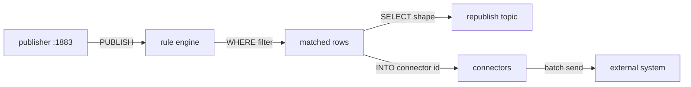

# Rules

A rule reads each message once at ingress. It filters rows with `WHERE`. It shapes rows with `SELECT`. It sends each result to a topic or to a connector.

Use rules when a message must fan out, change shape, or leave the broker. You get SQL over live MQTT traffic with no second process. The complete MQTT platform in one small binary: broker, SQL rules, data connectors and multi-tenancy in a single process.



## Before you start

- Install the broker from [Install](../getting-started/install.md).
- Keep ports 1883 and 18083 free.
- Read [Concepts](../concepts/index.md) for topics and wildcards.

## In this section

| Page | What it covers |
|---|---|
| [Rule SQL](./sql.md) | `SELECT`, `FROM`, `WHERE`, `FOREACH`, `CASE`, operators, event sources, windows. |
| [Clauses and operators](./clauses-operators.md) | One verified entry per SQL clause and operator. |
| [Functions](./functions.md) | Every built-in function by group, with call shape and arity. |
| [Message context functions](./functions-context.md) | One verified entry per message context accessor. |
| [Math and bitwise functions](./functions-math-bitwise.md) | One verified entry per math and bitwise function. |
| [Bit and byte functions](./functions-bits-bytes.md) | One verified entry per bit and byte function. |
| [Type conversion functions](./functions-type-conversion.md) | One verified entry per type conversion function. |
| [Type check functions](./functions-type-checks.md) | One verified entry per type check function. |
| [Array functions](./functions-arrays.md) | One verified entry per array function. |
| [Hashing functions](./functions-hashing.md) | One verified entry per hashing function. |
| [Compression functions](./functions-compression.md) | One verified entry per compression function. |
| [Rule state functions](./functions-state.md) | One verified entry per rule state function. |
| [Actions](./actions.md) | Built-in actions, a tested republish example, how to test a rule, limits. |
| [Rule actions A](./actions-a.md) | One verified entry per action from alloydb to dynamodb. |
| [Rule actions B](./actions-b.md) | One verified entry per action from elasticsearch to opentsdb. |

> [!NOTE]
> A rule keeps the tenant of its input message. A rule of tenant A never fires for a publish of tenant B. See [Multi-tenancy](../multi-tenancy/index.md).

## Check that it works

Start the broker with this file. The health endpoint returns `OK`.

```toml test
[node]
id = "docs-rules"

[listeners.tcp]
bind = "0.0.0.0:1883"

[listeners.api]
bind = "0.0.0.0:18083"

[logging]
level = "warn"

[auth]
allow_anonymous = true

[rules_engine]
window_channel_depth = 65536
```

```sh test
python3 - <<'PY'
import os, socket
port = int(os.environ.get("API_PORT", "18083"))
sock = socket.create_connection(("127.0.0.1", port), timeout=5)
sock.sendall(b"GET /healthz HTTP/1.0\r\nHost: docs\r\n\r\n")
print(sock.makefile().read().strip().splitlines()[-1])
PY
```

```output
OK
```

## API errors

Creating a rule with an id that already exists returns `400 BAD_REQUEST`.
The existing rule and its stored settings do not change.
Testing an absent rule with `POST /api/v5/rules/{id}/test` returns
`404 RULE_NOT_FOUND`. The test creates no rule.

## Next steps

- Write the query with [Rule SQL](./sql.md).
- Shape payloads with [Functions](./functions.md).
- Send results with [Actions](./actions.md).
