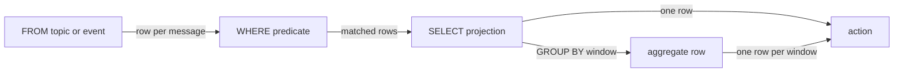

# Rule SQL

Rule SQL reads MQTT messages as rows. `FROM` names the input. `WHERE` keeps rows. `SELECT` shapes rows. `GROUP BY` opens windows for aggregates.

Use this page when you write a rule query. You get the exact clauses the broker parses.



## Before you start

- Start the broker from [Rules](./index.md).
- Keep one test topic free, for example `sensors/kitchen`.
- Send JSON payloads while you learn. Field access reads JSON keys.

## FROM

`FROM` takes one or more sources. Each source is a quoted MQTT topic filter or an event source name.

```sql no-test
-- Comment: one source only. The docs test runs the full rule in Actions.
SELECT temperature FROM "sensors/+"
```

| Source form | Example | Meaning |
|---|---|---|
| Quoted topic filter | `FROM "sensors/+"` | Each PUBLISH on a matching topic is one row. |
| Several filters | `FROM "sensors/+", "factory/#"` | A message on any filter is one row. |
| Event source | `FROM "$events/client_connected"` | A broker event is one row. |

Event sources:

| Source | Row per |
|---|---|
| `$events/client_connected` | Each CONNECT. |
| `$events/client_disconnected` | Each disconnect. |
| `$events/client_connack` | Each CONNACK. |
| `$events/client_check_authz_complete` | Each completed authorization check. |
| `$events/session_subscribed` | Each subscribe. |
| `$events/session_unsubscribed` | Each unsubscribe. |
| `$events/message_delivered` | Each delivered message. |
| `$events/message_acked` | Each acknowledgement. |
| `$events/message_dropped` | Each dropped message. |
| `$events/delivery_dropped` | Each dropped delivery. |

> [!NOTE]
> A message outside every `FROM` source never reaches `WHERE`. The engine drops it before evaluation.

## SELECT

`SELECT` lists fields, expressions, or `*`. `AS` renames a column.

```sql no-test
-- Comment: projection only. The docs test runs the full rule in Actions.
SELECT temperature, device AS device_id FROM "sensors/+"
```

| Form | Example | Result |
|---|---|---|
| Field | `SELECT temperature` | The payload key `temperature`. |
| Rename | `SELECT temperature AS temp_c` | The value under `temp_c`. |
| All | `SELECT *` | The full payload object. |
| Expression | `SELECT temperature * 1.8 + 32 AS temp_f` | The computed value under `temp_f`. |

### Output field order

An explicit projection keeps the written SELECT order after each `AS`
rename. For input `{"a":1,"b":2,"c":3}`, `SELECT b, a, c` emits
`{"b":2,"a":1,"c":3}`. `SELECT *` keeps the input object's member order.
Objects inside a field keep their input order too.

In a mixed list, fields before `*` come first. The wildcard adds the input
fields in input order. Fields after `*` follow them. A repeated name keeps
its first position and takes the last value. For input `{"b":2,"a":1}`,
`SELECT 99 AS a, *` emits `{"a":1,"b":2}`. A missing selected field is
`null`. A payload key named `topic`, `qos` or `payload` keeps its existing
value. Wildcard output omits metadata that the engine adds. Select metadata
by name to place it in the result.

Expressions keep the names that the evaluator assigns. For example,
`SELECT b + 1, abs(a), c + 2` has keys `kuiper_field_0`, `abs`, then
`kuiper_field_1`. In `FOREACH ... DO`, fields keep DO order. An unaliased
expression uses `col_<field index>`, starting at zero. Without DO, each row
has one `item` key and keeps the order inside that item.

Republish, console, connector forwarding and the HTTP rule tester use the
same ordered row. The management tool for the rule tester returns that
same result. A rule update applies the new order. A restart retains it.
A sink with column mappings uses its configured names. A table sink that
uses the whole row keeps column names paired with values in projection
order. Added sink metadata follows the row fields.

Window results keep SELECT order. Group rows keep the order in which the
groups first appear. Wildcard fields come from the group's first record.
For rows `{"v":1}` and `{"v":3}`, the duplicate-name contract for
`SELECT sum(v) AS v, * ... GROUP BY COUNTWINDOW(2)` requires `{"v":1}`:
the later wildcard supplies the raw first-record value.

A payload that is not a JSON object matches only `SELECT *` and rules without SQL. `SELECT *` yields `{}` inline and in windows. Other SQL yields no row.

## WHERE

`WHERE` keeps rows with a boolean predicate. Comparison, arithmetic, and boolean operators work. String functions work; see [Functions](./functions.md).

```sql no-test
-- Comment: predicate only. The docs test runs the full rule in Actions.
SELECT temperature FROM "sensors/+" WHERE temperature > 80.0
```

| Operator | Meaning |
|---|---|
| `=`, `<>`, `!=` | Equal, not equal. |
| `<`, `<=`, `>`, `>=` | Ordered comparison. |
| `+`, `-`, `*`, `/`, `%` | Arithmetic. |
| `AND`, `OR`, `NOT` | Boolean combination. |
| `LIKE` | String pattern match. |
| `IN` | Membership in a list. |
| `IS NULL`, `IS NOT NULL` | Null checks. |

## FOREACH

`FOREACH` expands one message into one row per array element. `DO` names the fields of each row. `INCASE` keeps elements.

```sql no-test
-- Comment: expansion only. It needs an array payload to fire.
FOREACH readings DO device, item.temp AS temp INCASE item.temp > 80.0 FROM "sensors/+"
```

Each row exposes `item` for the element. Without `DO`, each row is `{"item": element}`. `FOREACH` never combines with a window clause.

## CASE

`CASE` branches inside an expression.

```sql no-test
-- Comment: branch only. The docs test runs the full rule in Actions.
SELECT CASE WHEN temperature > 80.0 THEN 'hot' ELSE 'ok' END AS state FROM "sensors/+"
```

Every `CASE` needs at least one `WHEN`. `ELSE` is optional; a missing `ELSE` yields null.

## Windows

`GROUP BY` with a window clause aggregates rows in time or in count. Time units are `dd`, `hh`, `mi`, `ss`, `ms`.

| Window | Syntax | Meaning |
|---|---|---|
| Tumbling | `GROUP BY TUMBLINGWINDOW(ss, 10)` | Non-overlapping 10 s buckets. |
| Hopping | `GROUP BY HOPPINGWINDOW(ms, 300, 150)` | 300 ms buckets every 150 ms. |
| Sliding | `GROUP BY SLIDINGWINDOW(ss, 60)` | Sliding 60 s bucket. |
| Count | `GROUP BY COUNTWINDOW(5)` | One row per 5 messages. |

```sql no-test
-- Comment: aggregate only. It fires after 5 messages reach the rule.
SELECT avg(temperature) AS avg_temp FROM "sensors/+" GROUP BY COUNTWINDOW(5)
```

Aggregate functions include `avg`, `sum`, `count`, `min`, `max`, `stddev`, `median`, `percentile`. Analytic functions such as `lag` and running sums need the streaming dialect. See [Functions](./functions.md).

> [!WARNING]
> Stateful windows buffer rows in memory. Bound the ingress buffer with `rules_engine.window_channel_depth` (default 65536). See [Actions](./actions.md).

## Check that it works

Dry-run a query through the management API. No rule is stored. The first call matches and projects. The second call matches nothing.

```toml test
[node]
id = "docs-rules-sql"

[listeners.tcp]
bind = "0.0.0.0:1883"

[listeners.api]
bind = "0.0.0.0:18083"

[logging]
level = "warn"

[auth]
allow_anonymous = true
```

```sh test
python3 - <<'PY'
import json, os, urllib.request
port = os.environ.get("API_PORT", "18083")
key = os.environ["API_KEY"]

def dry_run(sql, topic, payload):
    body = json.dumps({"sql_query": sql, "topic_filter": "sensors/+",
                       "topic": topic, "payload": payload}).encode()
    req = urllib.request.Request(
        f"http://127.0.0.1:{port}/api/v1/rules/test", data=body, method="POST",
        headers={"Authorization": f"Bearer {key}", "Content-Type": "application/json"})
    with urllib.request.urlopen(req, timeout=5) as res:
        return json.load(res)

hit = dry_run('SELECT temperature FROM "sensors/+" WHERE temperature > 0',
              "sensors/kitchen", {"temperature": 72.5, "secret": "x"})
assert hit["matched"] is True
assert hit["projected"] == {"temperature": 72.5}
miss = dry_run('SELECT * FROM "sensors/+" WHERE temperature > 100.0',
               "sensors/kitchen", {"temperature": 72.5})
assert miss["matched"] is False
assert miss["projected"] is None
print("matched")
print("unmatched")
PY
```

```output
matched
unmatched
```

## Limits

- `FROM` needs at least one source. An empty source is a startup error.
- `SELECT` needs at least one field.
- `FOREACH ... DO *` is refused. Name the fields or omit `DO`.
- `FOREACH` never combines with `GROUP BY`.
- Analytic `OVER` clauses belong to the streaming dialect only.

## Next steps

- Shape payloads with [Functions](./functions.md).
- Send results with [Actions](./actions.md).
