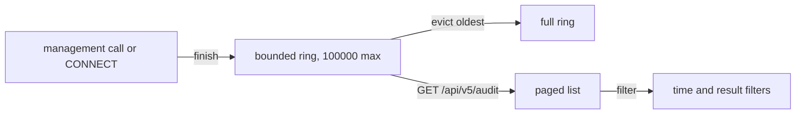

# Audit log

The audit log records management calls and CONNECT outcomes. Each entry names the time, the source, the operation and the result. Use it to review who changed users, rules or keys. Use it to count failed CONNECTs during an incident. The broker stores entries in a bounded ring. The API returns entries as pages.



## Before you start

- Read [Management users](./management-access.md) for the calls it records.
- Keep ports 1883 and 18083 free.
- There is no toggle. An empty log returns an empty list, never an error.

## Minimal example

This file serves the management API and plain MQTT.

```toml test
[node]
id = "docs-audit"

[listeners.tcp]
bind = "0.0.0.0:1883"

[listeners.ws]
bind = "0.0.0.0:8083"
path = "/mqtt"

[listeners.api]
bind = "0.0.0.0:18083"

[logging]
level = "warn"

[auth]
allow_anonymous = true
```

Validate the directory before you start. The command prints `ok`.

```sh test
"${INDRAMQTT_BIN:-indramqtt}" --config-dir "${DOCS_CFG_DIR:-./docs-start}" --check-config
```

```output
ok
```

## Check that it works

Write one entry, then read the log. Create the user `audit-01` through the management API. The call answers 201. Read the audit log. The call answers 200.

```sh test
python3 - <<'PY'
import json, os, urllib.request
port = os.environ.get("API_PORT", "18083")
key = os.environ["API_KEY"]

def call(method, path, body=None):
    req = urllib.request.Request(
        f"http://127.0.0.1:{port}{path}",
        data=None if body is None else json.dumps(body).encode(),
        method=method,
        headers={"Authorization": f"Bearer {key}", "Content-Type": "application/json"},
    )
    with urllib.request.urlopen(req, timeout=5) as res:
        return res.status

assert call("POST", "/api/v1/auth/users",
            {"username": "audit-01", "password": "Audit-docs-pw-1"}) == 201
status = call("GET", "/api/v5/audit?page=1&limit=20")
assert status == 200
print(status)
PY
```

```output
200
```

Filter by result and by time.

```sh no-test
# Needs a running broker with an operator key. The docs test never starts one.
curl -sf "http://127.0.0.1:18083/api/v5/audit?operation_result=success&gte_created_at=1700000000000000" -H "Authorization: Bearer $INDRA_API_KEY"
```

## Limits

- The ring holds at most 100000 entries. New entries evict the oldest first.
- Writes never block the audited request. A full ring evicts the oldest entry first and increments the eviction counter.
- Publish and deliver never touch the ring. Only management calls and CONNECT outcomes write to it.
- Unknown query parameters are ignored. A future timestamp returns an empty list.

## Next steps

- Manage callers with [Management users](./management-access.md).
- Grant topics with [Authorization](./authorization.md).
- See every setting in the [settings reference](../reference/settings.md).
