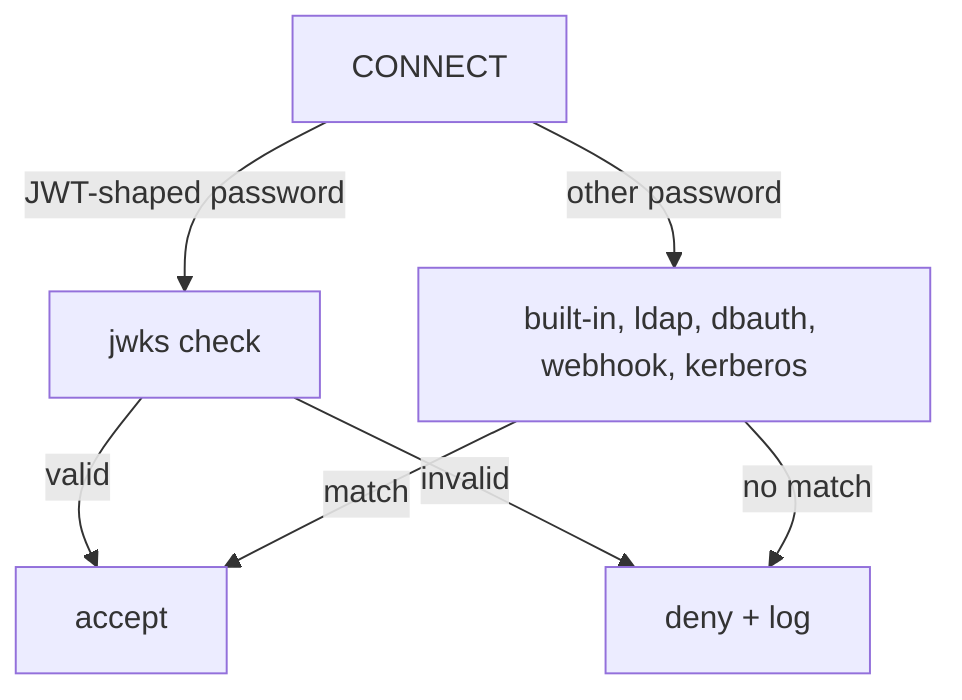

# Authentication

Authentication runs at CONNECT. The broker checks the username and the password. It denies unknown names and bad passwords. It logs each denial. Use the built-in database for fleets the broker manages alone. Use an external back end when passwords already live elsewhere.



## Before you start

- Read [Listeners](../concepts/listeners.md).
- Work the [built-in example](./authentication-builtin.md) first.
- Keep ports 1883 and 18083 free.

## Back ends

| Back end | Setting that enables it | Use it when |
|---|---|---|
| Built-in database | always on | The broker manages the fleet alone. |
| JWT | `jwks.url` | Devices already hold issuer tokens. |
| HTTP webhook | `webhook.url` | A custom service decides each connect. |
| LDAP | `ldap.server_url` | Staff clients live in a directory. |
| SQL and NoSQL | `dbauth.postgres_url`, `dbauth.mysql_url`, `dbauth.redis_url`, `dbauth.mongodb_url` | Passwords live in Postgres, MySQL, Redis or MongoDB. |
| Kerberos | `kerberos.keytab_path` | The site already runs Kerberos. |

> **Note:** JWT checks see only JWT-shaped passwords. Three base64url parts with dots between them enter JWT checks. Other passwords keep the existing credential paths.

> **Note:** Dashboard operators log in with SCRAM through `POST /api/v5/login/challenge` and `POST /api/v5/login/verify`. MQTT clients cannot use SCRAM. See [Management users](./management-access.md).

## Minimal example

This file keeps the defaults and closes anonymous access.

```toml test
[node]
id = "docs-auth"

[listeners.tcp]
bind = "0.0.0.0:1883"

[listeners.ws]
bind = "0.0.0.0:8083"
path = "/mqtt"

[listeners.api]
bind = "0.0.0.0:18083"

[logging]
level = "warn"

[auth]
enabled = true
allow_anonymous = false
```

Validate the directory before you start. The command prints `ok`.

```sh test
"${INDRAMQTT_BIN:-indramqtt}" --config-dir "${DOCS_CFG_DIR:-./docs-start}" --check-config
```

```output
ok
```

## Check that it works

Create the user `auth-01` through the management API. The call answers 201.

```sh test
python3 - <<'PY'
import json, os, urllib.request
port = os.environ.get("API_PORT", "18083")
key = os.environ["API_KEY"]

def call(method, path, body=None):
    req = urllib.request.Request(
        f"http://127.0.0.1:{port}{path}",
        data=None if body is None else json.dumps(body).encode(),
        method=method,
        headers={"Authorization": f"Bearer {key}", "Content-Type": "application/json"},
    )
    with urllib.request.urlopen(req, timeout=5) as res:
        return res.status

status = call("POST", "/api/v1/auth/users",
              {"username": "auth-01", "password": "Auth-docs-pw-1"})
assert status == 201
print(status)
PY
```

```output
201
```

List the authenticator chain through the management API.

```sh no-test
# Needs a running broker with an operator key. The docs test never starts one.
curl -sf http://127.0.0.1:18083/api/v5/authentication -H "Authorization: Bearer $INDRA_API_KEY"
```

## Limits

- With zero users the broker is open. The first user closes anonymous access.
- `auth.enabled` defaults to true. `auth.allow_anonymous` defaults to false.
- Usernames hold at most 256 bytes. Passwords hold at most 8192 bytes. Longer values fail closed.
- The broker holds at most 100000 users. One import batch holds at most 10000 entries. Large fleets import in repeated batches.
- An unreachable back end denies access. It never grants it.
- Unknown `INDRA_*` variables refuse startup. A typo can never boot an open broker.

## Next steps

- Work the [built-in example](./authentication-builtin.md).
- Work the [JWT example](./authentication-jwt.md).
- Grant topics with [Authorization](./authorization.md).
