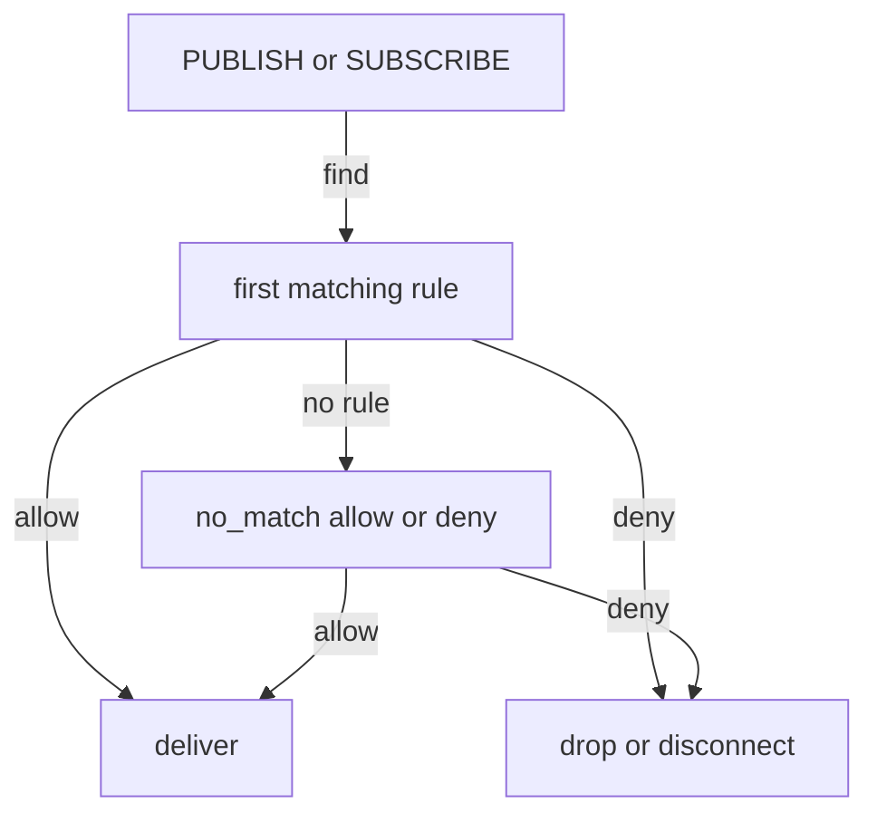

# Authorization

Authorization runs at publish and at subscribe. The broker checks the client id and the topic. It allows or denies each action. Use per-client rules for device fleets. Use per-user rules for staff accounts. The first matching rule decides each action.



## Before you start

- Create users with [Authentication](./authentication.md).
- Keep ports 1883 and 18083 free.
- Learn the rule order: the first matching rule decides.

## Rule tables

| Table | Names | Use it when |
|---|---|---|
| Per-client | one client id | Each device owns its topic branch. |
| Per-user | one username | Staff accounts share devices. |
| Catch-all | many clients at once | Defaults cover the rest. |

Each rule names an action (`publish`, `subscribe` or `all`), a topic pattern and an allow flag. With zero rules everything is allowed. The first written rule switches the table to first-match-wins. An unmatched check then follows the `no_match` setting.

## Minimal example

Start with a closed broker.

```toml test
[node]
id = "docs-authz"

[listeners.tcp]
bind = "0.0.0.0:1883"

[listeners.ws]
bind = "0.0.0.0:8083"
path = "/mqtt"

[listeners.api]
bind = "0.0.0.0:18083"

[logging]
level = "warn"

[auth]
enabled = true
allow_anonymous = false
```

Validate the directory before you start. The command prints `ok`.

```sh test
"${INDRAMQTT_BIN:-indramqtt}" --config-dir "${DOCS_CFG_DIR:-./docs-start}" --check-config
```

```output
ok
```

## Check that it works

Create the user `press-02`. Grant it publish and subscribe access to `press/02`. Both calls answer 201.

```sh test
python3 - <<'PY'
import json, os, urllib.request
port = os.environ.get("API_PORT", "18083")
key = os.environ["API_KEY"]

def call(method, path, body=None):
    req = urllib.request.Request(
        f"http://127.0.0.1:{port}{path}",
        data=None if body is None else json.dumps(body).encode(),
        method=method,
        headers={"Authorization": f"Bearer {key}", "Content-Type": "application/json"},
    )
    with urllib.request.urlopen(req, timeout=5) as res:
        return res.status

status = call("POST", "/api/v1/auth/users",
              {"username": "press-02", "password": "Press-docs-pw-1"})
assert status == 201
for action in ("publish", "subscribe"):
    assert call("POST", "/api/v1/auth/acls",
                {"client_pattern": "*", "action": action,
                 "topic_pattern": "press/02", "allow": True}) == 201
print(status)
PY
```

```output
201
```

Publish under the allowed branch as `press-02`. The subscriber prints the payload. This proves the rule allows the message through the broker.

```sh test
python3 - <<'PY'
import os, socket, struct
mqtt_port = int(os.environ.get("MQTT_PORT", "1883"))

def packet(kind, body):
    return bytes([kind, len(body)]) + body

def field(data):
    return struct.pack(">H", len(data)) + data

def try_connect(client_id, username, password):
    sock = socket.create_connection(("127.0.0.1", mqtt_port), timeout=5)
    sock.settimeout(5)
    body = (b"\x00\x04MQTT\x04\xc2\x00\x3c" + field(client_id)
            + field(username) + field(password))
    sock.sendall(packet(0x10, body))
    try:
        reply = sock.recv(4)
    except OSError:
        return None
    return sock if reply == b"\x20\x02\x00\x00" else None

topic = b"press/02"
sub = try_connect(b"docs-press-sub", b"press-02", b"Press-docs-pw-1")
assert sub is not None
sub.sendall(packet(0x82, b"\x00\x01" + field(topic) + b"\x00"))
assert sub.recv(5)[:1] == b"\x90"
pub = try_connect(b"docs-press-pub", b"press-02", b"Press-docs-pw-1")
assert pub is not None
pub.sendall(packet(0x30, field(topic) + b"hello-press"))
sub.settimeout(5)
print(sub.recv(100).split(topic)[-1].decode())
PY
```

```output
hello-press
```

Read the rules of one client through the management API.

```sh no-test
# Needs a running broker with an operator key. The docs test never starts one.
curl -sf http://127.0.0.1:18083/api/v5/authorization/sources/built_in_database/rules/clients/press-02 -H "Authorization: Bearer $INDRA_API_KEY"
```

## Authorization settings

The broker reads `no_match` on each unmatched check. `deny` refuses the action. `allow` permits it. The broker reads `deny_action` on each denial. `ignore` drops the message. `disconnect` closes the connection with reason code 0x87.

The broker caches each decision per client. `cache.enable` selects caching. `cache.max_size` bounds entries per client. `cache.ttl` bounds staleness. `cache.excludes` skips listed topics. Each rule, source, user, client or settings change clears the cache at once.

Only the built-in database source runs. The broker refuses other kinds at create and update with 400. It stores nothing. Old stored sources stay unchanged. Each decision that reaches such a source is denied. The broker raises `unsupported_authorization_source`. The operator lists and deletes the record through the API. Delete clears the alarm when no such source remains.

```sh no-test
# Needs a running broker with an operator key. The docs test never starts one.
curl -sf -X PUT http://127.0.0.1:18083/api/v5/authorization/settings -H "Authorization: Bearer $INDRA_API_KEY" -H "Content-Type: application/json" -d '{"no_match":"deny","deny_action":"ignore"}'
curl -sf http://127.0.0.1:18083/api/v5/alarms -H "Authorization: Bearer $INDRA_API_KEY"
```

## Limits

- Catch-all rules hold at most 128 entries. Per-client rules hold at most 100000 entries. Per-user rules hold at most 100000 entries. Writes past a cap fail with an error.
- Client ids and usernames in rules hold at most 256 bytes each.
- `no_match` accepts `allow` or `deny`. Default is `deny`. `deny_action` accepts `ignore` or `disconnect`. Default is `ignore`.
- The `auth.superusers` list is stored in configuration. Superusers bypass access rules.

## Next steps

- Create users with [Authentication](./authentication.md).
- Review changes in the [Audit log](./audit-log.md).
- See every setting in the [settings reference](../reference/settings.md).
