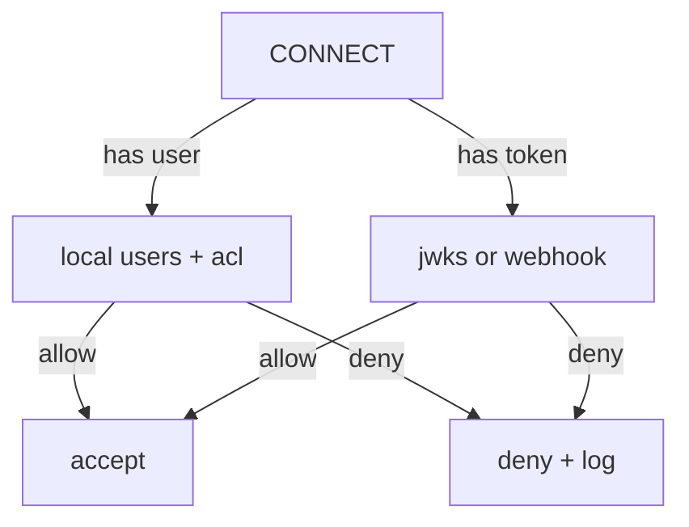

# Security

The broker denies access when credentials fail. It fails closed: an unreachable user store denies access and logs the fault. It never grants access on an error.



## API keys

The management API and `indra ctl` need an API key. Set the accepted keys in `INDRA_API_KEYS`. Send the key in the `Authorization` header as a bearer token. Each key needs 16 characters or more.

## Local users

Create users through `POST /api/v1/auth/users` as in [First user](../getting-started/first-user.md). The broker stores password hashes. Set the algorithm with `auth.password_hash` (`sha256` or `bcrypt`). Mark superusers with `auth.superusers`. Superusers bypass access rules.

## Access rules

Grant publish and subscribe rights per topic pattern through `/api/v1/auth/acls`. When rules exist and no rule matches, the broker denies the message.

## Anonymous access

`auth.allow_anonymous` accepts clients without credentials while no users exist. Once users exist, anonymous clients fail. Do not enable it in production.

## External user stores

The broker checks credentials against one external store when set: LDAP (`ldap.*`), Kerberos (`kerberos.*`), JWT from a JWKS endpoint (`jwks.*`), a database (`dbauth.*`) or an HTTP webhook (`webhook.*`). Set only the store you use. Each setting lives in the [settings reference](../reference/settings.md).

## Transport

Serve MQTT over TLS (`listeners.tls`) and WebSocket over TLS (`listeners.wss`). Request client certificates with `verify_client_cert`. Take the username or client id from the certificate with `peer_cert_as_username` and `peer_cert_as_clientid`.

## Check that it works

Start the broker with this file. It allows anonymous clients. See [First start](../getting-started/first-start.md) for the start command.

```toml test
[node]
id = "docs-security"

[listeners.tcp]
bind = "0.0.0.0:1883"

[listeners.api]
bind = "0.0.0.0:18083"

[logging]
level = "warn"

[auth]
allow_anonymous = true
```

Create the user `alice` through the management API. The call answers 201.

```sh test
python3 - <<'PY'
import json, os, urllib.request
port = os.environ.get("API_PORT", "18083")
key = os.environ["API_KEY"]

def call(method, path, body=None):
    req = urllib.request.Request(
        f"http://127.0.0.1:{port}{path}",
        data=None if body is None else json.dumps(body).encode(),
        method=method,
        headers={"Authorization": f"Bearer {key}", "Content-Type": "application/json"},
    )
    with urllib.request.urlopen(req, timeout=5) as res:
        return res.status

status = call("POST", "/api/v1/auth/users",
              {"username": "alice", "password": "Alice-docs-pw-1"})
assert status == 201
for action in ("publish", "subscribe"):
    assert call("POST", "/api/v1/auth/acls",
                {"client_pattern": "*", "action": action,
                 "topic_pattern": "docs/#", "allow": True}) == 201
print(status)
PY
```

```output
201
```
