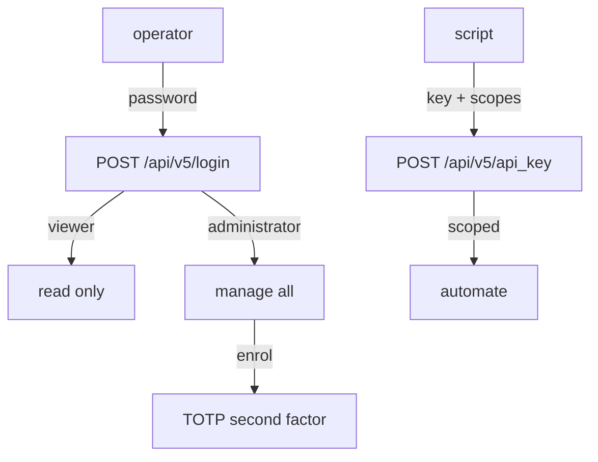

# Management users, MFA and API keys

Management users own the dashboard and the management API. API keys own automation. MFA adds a second factor to a user login. Use one management user per operator. Use API keys for scripts. Each operator uses a separate login. Each script uses a scoped key.



## Before you start

- Start the broker with an API key of 16 characters or more.
- Change the first-boot `admin` password on first login.
- Give each script only the scopes it needs.

## Roles and keys

| Item | Choices | Use it when |
|---|---|---|
| Role | `administrator`, `viewer` | Administrators manage all. Viewers read only. |
| MFA | TOTP, 6 digits, 30 second step | Each administrator needs a second factor. |
| API key | ten fixed scopes | Scripts call the API without a password. |

The ten scopes are `connections`, `publish`, `data_integration`, `access_control`, `gateways`, `monitoring`, `cluster_operations`, `system`, `audit` and `license`. The catalogue is fixed. Unknown scopes fail.

## Minimal example

This file serves the management API and plain MQTT.

```toml test
[node]
id = "docs-mgmt"

[listeners.tcp]
bind = "0.0.0.0:1883"

[listeners.ws]
bind = "0.0.0.0:8083"
path = "/mqtt"

[listeners.api]
bind = "0.0.0.0:18083"

[logging]
level = "warn"

[auth]
allow_anonymous = true
```

Validate the directory before you start. The command prints `ok`.

```sh test
"${INDRAMQTT_BIN:-indramqtt}" --config-dir "${DOCS_CFG_DIR:-./docs-start}" --check-config
```

```output
ok
```

## Check that it works

Create the operator `ops-01` with the viewer role. The call answers 200.

```sh test
python3 - <<'PY'
import json, os, urllib.request
port = os.environ.get("API_PORT", "18083")
key = os.environ["API_KEY"]

def call(method, path, body=None):
    req = urllib.request.Request(
        f"http://127.0.0.1:{port}{path}",
        data=None if body is None else json.dumps(body).encode(),
        method=method,
        headers={"Authorization": f"Bearer {key}", "Content-Type": "application/json"},
    )
    with urllib.request.urlopen(req, timeout=5) as res:
        return res.status

status = call("POST", "/api/v5/users",
              {"username": "ops-01", "password": "Operator-9hn", "role": "viewer"})
assert status == 200
print(status)
PY
```

```output
200
```

Mint a key, list the scopes and enrol MFA through the management API.

```sh no-test
# Needs a running broker with an operator key. The docs test never starts one.
curl -sf -X POST http://127.0.0.1:18083/api/v5/api_key -H "Authorization: Bearer $INDRA_API_KEY" -H "Content-Type: application/json" -d '{"name": "reader-01", "scopes": ["monitoring"]}'
```

```sh no-test
# Needs a running broker with an operator key. The docs test never starts one.
curl -sf -X POST http://127.0.0.1:18083/api/v5/users/ops-01/mfa -H "Authorization: Bearer $INDRA_API_KEY"
```

> **Warning:** The broker shows a minted secret once, at mint time. Store it at once. A lost secret needs a new key.

Dashboard login uses SCRAM challenge and verify. MQTT clients cannot use SCRAM. Use `POST /api/v5/login/challenge` and `POST /api/v5/login/verify`.

<!-- screenshot: dashboard login with username, password and MFA code fields -->

## Limits

- Passwords hold at least 8 characters with a letter and a digit. Weak passwords fail.
- The broker holds at most 1024 management users. API key names hold 1 to 256 characters.
- Minted secrets hold 43 characters from 32 random bytes. 32 random bytes give 256 bits of entropy. Operator keys in `INDRA_API_KEYS` need 16 characters or more. The broker shows a minted secret once, at mint time.
- TOTP uses 6 digits and a 30 second step with one step of grace. Five bad codes lock verification for 60 seconds. Sixty seconds span two steps, so tried codes expire before the next attempt.

## Next steps

- Review these calls in the [Audit log](./audit-log.md).
- Grant MQTT topics with [Authorization](./authorization.md).
- See every setting in the [settings reference](../reference/settings.md).
