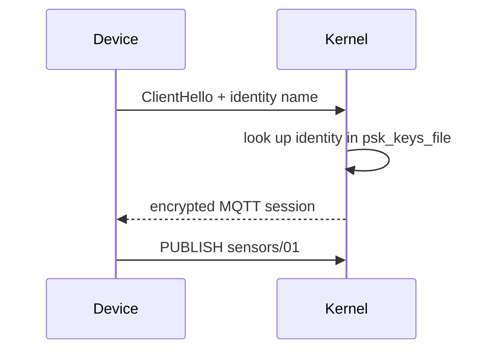

# Pre-shared keys

A pre-shared key (PSK) is a secret that client and broker both hold. The handshake uses it. No certificate passes on the wire. Use PSK for small devices without certificate storage. Each device uses one shared secret. The handshake encrypts MQTT with that secret.



## Before you start

- Read [TLS](./tls.md) for certificate mode.
- Make one identity name and one hex key per device.
- Keep the identity file readable only by the broker user.

## Minimal example

This file serves the management API and plain MQTT. PSK stays off until the identity file exists.

```toml test
[node]
id = "docs-psk"

[listeners.tcp]
bind = "0.0.0.0:1883"

[listeners.ws]
bind = "0.0.0.0:8083"
path = "/mqtt"

[listeners.api]
bind = "0.0.0.0:18083"

[logging]
level = "warn"

[auth]
allow_anonymous = true
```

Enable PSK on the TLS listener. Point it at the identity file. A PSK-only listener needs no certificate files.

```toml no-test
# Needs an identity file with secrets on disk. The docs test boots without it.
[listeners.tls]
enabled = true
bind = "0.0.0.0:8883"
psk_enabled = true
psk_keys_file = "/etc/indramqtt/psk.keys"
```

Each line of the identity file holds one identity and one hex key.

```sh no-test
# The identity file holds secrets. The docs test never writes secrets.
echo "sensor-01:9f2c4a7b8d0e1f2a3b4c5d6e7f8091a2" > /etc/indramqtt/psk.keys
```

## Check that it works

Validate the directory before you start. The command prints `ok`.

```sh test
"${INDRAMQTT_BIN:-indramqtt}" --config-dir "${DOCS_CFG_DIR:-./docs-start}" --check-config
```

```output
ok
```

Ask the health endpoint. It answers `OK`.

```sh test
python3 - <<'PY'
import os, socket
port = int(os.environ.get("API_PORT", "18083"))
sock = socket.create_connection(("127.0.0.1", port), timeout=5)
sock.sendall(b"GET /healthz HTTP/1.0\r\nHost: docs\r\n\r\n")
print(sock.makefile().read().strip().splitlines()[-1])
PY
```

```output
OK
```

## Limits

- PSK is off by default. Certificate handshakes stay unchanged while it is off.
- An empty identity file keeps the store empty. Every handshake then fails closed.
- Each key holds 16 to 64 bytes. 16 bytes give 128 bits of entropy. 64 bytes bound memory.
- Each identity holds at most 128 bytes. 128 bytes cover device names.
- The store holds at most 1024 entries. 1024 entries cover constrained fleets. Larger fleets need certificates.
- An unknown identity fails the handshake. The broker leaks no stored key data.

## Next steps

- Use [TLS](./tls.md) for browsers and servers.
- Add users with [Authentication](./authentication.md).
- See `listeners.tls.psk_enabled` and `listeners.tls.psk_keys_file` in the [settings reference](../reference/settings.md).
