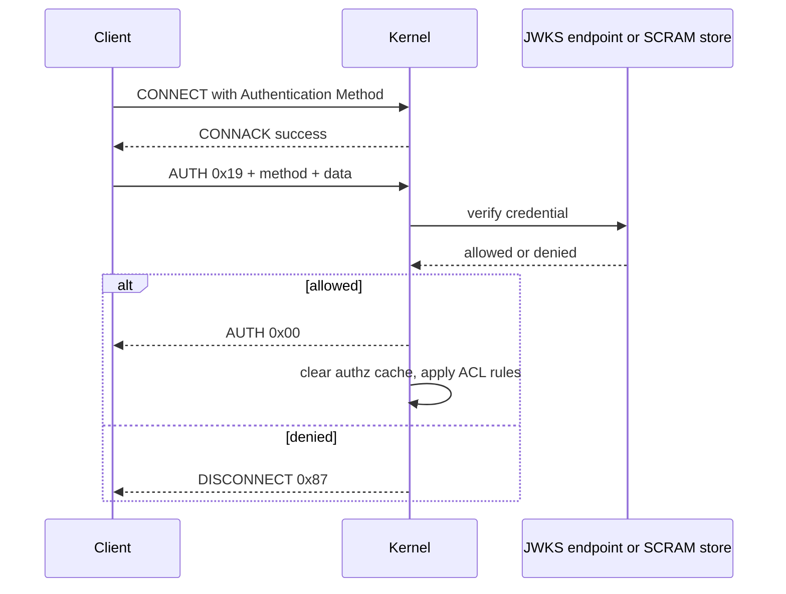
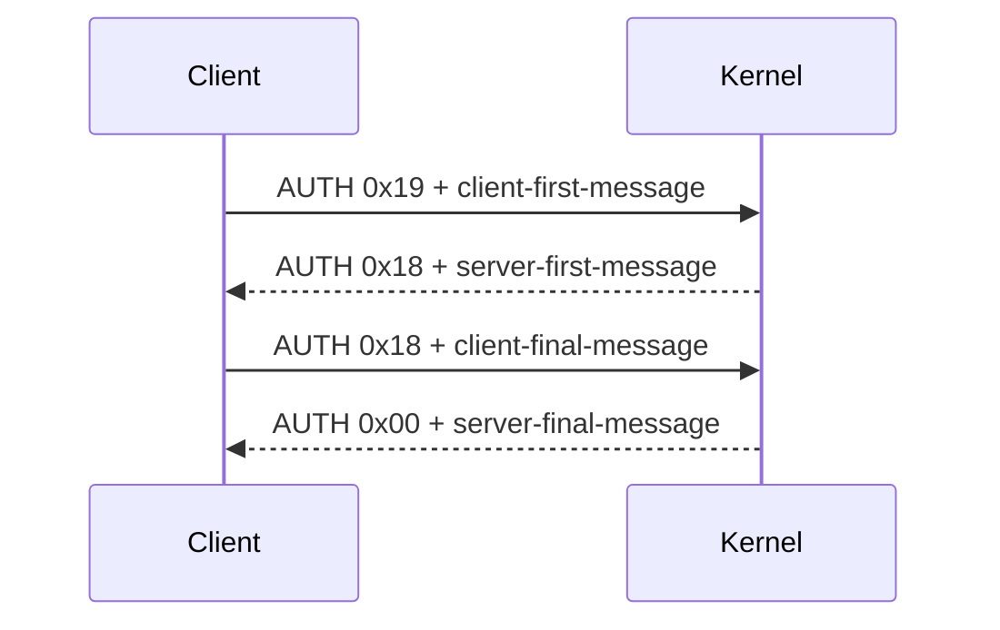

# Re-authentication

A connected MQTT 5 client refreshes its credentials with an AUTH packet. The broker checks the new credential, renews the authentication deadline and keeps the session. Use it when a long-lived connection must present a new token or a new SCRAM proof. You get the same session, the same client attributes and the same topic permissions until the new credential changes them.



## Before you start

- Read [Authentication](./authentication.md) and [Authorization](./authorization.md).
- Configure the method at CONNECT: `jwks.*` for JWT, or an administrator credential for `SCRAM-SHA-256`.
- Keep ports 1883 and 18083 free.

```toml test
[node]
id = "docs-reauth"

[listeners.tcp]
bind = "0.0.0.0:1883"

[listeners.ws]
bind = "0.0.0.0:8083"
path = "/mqtt"

[listeners.api]
bind = "0.0.0.0:18083"

[logging]
level = "warn"

[auth]
allow_anonymous = true
```

## Rules

The broker applies these rules in order. A refused packet ends the connection.

| Packet | Connection state | Broker answer |
|---|---|---|
| AUTH 0x19 | CONNECT did not negotiate a method | DISCONNECT 0x82 |
| AUTH 0x19 | Method differs from CONNECT | DISCONNECT 0x82 |
| AUTH 0x19 | A re-authentication is open | DISCONNECT 0x82 |
| AUTH 0x00 | Any | DISCONNECT 0x82 |
| AUTH 0x19, JWT, no data | Any | DISCONNECT 0x87 |
| AUTH 0x19, JWT, expired token | Any | DISCONNECT 0x87 |
| AUTH 0x19, SCRAM, bad proof | Any | DISCONNECT 0x87 |
| AUTH 0x19 | No answer within 30 s | DISCONNECT 0x87 |

`DEFAULT_REAUTH_TIMEOUT_SECS` is 30. The value is the protocol deadline for one exchange.

## JWT method

The method name is `JWT`. The AUTH packet carries the token in Authentication Data property `0x16`. The broker checks the signature, the `exp` claim, the issuer and the audience against `jwks.url`. A valid token gets AUTH 0x00. A new `exp` value replaces the authentication deadline. A token without an `exp` claim cancels the active deadline.

## SCRAM-SHA-256 method

The method name is `SCRAM-SHA-256`. The exchange has two rounds.



The server-first message carries a nonce, a salt and an iteration count. The client-final message carries the proof. A valid proof gets AUTH 0x00 with the server signature. A bad proof gets DISCONNECT 0x87.

## Session behaviour

Re-authentication does not change the client id or the attributes from CONNECT. Application traffic continues during the exchange. The connection uses the old permissions until the new credential succeeds.

On success the broker clears the per-client authorization decision cache. It replaces the connection ACL set with the rules that the credential returns. A credential with no ACL rules clears the previous client rules. Read the cache with `GET /api/v5/clients/{clientid}/authorization/cache` and clear it with `DELETE /api/v5/clients/{clientid}/authorization/cache`.

## Check that it works

Connect a client without an Authentication Method, then send AUTH 0x19. The broker answers with a DISCONNECT packet that carries reason code 0x82 and closes the socket. The check below prints the reason code.

```sh test
python3 - <<'PY'
import os, socket, struct
port = int(os.environ.get("MQTT_PORT", "1883"))
mqtt = socket.create_connection(("127.0.0.1", port), timeout=5)
connect = b"\x00\x04MQTT\x05\x02\x00\x3c\x00\x00\x0breauth-demo"
mqtt.sendall(bytes([0x10, len(connect)]) + connect)
_ = mqtt.recv(16)
props = b"\x15" + struct.pack(">H", 3) + b"JWT"
body = b"\x19" + bytes([len(props)]) + props
mqtt.sendall(bytes([0xF0, len(body)]) + body)
disc = mqtt.recv(16)
reason = disc[2] if len(disc) > 2 else 0
print(f"0x{reason:02x}")
PY
```

```output
0x82
```

## Next steps

- Read [Authorization](./authorization.md) for ACL rules and cache routes.
- Read [JWT example](./authentication-jwt.md) for the `jwks.*` settings.
