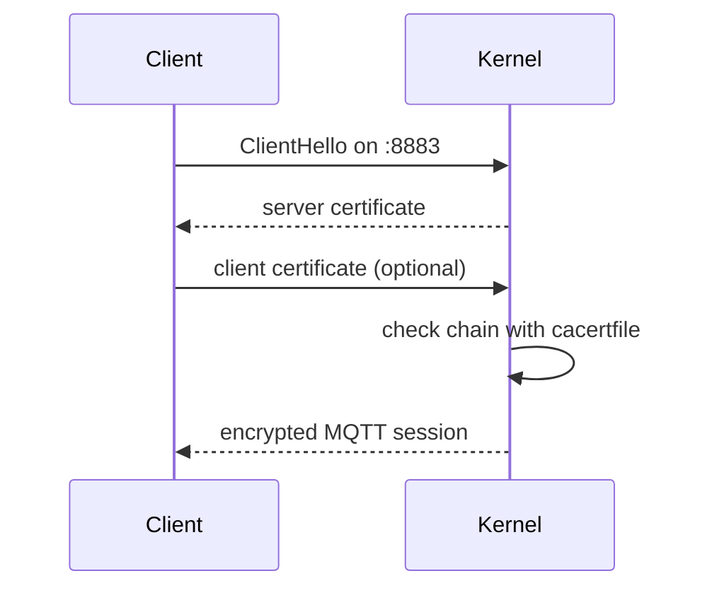

# TLS and client certificates

TLS encrypts the link between client and broker. Use it for any client on an open network. Use client certificates for devices that already hold one. One handshake encrypts the link and identifies the device.



## Before you start

- Read [Listeners](../concepts/listeners.md) for the four listeners.
- Make a server certificate and key. Keep them outside the data directory.
- Keep ports 8883 and 18083 free.

## Minimal example

This file serves the management API and plain MQTT. TLS stays off until the certificate files exist.

```toml test
[node]
id = "docs-tls"

[listeners.tcp]
bind = "0.0.0.0:1883"

[listeners.ws]
bind = "0.0.0.0:8083"
path = "/mqtt"

[listeners.api]
bind = "0.0.0.0:18083"

[logging]
level = "warn"

[auth]
allow_anonymous = true
```

Enable TLS with a server certificate. It disables nothing else.

```toml no-test
# Needs certificate files on disk. The docs test boots without them.
[listeners.tls]
enabled = true
bind = "0.0.0.0:8883"
cert_file = "/etc/indramqtt/server.pem"
key_file = "/etc/indramqtt/server.key"
verify = "verify_none"
```

Request a client certificate. Take the username from its common name.

```toml no-test
# Needs certificate files on disk. The docs test boots without them.
[listeners.tls]
enabled = true
bind = "0.0.0.0:8883"
cert_file = "/etc/indramqtt/server.pem"
key_file = "/etc/indramqtt/server.key"
verify_client_cert = true
verify = "verify_peer"
cacertfile = "/etc/indramqtt/ca.pem"
fail_if_no_peer_cert = true
peer_cert_as_username = "cn"
```

Make a key and a self-signed certificate for local tests only.

```sh no-test
# Needs openssl on the operator host. The docs test never writes keys.
openssl req -x509 -newkey rsa:2048 -nodes -keyout server.key -out server.pem -days 30 -subj "/CN=localhost"
```

## Check that it works

Validate the directory before you start. The command prints `ok`.

```sh test
"${INDRAMQTT_BIN:-indramqtt}" --config-dir "${DOCS_CFG_DIR:-./docs-start}" --check-config
```

```output
ok
```

Ask the health endpoint. It answers `OK` while TLS stays off.

```sh test
python3 - <<'PY'
import os, socket
port = int(os.environ.get("API_PORT", "18083"))
sock = socket.create_connection(("127.0.0.1", port), timeout=5)
sock.sendall(b"GET /healthz HTTP/1.0\r\nHost: docs\r\n\r\n")
print(sock.makefile().read().strip().splitlines()[-1])
PY
```

```output
OK
```

## Certificate checks

| Setting | Values | Effect |
|---|---|---|
| `verify` | `verify_none`, `verify_peer` | `verify_peer` checks the client chain. |
| `fail_if_no_peer_cert` | `true`, `false` | `true` refuses handshakes without a certificate. |
| `peer_cert_as_username` | `disabled`, `cn`, `dn` | Takes the MQTT username from the certificate. |
| `peer_cert_as_clientid` | `disabled`, `cn`, `dn` | Takes the client id from the certificate. |
| `cacertfile` | path or empty | Empty uses the system roots. |

> **Warning:** Without certificate files the broker refuses to start. It logs the missing setting. Add the files before you enable the listener.

## Limits

- `verify` accepts `verify_none` or `verify_peer` only. Other values refuse startup.
- `fail_if_no_peer_cert` needs verification on. It refuses startup without it.
- `peer_cert_as_username` and `peer_cert_as_clientid` accept `disabled`, `cn` or `dn` only.
- An empty `cacertfile` uses the system roots.

## Next steps

- Use [Pre-shared keys](./psk.md) for devices without certificate storage.
- Add users with [Authentication](./authentication.md).
- See every setting in the [settings reference](../reference/settings.md).
